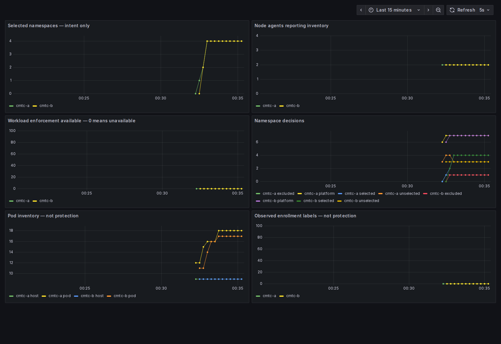

# Local MacBook two-cluster qualification

Executed on this MacBook in the dedicated `cmtc-cilium` Colima VM: Ubuntu 24.04.4 ARM64, kernel 6.8.0-117-generic, 8 CPUs and 16 GiB RAM. Both kind clusters have one control plane and one worker, running Kubernetes 1.36.4.

CMTC source: `dbb56598e5f7c64228c7a818e03188140f9e7b4c`.
Cilium image and chart source: `93041b3f7ec55ff12c83ecd266f14fb392ea5c93`.
The image verification JSON records the actual GHCR digest references, runtime IDs and `linux/arm64` agent versions from all four nodes.

The existing `scripts/lab/up.sh` and `scripts/lab/test.sh` passed. Each cluster reports 2/2 nodes and 1/1 KVStoreMesh replicas connected to its peer. The tests cover policy reconciliation, exclusions, namespace recreation, conflicts, read-only RBAC, allowed/denied shop traffic and a remote-only Global Service backend.

Three real Fortio streams started at 2026-10-24T00:33Z before screenshots. The normal load collector passed its request success, duration and achieved-rate gates:

| Stream | Requests | HTTP 200 | Actual requests/s | Seconds |
| --- | ---: | ---: | ---: | ---: |
| cmtc-a-shop | 7200 | 7200 | 19.997 | 360.051 |
| cmtc-b-shop | 7200 | 7200 | 19.997 | 360.051 |
| cmtc-a-mesh | 3600 | 3600 | 9.997 | 360.101 |

All 11 browser pages rendered. The Observe dashboard has data in all six panels; the application page shows the backend from cluster B. The nine planned security dashboards retain explicit blocked feature-evidence verdicts in `walk-results.json`.



This is the Observe/ClusterMesh baseline. Workload mTLS, authorization enforcement and WireGuard/IPsec composition are not implemented or established by this run. Strict mode rejection is an expected negative test. ClusterMesh API TLS is separate from workload mTLS.

The initial local run found the VM's `fs.inotify.max_user_instances=128` too low for four kind nodes. Raising it to 8192 resolved the worker agent's inotify failure. The setting was persisted in `/etc/sysctl.d/99-cmtc-kind.conf` inside this dedicated VM. Before/after values are included under `local/`.

Commands ran inside the VM, with the checksum-pinned tools installed by `scripts/lab/ci-bootstrap.sh`:

```sh
make image
CILIUM_SOURCE_DIR=/private/tmp/cilium-ghcr-source930 make lab-up
make lab-test
make capture-image
bash scripts/lab/load.sh start
make lab-capture
bash scripts/lab/load.sh collect
make lab-evidence
```

The independent [AMD64 GitHub Actions run](https://github.com/ephico2real2/clustermesh-trust-controller/actions/runs/40043884931) also passed at the same CMTC head with 18,000/18,000 HTTP 200 responses.
