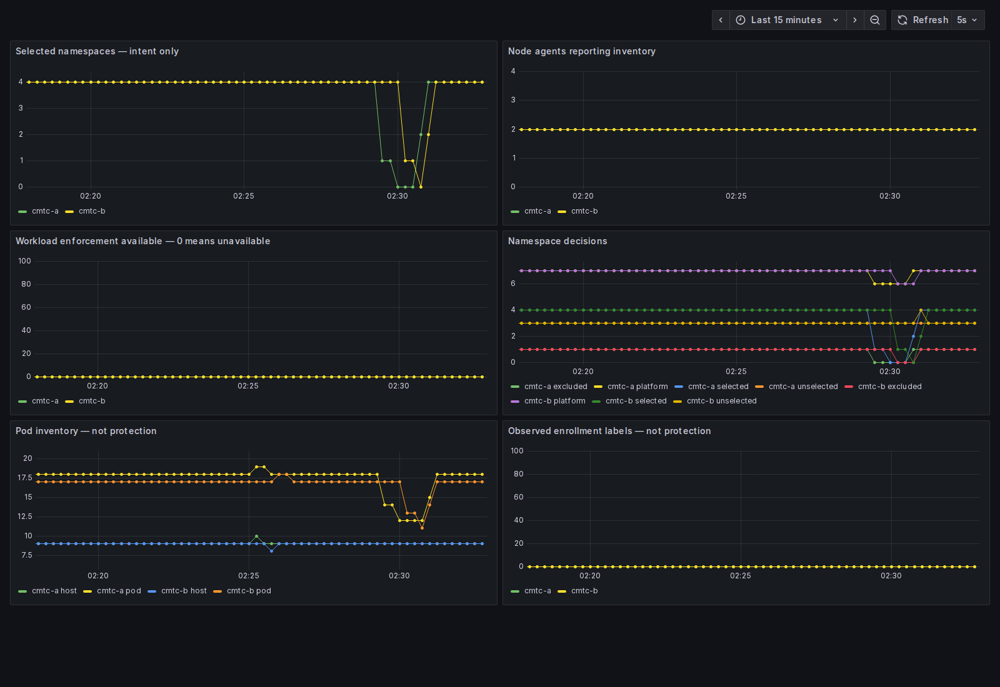

# Local qualification of the Authorization image bundle

Both retained two-node kind clusters passed the digest/runtime-image/source-version verifier for Cilium source `42f89f83aa5a03ea80f7a2b8cece56b27f87385a`. All three components use the published fork bundle. The CMTC runtime and test scripts are unchanged from `548ccc8ea4405211925e9f9701c1104f9553011f`; this run overrides its image lock with the candidate bundle.

Policy reconciliation, UID recreation, conflict handling, intentional Strict rejection, read-only RBAC, allowed/denied shop requests and the remote-only Global Service passed. Three six-minute Fortio streams returned 18,000/18,000 HTTP 200 responses. The load was active while eleven browser pages were captured. All six Observe panels contain data. Missing future security signals are explicitly blocked. This is not workload-mTLS or layered-encryption evidence.

Only the six task-owned test namespaces were reset before rerunning against the retained clusters. The clusters, issuer intermediates and monitoring were retained. No Secret resources, kubeconfigs or signing files are included. The separate AMD64 log proves only that the source-matched binary executes through local emulation.

