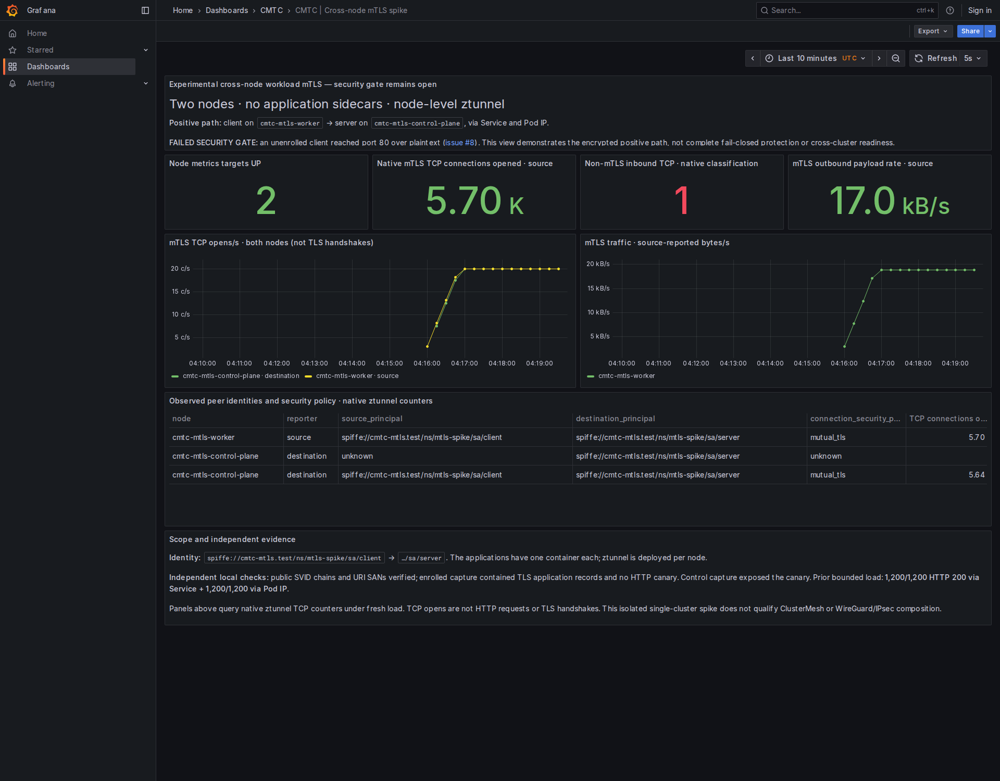

# Local cross-node SPIRE workload mTLS evidence

This is an **experimental local ARM64, single-cluster** qualification from the
MacBook's owned two-node `cmtc-mtls` kind lab. It is not a GitHub Actions run,
ClusterMesh qualification, transport-layer composition test or full security
acceptance. Applications have no sidecars; TLS runs in the node-level ztunnels.

- Fresh capture load: **3,000/3,000 HTTP 200 via Service and 3,000/3,000 via Pod IP**,
  each for 300 seconds at approximately 10 requests/s. [Raw results](runtime/mtls-capture-summary.json).
- The actual Playwright walk passed all nine Grafana panels with no `No data`.
  [Walk log](walk.log), [query vectors](runtime/dashboard-query-evidence.json),
  [node/image/container evidence](runtime/workload-placement-image-evidence.json).
- Native metrics identify client/server SPIFFE principals and `mutual_tls` at
  both nodes. These TCP connection counters are **not TLS handshake counts**.
- Independent earlier controls: plaintext canary visible without enrollment,
  absent in the enrolled capture, with actual TLS records parsed. Public SVID
  URI SANs/chains were verified. See the pcaps, certificates and summaries in
  [runtime](runtime).
- Actual SPIRE fault test: seven structured retries, no authenticated ACK while
  unavailable, ACK after server recovery. SPIRE and both agents were restored
  healthy. [Summary](runtime/spire-retry-runtime-summary.json).

## Failed gate and scoped policy experiment

The unprotected baseline accepted unauthenticated plaintext HTTP 200 on both
node placements and both host-origin paths. This keeps
[issue #8](https://github.com/ephico2real2/clustermesh-trust-controller/issues/8)
open. The red screenshot counter intentionally exposes that result.

Thirty actual path observations tested the following policies:

| Policy | Enrolled Service / Pod IP | Unenrolled same / other node | Server-node / other host |
| --- | --- | --- | --- |
| None | 200 / 200 | 200 / 200 | 200 / 200 |
| CNP allow HBONE, default deny other ingress | 200 / 200 | blocked / blocked | 200 / blocked |
| CNP + broad Kubernetes NetworkPolicy allow | 200 / 200 | 200 / 200 | 200 / 200 |
| CNP + explicit port-80 deny, broad allow retained | 200 / 200 | blocked / blocked | blocked / blocked |
| Equivalent scoped CCNP + explicit port-80 deny, broad allow retained | 200 / 200 | blocked / blocked | blocked / blocked |

[Raw policy results and exact policy JSON](runtime/policy-experiment/summary.json),
[execution log](policy-experiment.log). Blocked probes timed out; they did not
receive an HTTP 403. All temporary experiment policies/probes were removed.
This is a port-80 mitigation experiment, not general authorization or persistent
fail-closed admission. Arbitrary ports, policy loss/restart, first packets,
platform health exceptions, remote cluster identity and WireGuard/IPsec layering
remain separate gates. The CRD remains Observe-only.

## Source and tool boundaries

[qualification.json](qualification.json) records exact source/image pins.
The operator was built with host Podman, source
`d8124529b590bfb24adbd3d2916a4a984b666f9e`, and deployed locally. Its initial Go
retry/RPC-ACK slice passes race tests, vet and pinned lint; associated logs are
included. The agent SPIRE spike is source
`0d787e82f2a54b0f51eec97a39c24556dd3596d5`; ztunnel is pinned at
`5bb9cf256b10a209ae9bc0624ddfbf27dbc439de`.

The CMTC image smoke is a distinct `01320a19` image, not the operator image or a
claim of CMTC datapath enforcement. Runtime CRI image IDs can be import indexes;
the included image-verification chain resolves index → manifest → config.
Development commits were local-only at capture time. This evidence does not
claim their code was merged or the images published to GHCR.

Executed scripts retain this machine's fixture paths; adapt those paths before
reuse. Root private signing keys, kubeconfig credentials and workload private
keys are excluded. All evidence bytes, including pcaps, passed a private-key
PEM/JWT-pattern scan. Only public certificate/CSR material is retained.
