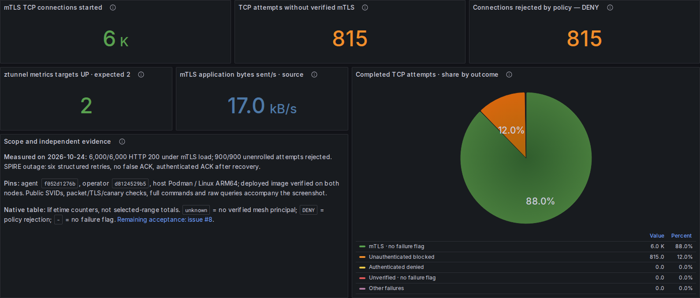

# Local authenticated-only workload mTLS qualification

Measured 2026-10-24 on the MacBook's isolated two-node `cmtc-mtls` kind cluster.
Built with host Podman for Linux ARM64, then transferred into the existing Ubuntu
Colima kind runtime. No application sidecars, ClusterMesh, CNP, CCNP or KNP in
this native-policy trial. This is local evidence, not a GitHub Actions result.

| Check | Observed result | Raw output |
| --- | --- | --- |
| Steady and post-restart multiport matrix | 57/57 passed; valid mTLS on 80/8080/9443 and Service 18080→8080, unverified pod/host sources rejected | [check.txt](check.txt), [results](runtime/results.json), [every command/exit/output](runtime/commands.ndjson) |
| Continuous ztunnel restart probes | 384 attempts, zero unexpected HTTP responses | [results](runtime/results.json) |
| Continuous Cilium restart probes | 1,014 attempts, zero unexpected HTTP responses | [results](runtime/results.json) |
| Five-minute authenticated load | Service 3,000/3,000 + Pod IP 3,000/3,000 HTTP 200 | [load summary](runtime/authenticated-load-summary.json) |
| Unenrolled load | 900/900 attempts rejected, zero HTTP responses | [negative results](runtime/negative-load-results.json), [output](runtime/negative-load.log) |
| Actual SPIRE outage/recovery | Six structured retries, no false authenticated ACK, ACK after recovery | [retry result](runtime/spire-retry-runtime-summary.json), [field validation](runtime/structured-log-validation.json) |
| Identity and packet checks | Client/server SVID chains/SANs verified; no canary in 9,142 captured packets; 7,380 HBONE packets, 4,984 TLS application-data record packets | [TLS summary](runtime/tls-record-summary.json), [PCAP](runtime/authenticated-capture.pcap), public certificates in runtime/ |
| Local source checks | Race-enabled config/ADS tests, pinned lint, vet and Helm profiles passed | [local-validation](local-validation) |
| Deployed image | Exact Podman image config and binary source verified on both nodes | [verification](runtime/deployed-image-verification.json) |
| Grafana | Both themes, 12 populated panels each; all five legend entries and full caption fit | [browser results](runtime/screenshots/walk-results.json), [layout bounds](runtime/screenshots/layout-checks.json) |
| PromQL | All real queries succeed without notices; five categories equal denominator, percentages total 100; missing telemetry remains unavailable | [raw query evidence](runtime/dashboard-query-evidence.json) |

## Source and image boundary

Cilium agent `f052d1276b0fb1619809db0059fbbb7898c9cfae` publishes the native
GLOBAL DENY policy `cilium_require_mtls`, matching an absent verified TLS principal,
with no application-port predicate. The flag is experimental and defaults off.
Both proxy nodes expose the [actual policy](runtime/cmtc-mtls-control-plane-native-policies.json).

The operator is `d8124529b590bfb24adbd3d2916a4a984b666f9e`; the qualification
runner's CMTC source is `4f94290a898c30ad964c3053e45f4676d154691e`.
The [reviewable source patch and executed helpers](reproduction) accompany local-only commits.

The agent image overlays the freshly compiled Go binary onto the qualified fork
`42f89f83` runtime/BPF image; those unchanged BPF/runtime artifacts were reused.
Image config ID: `sha256:0f3a6f60cbb61700e0760536bf7fe0cbe5678a26c2f0e968505ec962a519d8dc`.
The source, build logs, image metadata and actual node content checks are retained.
This does not qualify AMD64 or publish a new GHCR development bundle.

## Reading the Grafana data

The [dashboard sources, inventory and validator](dashboard) follow the user's
[diagram-kit dashboard skill](https://github.com/ephico2real2/diagram-kit/blob/26b7c19791159929c76a264ea3d5274bef72e9f6/skill/dashboard/SKILL.md).
The three totals are selected-range counter increases. **TCP attempts without
verified mTLS include attempts later rejected**; DENY is the actual rejection
counter, so adding DENY to attempts would double count them. mTLS TCP connections
are neither HTTP requests nor TLS handshakes.

The pie's denominator is destination-reported completed TCP attempts, counted
once per connection. In this recorded load window it reports **87.97% mTLS with
no failure flag**, **12.03% unauthenticated blocked**, and zero authenticated
DENY, unverified/no-failure-flag and other failures. The percentages describe this
controlled TCP test mix, not a production HTTP request success rate.
Counter increases handle resets and are extrapolated estimates; they can be
fractional. In-flight/early-unrecorded failures are excluded. The native identity
table shows lifetime counters at range end; source and destination rows overlap.

Screenshots were taken after the bounded load completed and use its
[absolute data window](runtime/capture-time-window.json), ending five seconds
before load completion. They do not claim current traffic continues. The
[exact capture specification](runtime/capture-spec.json) preserves that range.

[Full dark view](runtime/screenshots/authenticated-only-after-load-dark.png) ·
[full light view](runtime/screenshots/authenticated-only-after-load-light.png) ·
[light outcome detail](runtime/screenshots/tcp-outcomes-light.png).

## Remaining acceptance

**Complete fail-closed protection remains false.** Bounded restart passes do not
prove fresh first-packet admission or the known proxy default-allow behavior
while policy is missing. General destination permissions, unsupported profiles,
platform/probe exceptions, identity/issuer isolation, remote workload discovery,
ClusterMesh and WireGuard/IPsec composition remain separate gates. The CRD stays
Observe-only and the compatibility guard stays in place. Issues #7 and #8 remain
open; #9 separately evaluates node-level Envoy without selecting it.

TLS record packets can include duplicate capture observations; they are not
TLS handshake counts. Public certificates are included; keys and kubeconfig
credentials are excluded. The external bootstrap root private key was removed.
Prior port-policy diagnostics, where present, are deliberately not native-rule
acceptance evidence. No unrelated lab or application was removed.
