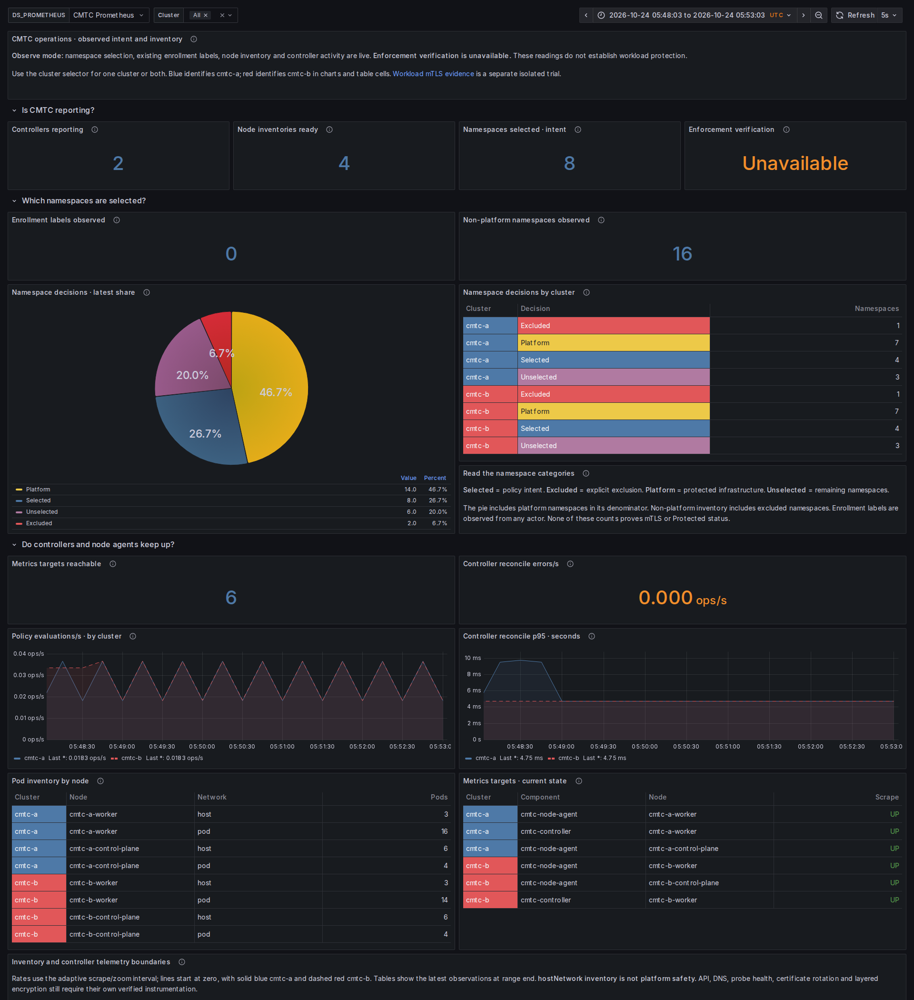
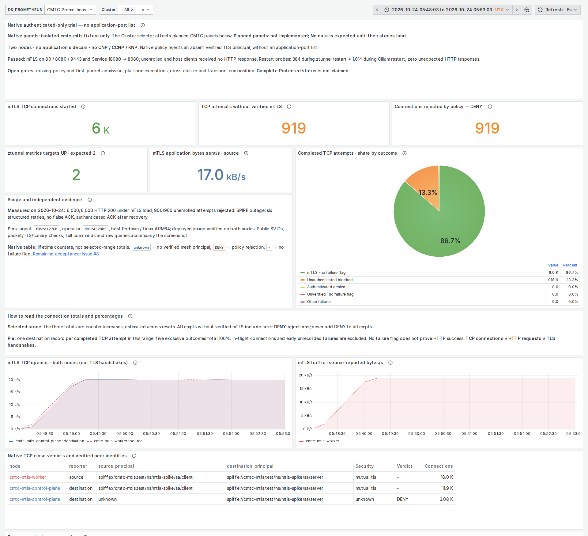

# Two consolidated CMTC dashboards — local measured evidence

All nine original domain JSON files are preserved byte for byte. Their full metric coverage is consolidated into **Operations** and **Workload Security**. The stable root `DASHBOARD_GUIDE.md` maps every original domain and contains named screenshots.

This evidence is from the user's local MacBook / dedicated Ubuntu Colima kind runtime on Linux ARM64. The existing qualified images were retained; this presentation/provisioning change did not rebuild a container. MacBook image builds continue to use Podman. The local sections below qualify ARM64; the separate AMD64 CI addendum records the subsequent owned-repository run.

## Measured load

| Experiment | Requests / attempts | Outcome |
| --- | ---: | --- |
| cmtc-a shop | 7,200 | 7,200 HTTP 200 |
| cmtc-b shop | 7,200 | 7,200 HTTP 200 |
| cmtc-a remote-only Global Service | 3,600 | 3,600 HTTP 200 |
| Isolated mTLS fixture, cross-node Service | 3,000 | 3,000 HTTP 200 |
| Isolated mTLS fixture, cross-node Pod IP | 3,000 | 3,000 HTTP 200 |
| Unenrolled source to enrolled destination | 900 | 900 rejected, no HTTP response |

The 18,000-request baseline experiment tests application paths in the Observe ClusterMesh fixture; it is distinct from the isolated mTLS experiment. Image IDs and actual daemon versions are in `runtime-images.json`: baseline `42f89f83aa`, isolated mTLS daemon `f052d1276b`. The CLI inside the overlaid mTLS image still reports the underlying baseline; the running daemon reports the experimental source, as expected.

The final captures all use absolute UTC **2026-10-24 05:48:03.361 through 05:53:03.361**, ending five seconds before the authenticated jobs completed. The raw job results cover the complete runs. Counter increases are extrapolated estimates, not exact generator request counts. The completed destination TCP pie has estimated total **6,890.743**, split **86.665% mTLS without a failure flag** and **13.335% unauthenticated blocked**, with the remaining three exclusive outcomes zero. Percentages total 100%; no failure flag alone is not an HTTP success claim. TCP starts, HTTP requests and TLS handshakes remain separate.

## Screenshot gallery

Operations: [dark full page](screenshots/cmtc-operations-dark.png) · [light full page](screenshots/cmtc-operations-light.png).

Workload Security: [dark full page](screenshots/cmtc-workload-security-dark.png) · [light full page](screenshots/cmtc-workload-security-light.png).

Retained planned sections: [Operations dark](screenshots/operations-planned.dark.png), [Operations light](screenshots/operations-planned.light.png), [Security dark](screenshots/workload-security-planned.dark.png), [Security light](screenshots/workload-security-planned.light.png). Their missing data is explicitly unimplemented, not an observed zero.

## Browser rendering and feature status

All five browser cases pass: Operations dark/light, Workload Security dark/light and the remote demo app. Every native security panel must have data (`requireNative=true`). Operations has 28 panels with ten named missing planned signals; Security has 29 panels with sixteen named missing planned signals. These are retained instrumentation requirements and their feature evidence is **BLOCKED**. No empty metric becomes a successful zero.

Both-theme full pages and readable summary/planned-section PNGs are under `screenshots/`. All panels fit the final 1920×4800 viewport, all eight namespace-decision rows are visible, and legends/captions were visually inspected. An initial 4400px viewport clipped the final planned security panel; increasing it to 4800px fixed that. The namespace table was increased from eight to ten grid units to expose its last two rows. Earlier screenshots are diagnostic only, not this final gallery.

The generated files match Grafana's live panel source exactly. Offline checks verify original hashes, all 31 original metric names, domain-to-panel destinations, replacement meanings, metric types, fixed Tableau colours, descriptions, cluster scoping and absence behavior. Real API checks cover both clusters and each cluster separately; implemented types match declared exporter metadata, no query warnings are permitted, both pies partition their stated denominators and a nonexistent target stays empty.

## Files

- `screenshots/`: final full pages, section PNGs, absolute range, page spec, explicit absence reasons, metric assertions, layout report and browser verdicts.
- `load/`, `load-results.json`: baseline raw Fortio output, requests and durations.
- `mtls-load/`: copied bounded Job definitions, raw Fortio and rejection output, completed status and exact counts. Prior original Jobs were preserved.
- `query-evidence.json`: real Operations and planned-security query responses.
- `native-query-evidence.json`: real mTLS query vectors and TCP outcome partition assertions for the screenshot window.
- `metric-types.json`, `inventory.json`: actual exporter family metadata and inventory inputs; `INVENTORY.md` gives the human-readable inventory.
- `originals-preserved.json`, `manifest-check.json`, `provisioned-source-check.json`, `static-checks.txt`: preservation, source and semantic checks.
- `source/`: generator, validators, original and consolidated JSONs, contracts, capture code and dashboard guide.
- `runtime-images.json`, `source-provenance.json`, `final-browser.log`, `SHA256SUMS`: source/runtime identity, browser output and integrity.

No root private key, workload private key, kubeconfig or token belongs in this evidence. Complete fail-closed admission, general destination permissions, trust rotation, cross-cluster workload mTLS, layered WireGuard/IPsec composition and OpenShift/Perses rendering remain open acceptance gates. The presentation work does not change the Observe-only API or prove those features.

## AMD64 CI and merge addendum

[CI run 40068439940](https://github.com/ephico2real2/clustermesh-trust-controller/actions/runs/40068439940) passed unit and deployed-lab jobs at exact head `3e2afdc4f67b75c4d9f3daa54a214f3a0d4275db`. Its raw Fortio JSON/logs and assertions are preserved under `ci/`: 7,200 + 7,200 shop HTTP 200 responses and 3,600 remote Global Service HTTP 200 responses, **18,000/18,000** in total. All five browser cases passed. [Immutable CI PNGs and browser verdicts](https://github.com/ephico2real2/clustermesh-trust-controller/tree/35245cc/2026-10-24T0610Z_cmtc_run40068439940-1_deployed-lab) show this same consolidated layout on Linux AMD64.

CI deploys the Observe ClusterMesh baseline, so its native SPIRE security panels are explicitly BLOCKED alongside planned instrumentation; populated native mTLS evidence comes from the local experiment above. No new cross-cluster mTLS or transport-composition claim follows from this run.

[PR #10](https://github.com/ephico2real2/clustermesh-trust-controller/pull/10) merged normally at `b1f9c0e4140c8bd64a626c77ee1afc94f0eef489` after both exact-head checks passed. The entire merged source tree matches the tested head. Local main was fast-forwarded cleanly and only the merged feature branch was removed. All nine original JSON files remain unchanged. `semantic-mutations.json` also records rejection of gauge-as-rate, raw-counter and histogram-without-quantile mutations.
