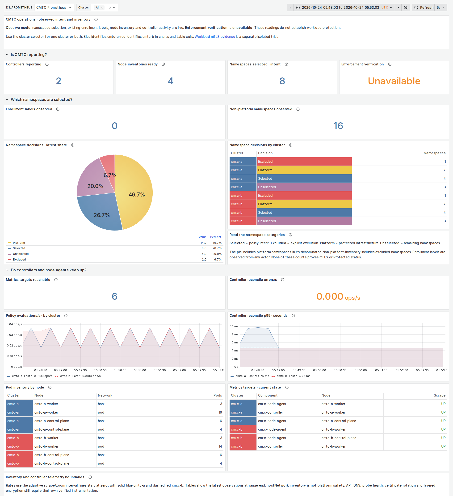
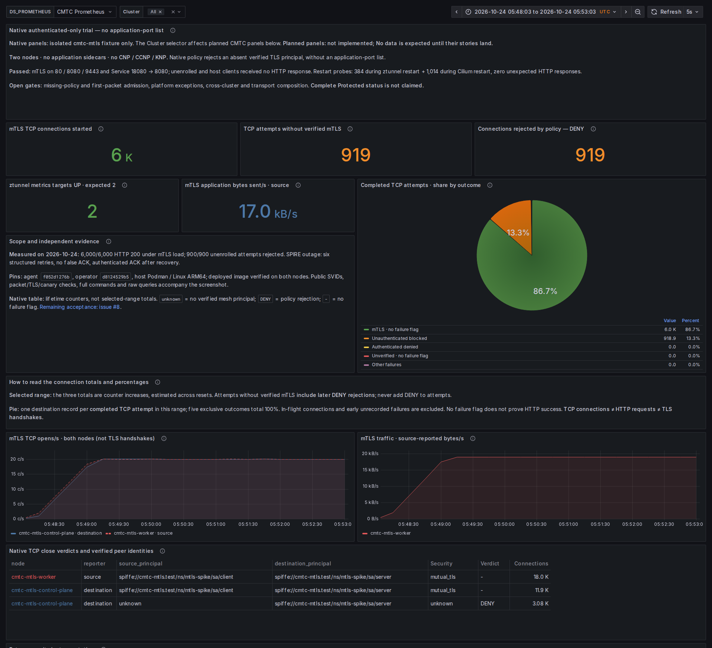

# CMTC dashboard guide

Updated October 24, 2026. **All nine original dashboard definitions are preserved unchanged.** Their coverage is combined into two Grafana pages, with repeated metrics shown once and future instrumentation retained as visible planned panels.

| Page | Local Grafana | Source |
| --- | --- | --- |
| Operations | [Open Operations](http://127.0.0.1:13000/d/cmtc-observe-lab) | [operations.json](observability/dashboards/operations.json) |
| Workload Security | [Open Workload Security](http://127.0.0.1:13000/d/cmtc-authenticated-only) | [workload-security.json](observability/dashboards/workload-security.json) |

The stable dashboard UIDs are retained. The nine original `01-` through `09-` files remain in [observability/dashboards](observability/dashboards/), with SHA-256 checks in [capabilities.json](observability/capabilities.json). They can still be imported individually. The default lab provisions the two consolidated files explicitly.

## Where each original dashboard went

| Original domain | Consolidated page and section |
| --- | --- |
| Security Overview | Operations: reporting, namespace intent and planned verified cluster/pod gates; actual TLS handshake panel is shared with Security performance |
| Namespace Enrollment | Operations: namespace decisions, exclusions, labels and planned label drift |
| Pod and Node Enforcement | Operations: node inventory and planned protected/pending/failed pod counts |
| mTLS Performance | Workload Security: native TCP outcomes and planned actual TLS handshakes, active connections, peer identity and remote-cache metrics |
| CA Trust and Rotation | Workload Security: planned trust consumption, SPIRE acknowledgment, issuer verification and rotation failures |
| Network Encryption | Workload Security: planned transport compatibility, dual encryption, encryption failure and MTU verification |
| Security Violations | Workload Security: native DENY plus planned authorization, plaintext bypass and policy conflict signals; peer identity failures appear once under TLS performance |
| Control Plane Safety | Operations: host-network inventory and planned platform dependencies, API probes and aborted rollouts |
| Operator and Node Agents | Operations: controller activity, target states, node inventory and planned proxy readiness/configuration drift |

All 31 original proposed metric names remain mapped to their agile stories. Current signals already supply three meanings: exclusions use `cmtc_namespace_decisions{decision="excluded"}`, host-network inventory uses `cmtc_pods_observed{network="host"}`, and controller errors use `controller_runtime_reconcile_errors_total`. The proposed `cmtc_hostnetwork_pods_total` is inventory, so its `_total` name needs correction before instrumentation; it must never be treated as a counter.

## Read the data correctly

Operations has 28 panels: 18 live observations/context panels and ten planned signals. Workload Security has 29: the twelve native trial panels, a context panel and sixteen planned signals. **No data on a planned panel means instrumentation is not implemented.** Its absence is not zero failures, healthy trust or protected workloads. The browser report records missing security evidence as BLOCKED even when rendering passes.

The Cluster selector filters Operations and planned CMTC security panels. Native ztunnel panels explicitly remain scoped to the separate `cmtc-mtls` two-node fixture. The baseline Observe CI does not deploy that fixture. Node inventory and namespace selection do not establish `Protected`; enforcement verification remains Unavailable in Observe mode.

Gauges show current levels or latest states. Counter charts show rates over the adaptive interval. Controller p95 uses actual controller-runtime histogram buckets and measures reconciliation, not TLS. Planned TLS p95 requires real handshake buckets. [METRICS.md](observability/METRICS.md) defines the type, meaning and owner of each live or proposed family; [INVENTORY.md](observability/INVENTORY.md) inventories the actual exporter surface.

The namespace pie is a latest inventory partition: selected, excluded, platform and unselected sum to all observed namespaces. It is not mTLS coverage. The security pie uses destination-reported completed TCP attempts, split into five exclusive outcomes. DENY overlaps the headline attempt counters and must not be added to them. TCP connections, HTTP requests and TLS handshakes remain distinct; see [MTLS_GUIDE.md](MTLS_GUIDE.md).

## Presentation and screenshots

The user's [MongoDB dashboard JSON](https://github.com/ephico2real2/mongodb-poc/blob/b3fff7df84af44ab2d3890ec284632fe277d237a/chart/mongodb-search-helm/files/mongodb-search.json) and its README screenshots were reviewed, including the coloured table cells. The [diagram-kit dashboard skill](https://github.com/ephico2real2/diagram-kit/blob/26b7c19791159929c76a264ea3d5274bef72e9f6/skill/dashboard/SKILL.md) guides metric inventory, chart choice and validation.

Blue `#4e79a7` identifies cmtc-a and red `#e15759` identifies cmtc-b in chart legends and table identity cells. Namespace categories use consistent blue/red/yellow/purple mappings. Lines are thin, shaded, start at zero and use solid/dashed cluster styles; legends sit below. Green indicates a verified good state, orange a warning. A reachable-target count is an observation, not an all-healthy verdict; inspect the individual target states.

Operations, light theme:



Workload Security, dark theme:



Both themes: [Operations dark](docs/images/cmtc-operations.dark.png), [Operations light](docs/images/cmtc-operations.light.png), [Security dark](docs/images/cmtc-workload-security.dark.png), [Security light](docs/images/cmtc-workload-security.light.png). Full-page captures also show the retained planned sections; see the evidence linked from [deployed validation](docs/development/VALIDATION.md).

## Reproduce locally before CI

```sh
python3 observability/build.py --check
python3 observability/validate.py
python3 examples/observability/ztunnel-spike/validate.py
python3 observability/validate.py \
  --prometheus http://127.0.0.1:13000/api/datasources/proxy/uid/cmtc-prom \
  --out artifacts/dashboard-query-evidence.json
```

Generate relevant real load before capture. For the isolated security fixture, run both authenticated traffic and unenrolled attempts and validate the native PromQL vectors over the recorded absolute time range. Keep load results, exact source/image pins, query responses, browser verdicts and layout checks alongside the PNGs. The default prepared Ubuntu Playwright walk captures four dashboard theme cases plus the remote demo app, without adding another CI workflow. Planned metric activation and OpenShift/Perses qualification remain in their delivering stories.
