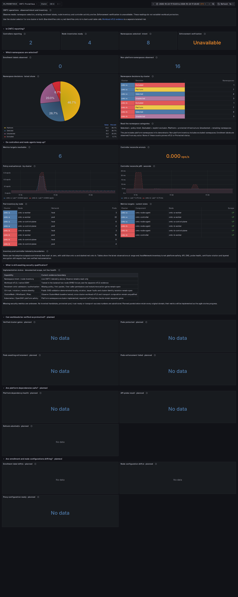

# Two-cluster CMTC Observe and reachability evidence

This run validates the retained Colima kind clusters `kind-cmtc-a` and
`kind-cmtc-b`. It is an **unencrypted Observe/reachability baseline**, not an
mTLS, authorization, or node-encryption qualification. The Observe profile had
no ztunnel Pods, no SPIRE federation, and no WireGuard/IPsec configuration.

## Result

- All 18 Global Service and direct remote Pod-IP checks returned the expected
  backend cluster over TCP/80, TCP/8080, and TCP/31337.
- Eight six-minute Fortio streams passed: 28,800 HTTP 200 responses total,
  including 14,400 cross-cluster responses (7,200 in each direction) and
  14,400 local shop responses.
- The existing CMTC Observe policy checks passed: policy reconciliation,
  exclusion/platform precedence, UID recreation, policy conflicts, Strict-mode
  rejection, read-only namespace RBAC, and allowed/denied shop paths.
- Playwright captured both consolidated CMTC dashboards in dark and light
  themes after load. Each page rendered successfully (28 Operations panels and
  29 Workload Security panels). The 10 Operations and 16 Workload Security
  signals that are still planned are reported as blocked, not as passing
  security evidence. The application response assertion returned the
  `cmtc-b` backend.
- A metric-name audit found 221 names in the queried Prometheus range and no
  Hubble, ztunnel, Envoy, or Cilium metric names. This matches the Observe-only
  runtime and must not be described as measured mTLS telemetry.

The run used the older fork agent image
`ghcr.io/ephico2real2/cilium-dev@sha256:15cc5402e93416e8ff71f24b79b0fc1e6b3837f0c4c216b0eb377b8d47b92d68`
(`1.21.0-dev`, source version `42f89f83aa`). The enhanced Cilium xDS candidate
at `f142e58d06a458b72cf7ea27999c093ca87c9c2b` was not deployed. The companion
ztunnel candidate was also not deployed. Full source/runtime context is in
[`runtime-and-image.json`](runtime-and-image.json).

## Dashboard evidence

Operations dashboard after the reciprocal six-minute load:

The other captures are [Operations light](grafana/cmtc-operations-light.png),
[Workload Security dark](grafana/cmtc-workload-security-dark.png), and
[Workload Security light](grafana/cmtc-workload-security-light.png). Raw
Playwright output and machine-readable assertions are in [`grafana/`](grafana/).

## Contents

- [`path-check-results.json`](path-check-results.json): 18 asserted service and
  remote Pod-IP paths, with expected and actual serving cluster.
- [`load/load-results.json`](load/load-results.json): request totals, response
  status, duration, and measured QPS for each stream. Raw Fortio logs and JSON
  are kept alongside it.
- `cmtc-*-shop-*` and `cmtc-*-strict-rejection.txt`: representative CMTC
  allowed/denied and Observe-mode rejection output.
- [`grafana/`](grafana/): four screenshots, capture range, panel results,
  Prometheus assertions, and the browser runner specification.
- [`diagnostics/first-capture-port-conflict.log`](diagnostics/first-capture-port-conflict.log):
  retained initial capture failure; the port was changed and the final capture
  passed.
- [`source-sha256.json`](source-sha256.json) and [`runtime-and-image.json`](runtime-and-image.json):
  source and image pins for this run and its tooling.
- [`SHA256SUMS`](SHA256SUMS): content checksums for the evidence files.

See the [refined two-cluster test and fork integration design](../docs/architecture/SECURITY_AND_FAILURE_TEST_MATRIX.md#two-cluster-application-and-ztunnel-test-design).
