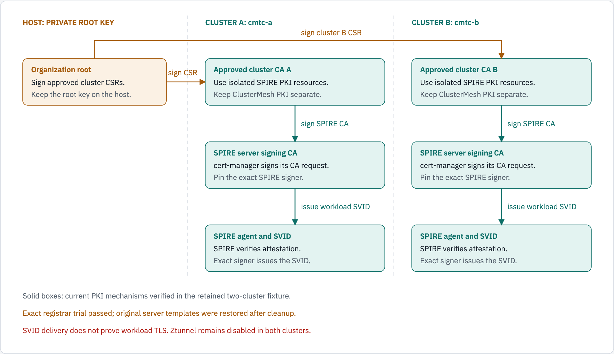
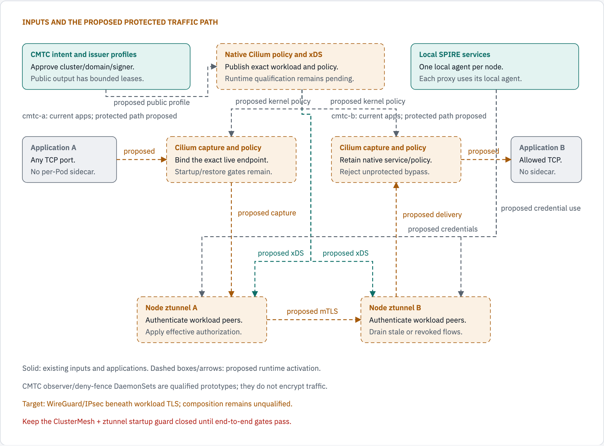

# CMTC architecture update

Status: measured runtime, qualified experiments and proposed integration, 2026-10-25.

The PKI and registration changes now have local evidence.
The combined Cilium ClusterMesh and ztunnel enforcement path remains incomplete.
This update connects the retained proposals to the current design.
An SVID is a SPIFFE workload credential.
Use [delivery status](docs/agile/DELIVERY_STATUS.md) for exact source and image pins.

## What changed

| Earlier proposal or baseline | Accepted change | Current limit |
| --- | --- | --- |
| A direct-root verifier accepted only a root that directly signed SPIRE's CA. | Verify the explicitly approved cluster intermediate and pin the exact SPIRE signer. | A shared root or matching trust-domain string alone grants no trust. |
| The first PKI proposal reused existing ClusterMesh issuer resources. | Use isolated SPIRE CA resources. Preserve ClusterMesh PKI. | Root private keys stay outside clusters and evidence. |
| Cilium's reviewed registrar selects namespace and service-account names. | Test exact Pod, node and daemon incarnations with bounded entry lifetimes and verified readback. | The separate server-local registrar remains an experiment. Its permanent owner is undecided. |
| The diagnostic client could swallow SPIRE stream errors. | Stop on the first error. A fresh request must prove recovery. | Credential delivery does not prove traffic protection. |
| Policy transitions could lose the original owner after an ADD acknowledgment was lost. | Retain bounded exact ADD history and join pending consumers before requesting a typed drain receipt. | This is source-qualified recovery, not durable restart state or deployed enforcement. |
| Older runners targeted the removed `cmtc-mtls` cluster. | Disable those runners before argument parsing, file writes or API calls. | Use `cmtc-a` and `cmtc-b`. Do not recreate the retired fixture for normal testing. |

The initial and revised Cursor PKI files remain [historical design inputs](docs/research/cursor/README.md#retained-pki-proposals).
Their embedded commands are not current runbooks.
Accepted implementation changes require separate evidence.

## Current PKI and credential path



*Solid boxes show the verified PKI mechanisms. Certificate authority relationships do not represent application traffic.*

```text
Private host:
  Organization root key -> sign each approved cluster CA CSR.

Each retained cluster, cmtc-a and cmtc-b:
  Approved cluster CA -> cert-manager signs SPIRE server CA.
  SPIRE verifies node and workload attestation.
  The exact SPIRE signer issues workload SVIDs.
  Existing ClusterMesh PKI remains separate.

Qualified temporary experiment:
  Exact registrar -> private server Admin socket -> owned registrations.
  Native credential controls verify target withdrawal and recovery.
  Original SPIRE server templates are restored after cleanup.

Ztunnel is disabled. These results do not establish workload mTLS.
```

The hierarchy has four certificate levels:
organization root, approved cluster intermediate, exact SPIRE signing CA and workload SVID.
The verifier accepts that approved chain.
It still rejects an unapproved signer and certificates issued by that signer.
See [PKI trust flow](PKI_TRUST_FLOW.md) for the verification order and stale-flow controls.

CMTC publishes approved **public** cluster, trust-domain and issuer information.
Its output has short leases and monotonic authority state.
This publication does not attest a Pod or grant traffic.
SPIRE performs attestation and credential issuance.

## Exact registration enhancement

The experimental Go registrar runs inside the SPIRE server Pod.
It uses the server's private Admin socket there.
It does not distribute that socket to applications or node proxies.
It neither signs certificates nor carries application traffic.

The helper checks approved cluster, namespace, service-account, node and daemon incarnations.
Its leaf entries select the current Pod UID and node name.
It removes obsolete owned entries and verifies stored material by readback.
A failed pass clears readiness and attempts bounded withdrawal.
Entry expiry, SVID expiry and connection drain remain separate controls.

The corrected two-cluster trial passed target credential withdrawal with valid same-node controls.
Reenrollment, Pod replacement, server restart and exact cleanup also passed.
All 124 host helper tests pass.
The final application continuity test passed all 36 paths.
These results establish registration and credential behavior; they do not establish protected traffic.

Read the [illustrated registration comparison](SPIRE_REGISTRATION_WORKFLOW.md),
[ownership decision](SPIRE_REGISTRATION_DESIGN.md) and
[retained runtime evidence](docs/evidence/exact-spire-registration/summary.json).
The permanent choice remains open: enhance Cilium's registrar or retain the separate helper.
Use one authoritative registration writer when that choice is activated.

## Proposed native enforcement path



*Dashed boxes and arrows show proposed runtime activation. The current applications communicate, but this path is not yet qualified.*

```text
Control inputs in each cluster:
  CMTC -> approved public trust intent.
  SPIRE -> attested workload credentials.
  Enhanced Cilium -> native workload discovery, capture, policy and xDS.

Proposed protected traffic:
  Application A -> mandatory Cilium capture and effective policy
    -> node ztunnel A -> authenticated workload TLS
    -> node ztunnel B -> native delivery -> Application B.
  Test the reverse direction with the same security gates.

Separate transport layer:
  The primary layered target requires WireGuard or IPsec beneath workload TLS.
  HBONE-only operation is a control profile.
  That layer does not replace workload identity or authorization.
```

No application sidecars are required.
Ztunnel is the node workload-TLS component.
The CMTC observer and deny-fence DaemonSets are separately qualified prototypes.
Those eBPF programs do not encrypt traffic.
Their eventual production integration belongs in the enhanced Cilium datapath.

Mandatory capture must cover application TCP ports without a fixed application-port list.
It must preserve native service translation, network policy and platform traffic.
A source-IP receipt or map reference alone cannot prove this coverage.

The combined startup guard remains closed until authenticated remote identities,
effective authorization and fail-closed startup/recovery pass with exact images.
A CMTC-to-ztunnel shortcut would leave the real Cilium delivery path untested.

## Current kernel fixture review

The new kernel test checks the actual policy-map and tail-call references reachable from loaded endpoint programs.
The static test header initially shadowed Cilium's generated node header.
That selected the wrong feature profile and removed the policy-map references during compilation.

Changing the include order exposed missing test initialization.
The minimal test Hive lacked several map-size providers.
Its load-balancer configuration also left a real map with zero capacity.
These failures remain recorded; the kernel candidate is unqualified.
Cursor is reviewing the fixture with the user-requested Opus 5.5 High model.
See [the exact request](docs/research/cursor/KERNEL_POLICY_FIXTURE_OPUS_REQUEST.md).

The separate lost-ACK recovery increment is committed as Cilium `3985cc135a`.
Its actual-etcd race profile passes 416 top-level tests and 1,713 subtests, with vet.
The affected lockdebug profile passes 40 tests and 74 subtests; lint reports no issues.
The real Rust owner profile also passes.
The broader lockdebug attempt found an unchanged upstream recursive-lock test.
Its failure is retained in [the evidence](docs/evidence/native-lost-add-ack/summary.json).
No new Cilium image or protected runtime follows from these source results.

## Remaining acceptance gates

1. Qualify the actual kernel policy-map and tail-call path.
2. Install persistent quarantine before restore or startup can forward traffic.
3. Bind remote workload identities to approved clusters and current incarnations.
4. Deliver effective authorization through the native Cilium/xDS path.
5. Qualify exact-image positive, negative and recovery traffic in both cluster directions.
6. Qualify workload TLS with WireGuard or IPsec as a separate composition test.

Registration source-failure and expiry injection remain open.
Production registrar ownership and node Admin access remain separate decisions.
The pending agent socket-permission migration has not run.
Keep [the security matrix](docs/architecture/SECURITY_AND_FAILURE_TEST_MATRIX.md) as the acceptance contract.

## Diagram sources

Use [the diagram-kit source](docs/diagrams/architecture-update/source.html).
Generate only light-theme images for this guide.
The kit check validates layout without producing dark image files.

```sh
~/.local/share/diagram-kit/.venv/bin/diagram-render --check \
  docs/diagrams/architecture-update/source.html
~/.local/share/diagram-kit/.venv/bin/python \
  scripts/capture/render_light_diagrams.py \
  docs/diagrams/architecture-update/source.html \
  docs/diagrams/architecture-update current-pki,target-enforcement
```

Update the source, images and text twins together.
Inspect both light images after rendering.
For build and import steps, use [the local image guide](LOCAL_IMAGE_BUILD.md).
