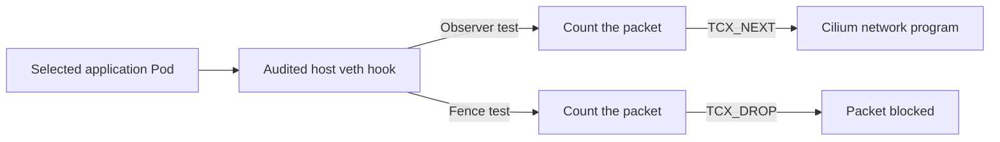

# CMTC DaemonSet implementation

The CMTC DaemonSet is part of the planned workload mTLS system.
The present eBPF programs count packets or block packets.
They do not encrypt traffic.
The eBPF prototype does not redirect traffic to ztunnel.
The design assigns workload TLS to ztunnel.

This guide uses ASD-STE100 writing principles and defined technical terms.
The writing reference is [ASD-STE100 Issue 9](https://www.asd-ste100.org/).

## Current condition

The local lab has two clusters: `cmtc-a` and `cmtc-b`.
Cilium connects these clusters through ClusterMesh.
The sample applications can communicate in both directions.

The lab runs the standard CMTC controller and node agents.
The optional eBPF DaemonSets passed their local tests.
The test procedure removed their temporary resources.
Ztunnel remains disabled in these clusters.
Cross-cluster workload mTLS remains incomplete.

## Technical terms

| Term | Meaning in this guide |
| --- | --- |
| DaemonSet | A Kubernetes object that starts one Pod on each selected node. |
| Node agent | The standard CMTC process that reports Pod inventory. |
| Go loader | The process that checks and attaches an eBPF program. |
| eBPF program | A small program that runs inside the Linux kernel. |
| ELF object | The compiled file that contains the eBPF program. |
| veth | A pair of virtual network interfaces. |
| TCX hook | A kernel connection point for a network program. |
| Link | The kernel object that connects a program to a hook. |
| Map | A kernel object that stores eBPF data. |
| Pin | A filesystem reference that retains a kernel object. |
| UID | The unique identifier for a Kubernetes object. |
| TLS | The protocol that protects a network connection with certificates and encryption. |
| bpffs | The Linux virtual filesystem that stores pins for kernel BPF objects. |
| Workload identity | The certificate identity of an application. |
| mTLS | TLS that checks the certificates of both peers. |
| HBONE | The tunnel protocol that ztunnel uses for application TCP traffic. |
| xDS | The control protocol that supplies workload and policy information. |

## Component tasks

| Component | Task |
| --- | --- |
| CMTC controller | Read namespace policy and report the current Observe state. |
| CMTC node agent | Report local Pod inventory without kernel privileges. |
| eBPF observer | Count packets at the selected hook. |
| eBPF fence | Block packets at the selected hook. |
| Cilium fork | Supply the current network routing and Cilium policy. |
| Ztunnel | Perform workload TLS when the remaining integration is complete. |

The observer and fence use separate images.
The default installation does not install these optional eBPF DaemonSets.
A test must explicitly select each node.
The prototype uses one audited workload hook on each selected node.

## Image contents

Each optional image contains a Go loader and a compiled ELF object.
The build records the source revision in the image.
The loader reports this revision through `--version`.

| Profile | Loader path | ELF path |
| --- | --- | --- |
| Observer | `/cmtc-bpf-observer` | `/usr/share/cmtc/observer_bpfel.o` |
| Fence | `/cmtc-bpf-fence` | `/usr/share/cmtc/fence_bpfel.o` |

The build uses Podman on the MacBook host.
The current qualified target is Linux ARM64.
The transfer procedure saves each image as an archive.
Kind loads the archive into the existing cluster runtime.
The test checks each node's image configuration ID and binary revision.

Refer to [the build and transfer guide](LOCAL_DAEMONSET_TELEMETRY.md#exact-build-and-transfer).

## Node selection and permissions

The experimental manifest uses a node selector.
The test adds the required label only to selected nodes.
Each node receives its own configuration file.
The Pod reads this file from an immutable ConfigMap.

The eBPF test Pod uses host networking and kernel privileges.
Its root filesystem is read-only.
It does not receive a Kubernetes service account token.
The standard CMTC node agent remains unprivileged.

The fence uses two separate host directories.
The bpffs directory stores the pinned kernel objects.
The ordinary filesystem directory stores the process lock.

The DaemonSet uses the `OnDelete` update strategy.
A template change does not replace its Pods automatically.
An operator must control each replacement.

## Startup checks

The Go loader checks the node configuration before attachment.
The checks include these values:

- Cluster name and node name.
- Workload Pod UID.
- Network namespace identity.
- Interface name, index, MAC address, and peer index.
- Selected traffic direction.
- Existing Cilium program and link IDs.

The fence also checks the Namespace UID.
The image tests verify the packaged ELF object and source revision.

A matching Pod UID is an audit check.
It does not prove a certificate identity.

The loader requires the expected veth interface and Cilium TCX attachment.
It rejects an unsupported attachment type.
It does not silently change to legacy TC or netkit.

If an identity check fails, the loader refuses the configuration.
It does not select a replacement interface automatically.
If the fence retains committed pins, a failed check does not remove them.

## Packet processing

The two profiles perform different actions.
The diagram shows alternative tests at the selected hook.

The observer returns `TCX_NEXT`.
Cilium then applies its own network behavior.
The observer does not change packet data or Cilium policy results.

The fence returns `TCX_DROP` for every packet at its selected hook.
It has no map that permits application traffic.
Its decision does not depend on an application port list.

This result applies only to the selected hook.
The live lab tests use the host veth ingress hook.
That hook receives packets from the selected application Pod.
Here, ingress names the host interface direction.
This fence does not authenticate callers at a destination.
They do not prove coverage of every destination path.

## Health checks and metrics

The health checks verify the actual loader and its configuration.
The fence checks also bind the daemon Pod UID, ELF identity, and source revision.
A successful readiness check does not prove workload mTLS.

Each profile exposes a separate metrics listener on the node IP.
The listener permits `GET /metrics`.
It rejects requests to health, debug, and configuration paths.
The health listener uses the node loopback address.

| Profile | Health port | Metrics port |
| --- | --- | --- |
| Observer | 18082 | 18085 |
| Fence | 18083 | 18084 |

| Metric | Meaning |
| --- | --- |
| `cmtc_datapath_observer_packets_total` | Packet observations before the Cilium decision. |
| `cmtc_datapath_observer_bytes_total` | Kernel packet bytes at the observer hook. |
| `cmtc_datapath_observer_ready` | A fresh sample with the expected attachment. |
| `cmtc_datapath_fence_dropped_packets_total` | Packet observations that the fence blocks. |
| `cmtc_datapath_fence_dropped_bytes_total` | Kernel packet bytes that the fence blocks. |
| `cmtc_datapath_fence_quarantine_verified` | Fresh verification of the expected fence. |

The packet counters include protocol traffic and retries.
The observer can count packets that Cilium subsequently rejects.
These counters do not count HTTP requests, TCP connections, or TLS handshakes.

If a sample is stale or invalid, the collector omits its packet and byte counters.
A missing counter does not mean zero traffic.

Each cluster's Prometheus collects its local metrics.
Cluster B sends its metrics to the Prometheus hub in cluster A.
Grafana reads that hub.
Cluster and node labels preserve the source of each measurement.

## Restart and removal behavior

The observer owns its kernel link through process handles.
If the process stops, the kernel removes that link.
A restarted observer creates new accounting maps.
Its counters can reset.

The fence retains its committed kernel objects through pins.
After a process crash, the committed fence continues to block packets.
A restarted loader checks every retained object before reuse.
The retained accounting map preserves its counters.

Removing the fence DaemonSet does not remove a committed fence.
The cleanup operation refuses a live interface.
It removes only the exact validated objects after that interface no longer exists.
An unknown kernel result does not permit cleanup.

A crash before pin installation remains a known limit.
The prototype does not guarantee persistence across a node reboot.

## Completed local tests

The four-node fence trial passed 168 audited application attempts.
It recorded 24 baseline successes and 144 expected denials.
It also passed 84 separate ClusterMesh continuity checks.

The observer trial passed 144 audited application attempts.
It recorded 96 allowed attempts and 48 attempts that native Cilium policy denied.
The tests checked real counter changes, process crashes, stale configuration, and resource cleanup.

The six metrics reached the central Prometheus query path.
The review checked Grafana screenshots in both themes after load.
The test procedure removed all temporary trial resources.

Refer to [the measured results and screenshots](docs/evidence/daemonset-telemetry/README.md).

## Work required for workload mTLS

The complete design needs these additional functions:

1. CMTC supplies an approved trust configuration.
2. Cilium verifies the source of remote workload records.
3. The certificate identity identifies the correct cluster.
4. Cilium supplies effective authorization to ztunnel.
5. Ztunnel checks peer certificates and applies that authorization.
6. Admission checks prevent traffic before the required protection is ready.
7. Recovery checks stop traffic when trust or authorization becomes invalid.

The design uses a ztunnel DaemonSet for workload TLS.
Each ztunnel Pod can serve many application Pods on its node.
The planned protected connection uses HBONE between ztunnel instances.
The application does not require a sidecar.
SPIRE supplies workload certificates in the target design.
Cert-manager can sign the SPIRE issuing certificate.
A trust-domain string alone does not establish trust.
WireGuard or IPsec can provide separate node encryption after composition tests pass.

The new ztunnel certificate constructors passed their local tests.
The exact image passed version checks on all four nodes.
The production proxy does not use those constructors yet.

Refer to [the TLS foundation guide](LOCAL_PINNED_TLS_FOUNDATION.md).
The Cilium compatibility guard remains closed until the complete security tests pass.

## Source files

| Subject | File |
| --- | --- |
| Observer program | [observer.c](internal/datapath/bpf/observer.c) |
| Fence program | [fence.c](internal/datapath/bpf/fence.c) |
| Observer loader | [observer_linux.go](internal/datapath/observer_linux.go) |
| Fence loader | [fence_linux.go](internal/datapath/fence_linux.go) |
| Observer command | [main.go](cmd/cmtc-bpf-observer/main.go) |
| Fence command | [main.go](cmd/cmtc-bpf-fence/main.go) |
| Four-node fence manifest | [datapath-fence-fanout.yaml](config/experimental/datapath-fence-fanout.yaml) |
| Current delivery state | [DELIVERY_STATUS.md](docs/agile/DELIVERY_STATUS.md) |
