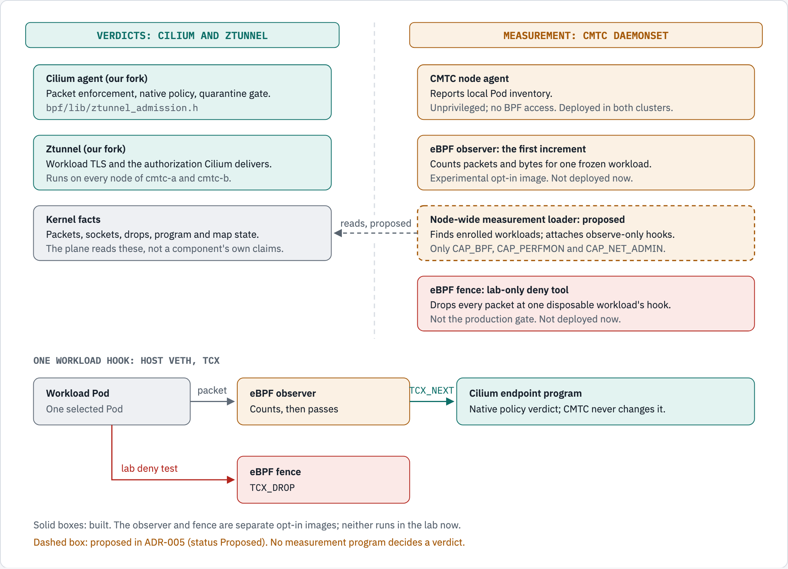

# CMTC DaemonSet and the eBPF measurement plane

<!-- CMTC_DOC_CONTEXT -->
Guide scope: check current runtime and feature gates before using these instructions. Read [current delivery status](docs/agile/DELIVERY_STATUS.md) and [documentation terms](DOCUMENTATION_GUIDE.md).
<!-- /CMTC_DOC_CONTEXT -->

The CMTC DaemonSet measures. It never decides a verdict.
Cilium owns packet enforcement and the workload quarantine gate.
Ztunnel owns workload TLS and authorization.
[ADR-005](docs/architecture/adr/ADR-005.md) (status Proposed, revised 2026-10-25) makes the CMTC eBPF programs the
permanent, observe-only **eBPF measurement plane** of each node.

| Part | State | What it does |
| --- | --- | --- |
| CMTC node agent | Current, deployed in both clusters | Reports local Pod inventory. It has no kernel privileges. |
| eBPF observer | Experimental; not deployed now | The first, single-workload increment of the measurement plane. It counts packets for one frozen workload. |
| eBPF fence | Experimental lab tool; not deployed now | Drops every packet at one disposable workload's hook. It is a lab-only deny tool, not the production gate. |
| Node-wide measurement loader | Proposed (ADR-005) | Finds enrolled workloads and attaches observe-only hooks on every node. |

This guide uses the spirit of ASD-STE100. It does not claim formal certification.

<!-- markdownlint-disable MD033 -->

<!-- markdownlint-enable MD033 -->

*The CMTC eBPF programs measure. Cilium and ztunnel own every verdict. The observer is the first, single-workload
increment. The fence is a lab-only deny tool. The node-wide loader is proposed.*

```text
Verdicts (not CMTC):
  Cilium agent (our fork)  packet enforcement, native policy, quarantine gate (bpf/lib/ztunnel_admission.h)
  ztunnel (our fork)       workload TLS and the authorization Cilium delivers
Measurement (CMTC DaemonSet):
  CMTC node agent          Pod inventory; unprivileged; deployed
  eBPF observer            counts one frozen workload, returns TCX_NEXT; experimental; not deployed now
  node-wide loader         PROPOSED (ADR-005): finds enrolled workloads, observe-only hooks
  eBPF fence               lab-only deny tool, returns TCX_DROP; not the production gate; not deployed now
One workload hook (host veth, TCX):
  Pod -> observer (count) -> TCX_NEXT -> Cilium endpoint program (verdict)
  Pod -> fence (lab deny test) -> TCX_DROP
```

## Current condition

Read 2026-10-25T23:07Z; exact pins are in [delivery status](docs/agile/DELIVERY_STATUS.md).

- `cmtc-a` and `cmtc-b` are joined by ClusterMesh.
- The Cilium agent, ztunnel and the SPIRE node agent run on all four nodes from our forks.
- The CMTC controller and node agent run in both clusters. The policy API accepts only Observe mode.
- Neither the eBPF observer nor the eBPF fence is deployed.

Traffic through ztunnel is allowed same-node, cross-node and cross-cluster for the enrolled fixture. The unregistered
caller is denied ([G1 evidence](docs/evidence/g1-destination-sources/README.md)). That record is traffic outcomes. It
is not per-connection peer-certificate evidence, recovery evidence or a `Protected` claim. DNS from enrolled Pods
fails and is not yet diagnosed.

## Technical terms

| Term | Meaning in this guide |
| --- | --- |
| DaemonSet | A Kubernetes object that starts one Pod on each selected node. |
| eBPF measurement plane | The permanent, observe-only eBPF programs of the CMTC DaemonSet (ADR-005). |
| Go loader | The process that checks and attaches an eBPF program. |
| eBPF program | A small program that runs inside the Linux kernel. |
| ELF object | The compiled file that contains the eBPF program. |
| veth | A pair of virtual network interfaces. |
| TCX hook | A kernel connection point for a network program. |
| Link | The kernel object that connects a program to a hook. |
| Map | A kernel object that stores eBPF data. |
| Pin | A filesystem reference that keeps a kernel object. |
| bpffs | The Linux virtual filesystem that stores pins for kernel BPF objects. |
| UID | The unique identifier for a Kubernetes object. |
| mTLS | TLS that checks the certificates of both peers. |
| HBONE | The tunnel protocol that ztunnel uses for application TCP traffic (port 15008). |
| xDS | The control protocol that supplies workload and policy information. |

## Component tasks

| Component | Task | Owner of verdicts? |
| --- | --- | --- |
| CMTC controller | Reads namespace policy, reports Observe state and publishes issuer profiles. | No |
| CMTC node agent | Reports local Pod inventory without kernel privileges. | No |
| eBPF observer | Counts packets at one selected hook. | No |
| eBPF fence | Blocks packets at one selected hook, in lab deny tests only. | No |
| Experimental SPIRE registrar | Manages exact registration entries from inside the SPIRE server Pod. Not deployed now. | No |
| Cilium agent (our fork) | Packet enforcement, native policy and the quarantine gate. | Yes |
| Ztunnel (our fork) | Workload TLS and the authorization Cilium delivers. | Yes |

The registrar is a separate Go helper and image. It is not the CMTC node agent. Read
[the registration design decision](SPIRE_REGISTRATION_DESIGN.md).

## The measurement plane decision (ADR-005)

1. **The observer is the first increment.** It counts one frozen workload per node configuration
   (`internal/datapath/observer_linux.go`, `Config`). It reads only the packet length and returns `TCX_NEXT`
   (`internal/datapath/bpf/observer.c:29`).
2. **The fence is a lab-only deny tool.** It returns `TCX_DROP` on every path (`internal/datapath/bpf/fence.c:33`).
   It serves deny-path tests on disposable workloads. The production gate it prototyped now lives natively in Cilium
   (`bpf/lib/ztunnel_admission.h` in the fork). The fence never becomes a dynamic allow controller.
3. **The node-wide plane is proposed.** A measurement loader container would discover enrolled workloads from a
   read-only source and attach observe-only hooks. It would hold only `CAP_BPF`, `CAP_PERFMON` and `CAP_NET_ADMIN`,
   bpffs and the cgroup v2 mount. The node agent container stays unprivileged. None of this is built.

Earlier text called the DaemonSet eBPF a "prototype" that "must later move into Cilium's agent". That direction is
historical (2026-10-23) and superseded by ADR-005.

## Image contents

Each optional image contains a Go loader and a compiled ELF object.
The build records the source revision in the image.
The loader reports this revision through `--version`.

| Profile | Loader path | ELF path |
| --- | --- | --- |
| Observer | `/cmtc-bpf-observer` | `/usr/share/cmtc/observer_bpfel.o` |
| Fence | `/cmtc-bpf-fence` | `/usr/share/cmtc/fence_bpfel.o` |

Build with Podman on the MacBook host, for Linux ARM64. Save each image as an archive. Load the archive into
`cmtc-a` and `cmtc-b`. Check each node's image configuration ID and binary revision.
Refer to [the build and transfer guide](LOCAL_DAEMONSET_TELEMETRY.md#exact-build-and-transfer).

## Node selection and permissions

The experimental manifests use a node selector.
A test adds the required label only to selected nodes.
Each node receives its own configuration file from an immutable ConfigMap.

The eBPF test Pod uses host networking and kernel privileges.
Its root filesystem is read-only.
It does not receive a Kubernetes service account token.
The standard CMTC node agent stays unprivileged.

The fence uses two separate host directories.
The bpffs directory stores the pinned kernel objects.
The ordinary filesystem directory stores the process lock.

The DaemonSet uses the `OnDelete` update strategy.
A template change does not replace its Pods.
An operator must control each replacement.

## Startup checks

The Go loader checks the node configuration before attachment:

- cluster name and node name;
- workload Pod UID;
- network namespace identity;
- interface name, index, MAC address and peer index;
- selected traffic direction;
- existing Cilium program and link IDs.

The fence also checks the Namespace UID.
A matching Pod UID is an audit check. It does not prove a certificate identity.

The loader requires the expected veth interface and Cilium TCX attachment.
It rejects legacy TC and netkit.
If an identity check fails, the loader refuses the configuration.
It does not select a replacement interface.
If the fence keeps committed pins, a failed check does not remove them.

## Packet processing

The observer returns `TCX_NEXT`. Cilium then applies its own verdict.
The observer does not change packet data or Cilium policy results.

The fence returns `TCX_DROP` for every packet at its selected hook.
It has no map that permits application traffic.

The live trials used the host veth ingress hook, which receives packets from the selected Pod.
The fence does not authenticate callers at a destination. It does not cover every destination path.

## Health checks and metrics

A successful readiness check does not prove workload mTLS.
Each profile exposes a metrics listener on the node IP that permits only `GET /metrics`.
The health listener uses the node loopback address.

| Profile | Health port | Metrics port |
| --- | --- | --- |
| Observer | 18082 | 18085 |
| Fence | 18083 | 18084 |

| Metric | Meaning |
| --- | --- |
| `cmtc_datapath_observer_packets_total` | Packet observations before the Cilium decision. |
| `cmtc_datapath_observer_bytes_total` | Kernel packet bytes at the observer hook. |
| `cmtc_datapath_observer_ready` | A fresh sample with the expected attachment. |
| `cmtc_datapath_fence_dropped_packets_total` | Packet observations that the fence blocks. |
| `cmtc_datapath_fence_dropped_bytes_total` | Kernel packet bytes that the fence blocks. |
| `cmtc_datapath_fence_quarantine_verified` | Fresh verification of the expected fence. |

Packet counters include protocol traffic and retries. They are not HTTP requests, TCP connections or TLS handshakes.
If a sample is stale or invalid, the collector omits its counters. A missing counter is unavailable data, not zero
traffic. Since neither profile is deployed, these series are absent now.

## Restart and removal behavior

The observer owns its kernel link through process handles.
If the process stops, the kernel removes that link, and its counters can reset.

The fence keeps its committed kernel objects through pins.
After a process crash, the committed fence continues to block packets.
A restarted loader checks every kept object before reuse.
Removing the fence DaemonSet does not remove a committed fence.
Cleanup refuses a live interface and removes only exact validated objects.

A crash between `BPF_LINK_CREATE` and `BPF_OBJ_PIN` loses that attachment.
Persistence across a node reboot is not tested.

## Historical test results (2026-10-24)

These results are historical. They apply to CMTC source `5b1bc205fe` and the images in
[the telemetry guide](LOCAL_DAEMONSET_TELEMETRY.md). They do not qualify a newer build.

- The four-node fence trial passed 168 audited application attempts: 24 baseline successes and 144 expected
  denials. It also passed 84 separate ClusterMesh continuity checks.
- The observer trial passed 144 audited application attempts: 96 allowed and 48 denied by native Cilium policy.
- The six metrics reached the central Prometheus query path. Grafana screenshots were checked in both themes.
- All temporary trial resources were removed.

Refer to [the measured results and screenshots](docs/evidence/daemonset-telemetry/README.md).

## Open gates

- The node-wide measurement plane: every ADR-005 acceptance gate (no verdict, attribution, recovery, cardinality,
  no double counting, freshness, footprint, separation).
- Recovery of the deployed mesh on the current Cilium agent: agent restart, ztunnel restart, node reboot, drain and
  lost-ACK recovery.
- Per-connection peer-certificate evidence for the allowed traffic.
- DNS from enrolled Pods.
- WireGuard/IPsec composition with workload mTLS.

Read [delivery status](docs/agile/DELIVERY_STATUS.md) for the current order of work.

## Source files

| Subject | File |
| --- | --- |
| Observer program | [observer.c](internal/datapath/bpf/observer.c) |
| Fence program | [fence.c](internal/datapath/bpf/fence.c) |
| Observer loader | [observer_linux.go](internal/datapath/observer_linux.go) |
| Fence loader | [fence_linux.go](internal/datapath/fence_linux.go) |
| Observer command | [main.go](cmd/cmtc-bpf-observer/main.go) |
| Fence command | [main.go](cmd/cmtc-bpf-fence/main.go) |
| Four-node fence manifest | [datapath-fence-fanout.yaml](config/experimental/datapath-fence-fanout.yaml) |
| Measurement-plane decision | [ADR-005](docs/architecture/adr/ADR-005.md) |

## Diagram sources

The figure source is [docs/diagrams/measurement-plane/source.html](docs/diagrams/measurement-plane/source.html).
Render it with `~/.local/share/diagram-kit/.venv/bin/diagram-render docs/diagrams/measurement-plane/source.html
docs/diagrams/measurement-plane measurement-plane`. Change the page, the PNGs and the text twin together.
