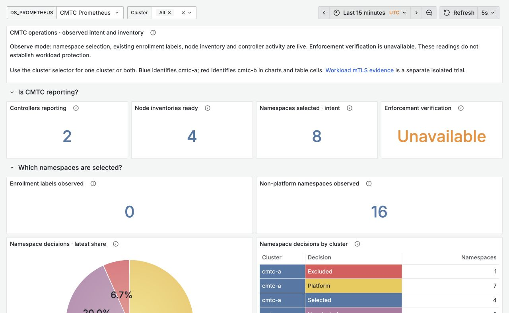

# Local admission and issuer verification increment

<!-- CMTC_DOC_CONTEXT -->
Evidence scope: results apply to the recorded source, image and fixture. Read [current delivery status](docs/agile/DELIVERY_STATUS.md) and [documentation terms](DOCUMENTATION_GUIDE.md).
<!-- /CMTC_DOC_CONTEXT -->

**Historical record (2026-10-24).** Cilium agent `8b01a7c954`, CMTC `85d0cd8acc`, ztunnel issuer foundation
`1db4fb296b`. It does not qualify the current build. **Current state:** ztunnel runs in both clusters from our fork,
the ClusterMesh/ztunnel startup guard was replaced by capability validation (Cilium `37d5fce0f7`), and enrolled
same-node, cross-node and cross-cluster traffic is allowed ([G1 evidence](docs/evidence/g1-destination-sources/README.md)).
Exact pins and open gates are in [delivery status](docs/agile/DELIVERY_STATUS.md).

On October 24, 2026, the MacBook's Podman builder qualified the admission changes and rebuilt the enhanced Cilium agent. Both retained ClusterMesh clusters then ran that image, with one sample backend per node. **This run proved source behavior and Observe-mode reachability; it did not prove cross-cluster workload mTLS.** At that time ztunnel interception and node encryption were disabled, and the compatibility guard was unchanged.

| Component | Source and local image | Verified scope |
| --- | --- | --- |
| Cilium agent | `8b01a7c95440f6db398a87bdac2136d36711d23f`, `localhost/cilium:admission-8b01a7c954` | Four ready agents; imported image identities and running binary hashes match |
| CMTC | `85d0cd8acc27c957c592011c7b5940ad1d2f8447`, `localhost/cmtc:observe-85d0cd8acc` | Unchanged Observe image, two controllers and four node agents ready |
| ztunnel issuer foundation | Local commit `1db4fb296beb4ca4c6c12762c61d1730dc38ceab` | 420 source tests; `localhost/cmtc-ztunnel:strict-1db4fb296b` imported and version-tested on every node. No active proxy DaemonSet |

The agent image configuration ID is `sha256:954ecb17927d8dc20fed5509c8cdb62b4aa268ed121a2ea2d47f6a1358bc8c78`; all four running binaries match SHA-256 `048f1bbf3be964092a60b29713590a6a737aa5fcda857674247b3a1ed3cc0d88`. [Runtime evidence](docs/evidence/admission-update/verified-runtime.json) records image IDs and containers. This remains an agent-only overlay on the pinned fork runtime; BPF, CNI, operator and mesh-server binaries are unchanged.

The staged proxy image configuration ID is `sha256:f83b7282473e1430bee4cc06d0a55890d49b7e2d3d916f4343aacf11d9a2145d`. Its version reports the full source SHA and `BuildStatus:"Clean"`; startup configuration/old-binary rejection checks pass. The Helm image override points to it for future gated integration. Version jobs do not exercise live workload TLS.

## Admission changes

Required intent is persisted synchronously before ZDS enrollment. The gate reads retained intent before interpreting current namespace labels, so label removal while the agent was down cannot forget a previous requirement. It validates live Pod/namespace identity and pins the actual network namespace across persistence, enrollment and final API checks. The journal contains intent and immutable sandbox identity, not ACK/readiness evidence.

A deterministic test reproduced a canceled request writing intent after waiting for the recorder lock. The fixed implementation checks cancellation after acquiring that lock; cancellation after a completed transaction still preserves Required intent and cannot report enrollment success. Strict API/CNI creation rejects blank identity. Cilium health, host and ingress endpoints use the internal creator path directly.

Native watch-session notifications now recur across reconnects, with stale deletion before completion and invalid-record/end notifications. A strict remote-workload subscriber is not wired yet; retained IPcache is not fresh authorization.

## Results and evidence

- Go: **190 top-level tests and 214 subtests** across ztunnel and endpoint API, with race/privileged cases, zero failures/skips; vet and lint pass. The native store package also passes **23 top-level tests and 14 subtests** against real isolated etcd, zero failures/skips, plus race/vet/lint.
- Rust issuer foundation: **370 library, 20 direct and 30 namespace tests**, zero failures/ignored; formatting and strict Clippy pass. Fourteen new tests cover domain/issuer isolation, canonical certificates, SAN validation, direct issuer constraints, withdrawal and expiry. These helpers are not wired into live TLS/pools/policy.
- Both meshes remain connected. **36** local/global Service and direct Pod-IP checks pass across every backend on TCP/80, 8080 and 31337, with cluster and serving-Pod assertions. Existing Observe/API, exclusion/conflict, namespace recreation, RBAC and shop allow/deny checks also pass.
- Eight six-minute load streams return **28,800/28,800 HTTP 200s**: 14,400 cross-cluster, split evenly by direction, and 14,400 local shop calls. [Per-stream counts](docs/evidence/admission-update/load-results.json). Run ID: `admission-8b01a7c954`.
- [Live query validation](docs/evidence/admission-update/dashboard-query-evidence.json) passes for both clusters and individually. Namespace shares sum to 100%; unavailable security telemetry remains unavailable.

[Commands, pins, summaries and screenshots](docs/evidence/admission-update/) preserve this run. Raw build/test/load logs and archives remain under `/private/tmp/cmtc-admission-20261024/`, `/private/tmp/cmtc-rebuild-20261024/`, and `artifacts/load/admission-8b01a7c954/`. Raw Helm values and private credentials are excluded from the committed evidence.

## Cursor collaboration and test environment correction

The [Cursor review index](docs/research/cursor/README.md) retains three Grok 4.7 Extra High proposal passes, complete code/test snippets and primary review findings. The full proposals were not accepted wholesale. The smaller issuer helper incorporates reviewed corrections; policy, TLS and pool wiring remain unfinished.

The first broad Rust run accidentally used the compile-only image without `ip`/`iptables`; it failed 19 dependent cases and omitted one ignored test. Those diagnostics were retained. The reusable [test Containerfile](docs/evidence/admission-update/ztunnel-test.Containerfile) now contains the required tools. The final run preflighted actual namespace creation and iptables, then included ignored tests. The personal Podman skill was updated and its validator passes. See the [local build runbook](docs/development/PODMAN_LOCAL_VALIDATION.md).

## Dashboard captures during measured load

These viewport captures show live intent/inventory. The Workload Security page's native panels refer to the historical isolated trial; that fixture is not running in these two clusters, so current mTLS series are absent.

[Operations dark](docs/evidence/admission-update/grafana/operations-dark.jpg), [Workload Security dark](docs/evidence/admission-update/grafana/workload-security-dark.jpg), [Workload Security light](docs/evidence/admission-update/grafana/workload-security-light.jpg).

At that checkpoint the next gates were kernel fencing before restore and during agent absence, exact retirement, authenticated recurring remote discovery, live issuer/CRL/freshness integration, effective authorization, and workload mTLS composed with WireGuard/IPsec. No CI dispatch, branch push, registry publication or cluster recreation was performed in this run.
