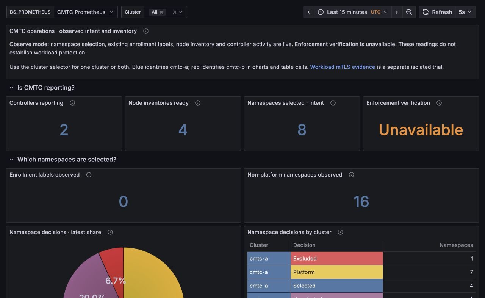

# Local image rebuild and ClusterMesh update

On October 24, 2026, the MacBook Podman builder rebuilt Linux ARM64 images and
updated the existing `cmtc-a` and `cmtc-b` clusters in Colima `cmtc-cilium`.
Cilium and CMTC are running the rebuilt images. The new ztunnel image is
imported and was executed on every node using version-only Jobs; active
ztunnel interception remains blocked by Cilium's ClusterMesh compatibility
check. This is an Observe/reachability qualification, not cross-cluster mTLS.

| Component | Source | Local image | Runtime state |
| --- | --- | --- | --- |
| Cilium agent | `a23b8479cae4052eff591484e58e3d9b7adc44f8` | `localhost/cilium:xds-a23b8479ca` | Four ready agents; embedded version and binary hash verified |
| CMTC | `85d0cd8acc27c957c592011c7b5940ad1d2f8447` | `localhost/cmtc:observe-85d0cd8acc` | Two controllers and four node agents ready |
| ztunnel | `8106c026621a6bbf51fbd9190585e6d3549aa527` | `localhost/cmtc-ztunnel:strict-8106c02662` | Imported and version-tested on all four nodes; no active proxy DaemonSet |

[Verified runtime identities](docs/evidence/local-image-update/verified-runtime.json)
record all image configuration IDs, imported manifest digests, live container
IDs and source labels. All 12 node/component image identities matched Podman.
Each running Cilium agent matched SHA-256
`1152bef474c16acc343c90dc0dc683cc4f6e7e4689c5d8737235c74682b99778`.

## Build and import procedure

Use the explicit Podman connection `cmtc-ubuntu-build`; do not change the
existing kind provider. The exact executed commands are retained in
[the evidence directory](docs/evidence/local-image-update/).

1. Run affected local tests, privileged cases, race detection, vet and lint.
   Commit the Cilium source before assigning its image source pin. For CMTC,
   verify image inputs match HEAD and export only those committed inputs into
   the shared `/private/tmp` build directory. The builder VM cannot assume the
   MacBook repository's `/Users` path is mounted.
2. [Build ztunnel](docs/evidence/local-image-update/build-ztunnel.sh) using Rust
   1.90 and the current upstream Dockerfile. Mount the worktree and common Git
   metadata at their actual absolute paths. Use a temporary writable Git index
   inside the disposable builder so source metadata is verified without
   modifying the read-only common Git directory. Rebuild the package to refresh
   embedded revision metadata. Require the runtime binary to report the full
   expected revision and `BuildStatus:"Clean"`. Pass `TARGETARCH=arm64` explicitly.
3. [Build Cilium](docs/evidence/local-image-update/build-cilium.sh) using Go
   1.27.1. This local image overlays only `cilium-agent` on the existing
   digest-pinned fork runtime. The candidate has no BPF/supporting-loader
   changes versus that runtime's source. Existing BPF, CNI, operator and
   ClusterMesh binaries remain from the base. This is a composite development
   image, not a full-source rebuild or a custom CMTC eBPF build.
4. [Build CMTC](docs/evidence/local-image-update/build-cmtc.sh) from the exported
   code. This run pins the available Go 1.27.1 builder and Debian 13 static
   runtime; the recorded build Dockerfile contains those local overrides.
5. Export each image with `podman save --format docker-archive`. Verify archive
   checksums, then use `kind load image-archive` with
   `DOCKER_HOST=unix://$HOME/.colima/cmtc-cilium/docker.sock` for **both** clusters.
6. [Upgrade Cilium](docs/evidence/local-image-update/update-cilium.sh) through
   the existing Helm releases one cluster at a time, retaining current
   encryption settings. The proxy image override is recorded for later gated
   integration; setting that override does not activate ztunnel.
   [Update CMTC](docs/evidence/local-image-update/update-cmtc-and-stage-proxy.sh)
   controller/node-agent images and wait for each rollout.
7. Run the [runtime verification](docs/evidence/local-image-update/verify-runtime.py)
   and [per-node proxy version Jobs](docs/evidence/local-image-update/check-proxy-on-nodes.py).
   Loading an archive alone does not establish a running workload or protection.

No registry publication, CI dispatch, provider switch or cluster recreation was
performed. Raw build context, archives and diagnostic failures remain in
`/private/tmp/cmtc-rebuild-20261024/`; the bounded evidence copied into this
repository contains no signing keys or kubeconfigs.

## Local results

- Cilium: 149 top-level tests and 150 subtests passed with race detection and
  privileged cases enabled; zero failures/skips. Vet passed; full
  `pkg/ztunnel/...` lint reported zero issues. The membership mutex warning was
  fixed with Cilium's lock type before the final run.
- CMTC: eight top-level tests and 14 subtests passed with race detection, zero
  failures/skips; vet passed.
- ztunnel source: 406 tests passed, zero failed/ignored; formatting and strict
  Clippy passed. The rebuilt image passed seven effective-config/invalid-env
  startup cases, its revision check, and the older binary rejection check.
- All 18 local/cross-cluster Service and remote Pod-IP assertions passed on
  TCP/80, 8080 and 31337, including fresh client creation after the upgrade.
  Existing Observe, exclusion, conflict, namespace recreation, RBAC and shop
  allow/deny assertions passed.
- Eight six-minute Fortio streams returned **28,800 HTTP 200 responses out of
  28,800 requests**: 14,400 cross-cluster (7,200 each direction), plus 14,400
  local shop requests. [Per-stream results](docs/evidence/local-image-update/load-results.json).
- Live queries passed for both clusters together and separately. The namespace
  pie sums to 100%; missing security instrumentation remains unavailable.
  [Query evidence](docs/evidence/local-image-update/dashboard-query-evidence.json).

These source and Observe checks do not close durable restore, authenticated
remote discovery, issuer binding, effective authorization, custom CMTC eBPF or
mTLS-with-WireGuard/IPsec gates. The full implementation mandate has resumed;
its next dependency is durable Required intent plus fail-closed admission and
recovery. Track subsequent candidate changes separately from this deployed pin.

## Screenshots after load

These are current viewport captures; query assertions above cover both complete
consolidated dashboards. Native mTLS signals remain unavailable in this profile.

[Operations light](docs/evidence/local-image-update/grafana/operations-light.jpg),
[Workload Security dark](docs/evidence/local-image-update/grafana/workload-security-dark.jpg),
and [Workload Security light](docs/evidence/local-image-update/grafana/workload-security-light.jpg).
