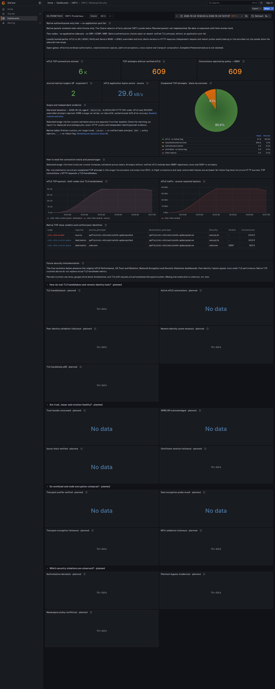

# Local mTLS and startup validation

This is an in-progress CMTC-101/403 qualification on the MacBook's isolated two-node `cmtc-mtls` fixture. CI and publication are deferred. The existing two Observe/ClusterMesh clusters are preserved. These results do not close the full CMTC security implementation or enable the Observe-only API's Strict mode.

## Exact deployed components

| Component | Qualified local source | Runtime |
| --- | --- | --- |
| Node ztunnel | `d79d3dfaef3d7afeb3552ea53cf90213141e95d3`, based on Cilium ztunnel `5bb9cf256b10a209ae9bc0624ddfbf27dbc439de` | `localhost/cmtc-ztunnel:strict-d79d3df-v2`; image config `9339a8f37174055c9b303748fc3bfcba14586997c0d82a49e70cbb9b8bb58946`; Rust 1.90, Linux ARM64 development build |
| Cilium agent | `40d20762d1cb88d9e25ead718d60c0470413fe08` | `localhost/cilium:cni-admission-40d20762d1`; image config `065c004da4fb10818dbb3d04baf1df927cf044cfb0d08bd530e8fa4472e1ae8a`; Go 1.27.1, Linux ARM64 |
| Chart strict command | `66cfc59f3e94dd11264f189fc62c0eaf3e9f7bff`, included in the agent branch | `proxy-mtls` when `encryption.ztunnel.requireMtls=true`; an explicit compatible proxy image is required |
| Proxy test-helper cleanup | `a1c3e9cd8f4b23128d70c434c4d01295fb252f9b` | Source/test-only follow-up; this commit is not the deployed proxy binary |

Both images were built with the MacBook host's Podman CLI against the task-owned Ubuntu connection, exported as archives and loaded into the existing kind runtime. The agent overlays its Go binary onto the qualified fork runtime/BPF base; this is not a fresh BPF build. Image config IDs above are local identities, not registry manifest digests. No AMD64 or release-performance qualification is implied.

Reproducible source patches are retained under [docs/development/patches](docs/development/patches/), with [proxy pins](docs/development/ztunnel-proxy.lock.json). The fork commits remain local while publication is deferred.

## Measured results

The proxy's strict process setting requires a verified inbound TLS identity before dynamic authorization. A workload's missing required policy reference denies access; an authenticated peer still cannot override an explicit DENY. The distinct command prevents an older binary from silently ignoring an unknown security setting.

| Local check | Observed output |
| --- | --- |
| Old pinned proxy with `proxy-mtls` | Exit 1, `unknown command: proxy-mtls` |
| Proxy authentication/RBAC unit tests | Three new authentication cases and three existing RBAC cases passed |
| Rust lint cleanup | Full benches/tests/bins Clippy passes with `-D warnings`, without the earlier category exceptions |
| Affected helper tests | Four CRI tests and eleven SPIRE tests passed |
| Test-selection guard | A nonexistent filter and an incorrect expected count both fail; the actual 4/11 selections pass |
| CLI/configuration matrix | Default and `proxy` remain compatible; environment opt-in works; `proxy-mtls` cannot be downgraded with `REQUIRE_INBOUND_MTLS=false`; invalid values fail before startup |
| Strict proxy with earlier agent `f052d127` | 57 path checks with the native rule and 57 with both nodes' dynamic/static policy caches empty; 2,666 continuous unauthenticated restart probes, zero HTTP responses; original rule restored |
| Earlier agent `63ce823` with strict proxy | 57 present-policy and 57 empty-cache path checks; 2,581 continuous restart probes, zero unexpected HTTP responses; original policy restored |
| Reenrollment agent `5e3a2a46` with strict proxy | 57 present-policy and 57 empty-cache path checks; 2,684 continuous restart probes, zero unexpected HTTP responses; original policy restored |
| CNI admission agent `40d20762d1` with strict proxy | 57 multiport path checks; 1,360 continuous unauthenticated restart probes, zero unexpected HTTP; actual CNI startup and deleted-netns reconnect checks below |
| Fresh cross-node application load on agent `5e3a2a46` | 3,000/3,000 HTTP 200 through Service plus 3,000/3,000 through Pod IP, each over 150.05 seconds; 600 unenrolled attempts rejected without HTTP response |
| Fresh cross-node load on agent `40d20762d1` | 3,000/3,000 HTTP 200 through Service and 3,000/3,000 through Pod IP; 600 unenrolled attempts rejected |
| Grafana | Native queries and the exclusive percentage denominator pass; both themes render; unimplemented planned signals remain explicitly unavailable |

Path checks cover application ports 80, 8080 and 9443, Service port 18080 translated to 8080, same-node and cross-node unenrolled sources, and both node hosts. No CNP, CCNP or Kubernetes NetworkPolicy is used to create these authentication results. The proxy unit cases additionally cover ports 1 and 65535. This is sampled port-independent logic, not an exhaustive network-path proof.

The CLI matrix only establishes parsing and effective configuration. It runs without workload credentials or a reachable CA/xDS dependency; its report explicitly has `deploymentReady=false`. Actual deployment and traffic acceptance come from the separate kind trials.

The original load attempt is retained as a diagnostic: Fortio's `-nocatchup` option skipped eight scheduled Pod-IP requests. All 2,992 issued requests returned HTTP 200, but the exact 3,000-request assertion correctly failed. Removing that option produced the qualified 6,000/6,000 result. An initial SPIRE test filter selected zero tests; it is also retained as invalid verification, followed by the actual eleven-test execution and a guard against recurrence.

## Actual CNI startup admission

The endpoint API now waits for a typed startup gate before returning CNI success. The strict gate reads fresh Namespace and Pod identity, binds the immutable CNI UID to the current node/service account, validates the network namespace, installs capture and requires a fresh proxy ADD ACK. It rechecks identity/intent and the managed endpoint lifetime before admitting startup. A copied proxy application label does not exempt a Pod.

Local qualification of commits `87b29fb8af` and `40d20762d1` passes 139 affected unit/race cases plus 49 actual ZDS socket/network-namespace/iptables cases, with zero failures/skips, Go vet and configured lint. Both kind nodes report the exact image config ID and binary source above. The first test invocation omitted the privileged opt-in and skipped eight cases; it is retained as invalid privileged evidence. Corrected invocations executed every case.

The production CNI trial pauses only the worker ztunnel process for 75 seconds with an independent resume safeguard. The enrolled test Pod uses the adversarial `app=ztunnel-cilium` label. All 61 samples show no application container in Kubernetes or CRI and no startup marker, while a real `FailedCreatePodSandBox` event reports admission failure. After resume, the same Pod UID recovers. Recorded nanosecond timestamps establish:

| Boundary | Epoch nanoseconds |
| --- | --- |
| Fresh enrollment ACK log | 1792849941551272481 |
| Admission completion log | 1792849941554375702 |
| CRI application container creation | 1792849941601738817 |
| CRI application start | 1792849941637512258 |

The first runtime trial passed the startup/recovery behavior but failed evidence parsing because this CRI returns RFC3339 timestamps. Its output remains retained. The corrected complete repeat passes the ordering assertions. This test proves the sampled startup failure/recovery path, not all first-packet paths or platform support.

Strict deleted-endpoint cleanup retires the exact ID/UID/netns cache entry before bounded waiting, retains capture, and checks ownership again after any in-flight ADD. A late ACK uses the real managed owner, so an immutable private metadata view cannot resurrect a deleted sandbox. A newer same-UID sandbox prevents an old DEL from removing its proxy. Tests include actual delayed ACKs, cache ID reuse, NACK/cancellation, removed namespaces and healthy reconnect snapshots.

Actual deletion/reconnect also passes: the deleted UID is absent before and after restarting only the worker proxy; the healthy client snapshot returns, 20 cross-node mTLS requests succeed and 10 plaintext host attempts are rejected. The broader matrix also passes all 57 path checks and 1,360 continuous unauthenticated restart probes (332 during proxy restart, 1,028 during agent restart), with zero unexpected HTTP and no probe errors. Fresh 6,000/6,000 HTTP 200 and 600 rejected attempts also pass. Both Grafana themes render after live query checks; all 16 planned signals remain explicitly unavailable. A duplicate legacy provisioning file had restored stale captions; its removal and the refreshed surviving file correct that drift without restarting monitoring. The original captures and transient provisioning 404 are retained.

Reproduce on the owned fixture using [CNI admission](scripts/lab/mtls/cni_admission.sh) with exact `CMTC_CNI_AGENT_SOURCE` and an absolute `CMTC_CNI_OUTPUT_ROOT`, followed by [deleted workload reconnect](scripts/lab/mtls/cni_postdelete.py). Current raw trial: `/private/tmp/cmtc-ztunnel-build-tools/cni-fixture-20261024135105-983222/`. The source patches are committed locally; publication remains deferred.

## ZDS acknowledgment and lifecycle increment

The new Cilium agent requires an explicit successful ACK, rejects malformed/missing ACKs and unsupported protocol versions, and bounds queue/socket waits. Expired queued updates are discarded. Cancellation during an in-flight operation retires the connection because ZDS V1 has no request nonce. A replacement joins the previous handler before consuming updates. Cache state commits before success publication, and snapshot network waits no longer hold the cache mutex.

Local real-socket race tests cover ACK/NACK, missing ACK, malformed data, timeout/recovery, queue saturation, cancellation, late ACK rejection, next-update reuse, replacement during a stalled ACK and shutdown during hello/snapshot waits. The privileged network namespace, iptables and rolling-update cases pass together with repository lint and Go vet. Structured logs identify actual acknowledged endpoint enrollment and its elapsed duration. An ACK alone does not prove SVID validity, policy convergence or protection.

The reenrollment follow-up reproduces a failed DEL whose capture rules were removed while the observed cache retained the endpoint. The old fast path returned success without restoring capture or sending another ADD. Agent `5e3a2a46` now reasserts capture and waits for a fresh ADD ACK on every enrollment retry. The regression first failed against the old source, then passed with the fix using real network namespaces, iptables and socket ACK/NACK traffic. Full privileged/race, vet and lint checks pass. Cancellation before filesystem access and after capture installation remains bounded; installed capture is retained on enrollment cancellation.

The first empty-cache run on this image passed its traffic checks but failed its recovery observation: DaemonSet readiness preceded the proxy admin listener. Its failed report is retained. The harness now separately bounds admin/policy convergence, records every attempt, and immediately rejects a wrong source or disabled authentication floor. The complete rerun passed with `trialPassed=true` and `restored=true`; one restored node required two observations over 0.56 seconds. The table uses this final run, not the earlier failed recovery report.

Research and complete proposed code are tracked in [issue #11](https://github.com/ephico2real2/clustermesh-trust-controller/issues/11) and [issue #12](https://github.com/ephico2real2/clustermesh-trust-controller/issues/12). The primary agent reviews proposals and tests selected changes locally. One proposed metadata-before-capture ordering was rejected because the current void enrollment callback could allow CNI success without installing a hold; the revised proposal preserves capture before conversion failure.

## Packet and Grafana evidence

Ten canary-bearing application requests succeeded during the earlier VXLAN capture on agent `f052d127` with the same strict proxy `d79d3dfa`. It contains 19,038 packet observations, including 14,538 inner-TCP-port-15008 observations. A TLS-record-header check identified 9,724 application-data, four handshake-record and two change-cipher-spec packet observations. The canary was absent from individual packet bytes. These are packet observations, including duplicates, not TLS handshake totals. The filter does not cover every possible route, and per-packet searching does not replace TCP stream reassembly or a plaintext detection control. This capture is historical; it was not repeated for the reenrollment agent.

The screenshots show the fresh 6,000-request/600-rejection window on agent `40d20762d1`, from `1792850044501` to `1792850227189` epoch milliseconds. Captions explicitly identify the separately published `f052d127` trial as historical. Live query validation estimates 6,056.67 completed mTLS attempts with no failure flag (90.86%) and 608.96 unauthenticated blocked attempts (9.14%); the other three exclusive categories are zero and the partition totals 100%. These counter increases include scrape/window effects and are not exact HTTP totals. Both expected targets are UP; missing telemetry still stays unavailable. Planned panels retain their unavailable state.

The first new capture exposed two provisioned files with the same UID. The legacy `authenticated-only.json` entry could overwrite the corrected `workload-security.json` captions. The owned ConfigMap now has one Workload Security source alongside Operations; the surviving file was refreshed after Grafana briefly removed the duplicated UID. No monitoring restart or telemetry reset was used. Both final themes were visually inspected. The nine original dashboard definitions remain unchanged in the repository.

[Light-theme screenshot](docs/images/persistent-authenticated-only-light.png)

Raw local commands, failed and passing logs, image/source evidence, empty-cache snapshots, traffic output, packet captures, query vectors and screenshots are retained at `/private/tmp/cmtc-ztunnel-build-tools/`. No root private key or workload credential is included in this evidence. Publication remains deferred.

A hashed copy of the selected evidence is committed locally on `ci-captures` at `2ea99a6535532a3635b61d23d50bcbbb2fa07652`, under `/private/tmp/cmtc-mac-captures/2026-10-24-persistent-mtls-zds-validation/`. Its readable README, summary, failed/passing reports, exact patches, scripts and both screenshots remain available without relying on the build cache. This local commit has not been pushed.

## Remaining acceptance

Reenrollment after a failed DEL now requires installed capture and a fresh ACK. Concurrent capture removal and intent transitions still require a generation-aware state machine. The typed new-Pod gate now propagates enrollment failure before application startup in the qualified pause/recovery fixture. Running-pod enrollment, restore, namespace intent generations and pinned namespace ownership still need separate transition gates.

Both runtime tests of a copied proxy app label were denied after enrollment. Source review explains why: the current helper looks up `k8s:app`, while canonical label maps use `app`. Do not activate a label-spoofable exclusion by merely correcting that key. Remove the unnecessary host-network-proxy exemption after qualification, or use authoritative identity if one is required.

Effective workload-bound authorization, namespace/Pod UID freshness, authenticated remote discovery and cluster identity, trust lifecycle, independent WireGuard/IPsec evidence and platform safety remain open. The ClusterMesh compatibility guard and Observe-only API remain in place. Continue through [delivery status](docs/agile/DELIVERY_STATUS.md) and the canonical backlog; this increment is not project completion.
