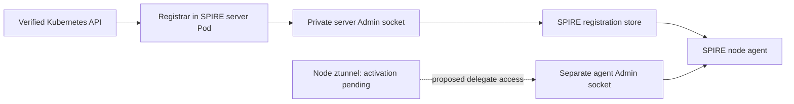

# Local exact SPIRE registrar

<!-- CMTC_DOC_CONTEXT -->
Evidence scope: results apply to the recorded source, image and fixture. Read [current delivery status](docs/agile/DELIVERY_STATUS.md) and [documentation terms](DOCUMENTATION_GUIDE.md).
<!-- /CMTC_DOC_CONTEXT -->

The separate registrar image is a later experimental design choice. The original plan reused Cilium enrollment. Read [the ownership review](SPIRE_REGISTRATION_DESIGN.md) before selecting a production owner.

The registrar manages workload registration inside the SPIRE server Pod. It does not capture or encrypt application traffic. Ztunnel performs workload TLS. Cilium owns the native workload and policy path.

The registrar reads the Kubernetes API over verified HTTPS. An administrator pins the cluster UID, namespace and service-account UIDs, agent and delegate DaemonSet UIDs, and exact daemon images. An enrollment label alone cannot authorize a registration.

Each node alias selects the current SPIRE agent Pod UID and node UID through the native PSAT selectors. Each workload row selects the exact namespace, service account, Pod UID and node name. The delegate row also requires the approved DaemonSet owner and image. A replaced Pod gets a new registration. An excluded namespace gets no workload row.

The **server Admin socket** stays inside the SPIRE server Pod. Cilium and applications do not receive this socket or an administrative SVID. The **agent Admin socket** supports the separately authorized ztunnel delegate on each node. These are distinct sockets and distinct privileges.

The registrar bounds each reconciliation pass to 20 seconds. It retries after 10 seconds. Logs record the component, stage, attempt, elapsed time, next retry, deadline and error. Readiness requires fresh API observations and exact SPIRE readback. Retained rows do not restore readiness after restart.

Rows expire after 90 seconds unless a successful pass renews them. Issued SVIDs have a 120-second requested lifetime. Entry expiry or deletion stops future issuance; it does not revoke an issued certificate or drain an active connection. Native membership freshness, authorization and connection draining remain separate gates.

The SPIRE Entry API does not offer compare-and-delete. Cleanup checks the current row before deletion, then checks its absence. This protects ordinary ownership mistakes. The profile requires one trusted registrar writer and treats SPIRE administrators as trusted. It does not claim atomic protection against another administrator changing that row between these calls.

## Local qualification

Use the MacBook Podman workflow in [PODMAN_LOCAL_VALIDATION.md](docs/development/PODMAN_LOCAL_VALIDATION.md). The source lives in `internal/spireregistrar` and `cmd/cmtc-spire-registrar`.

1. Export the committed Go source into an owned directory under `/private/tmp`.
2. Select the `cmtc-ubuntu-build` Podman connection.
3. Run the registrar race tests in the pinned Linux ARM64 builder.
4. Run the full CMTC race and vet checks.
5. Run the isolated observer and fence kernel profile.
6. Build `build/Containerfile.spire-registrar` for `linux/arm64` with the committed `SOURCE_REVISION`.
7. Run the image with `--version`.
8. Save the image as an archive.
9. Load the archive into both existing kind clusters.
10. Verify the image configuration ID, architecture and running binary revision.

The current local checks pass 15 registrar/command top-level tests and 27 subtests. The actual runner test uses the production ten-second delay and checks retry logs, fresh readback, readiness and shutdown withdrawal. Full CMTC race checks pass 87 top-level tests and 231 subtests before that additional runner case. The isolated kernel profile also passes. No skipped test case is accepted as proof.

The fork's opt-in `encryption.ztunnel.ca.externalExactRegistrar` setting disables its old namespace registrar and management client. Helm rejects that setting unless ztunnel and its SPIRE CA are selected. Positive rendering, three invalid-mode checks, 24 operator top-level race tests, 58 subtests, vet and required lint pass.

The exact registrar image is built and imported on all four nodes. Runtime trials passed initial registration and native SVID fetches. The latest trial failed credential-withdrawal qualification. An explicit empty SVID response must remain distinct from caller permission failure and timeout. The next test needs a still-authorized control workload. See [the current finding](SPIRE_REGISTRATION_DESIGN.md#current-withdrawal-finding).

The automated runner is `scripts/lab/spire/qualify_registrar.py`. It owns fixture setup, assertions, restart, evidence and cleanup. A failed assertion or cleanup returns a nonzero exit code. Do not rerun the old withdrawal assertion as acceptance evidence before the control and corrected diagnostic image are qualified. Do not select the new mode permanently until ownership and recovery gates pass. The ClusterMesh/ztunnel startup guard stays closed. None of these registration results establishes `Protected` or cross-cluster mTLS.
