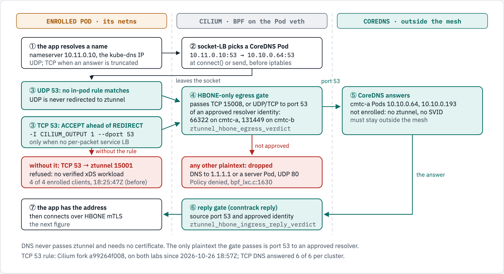
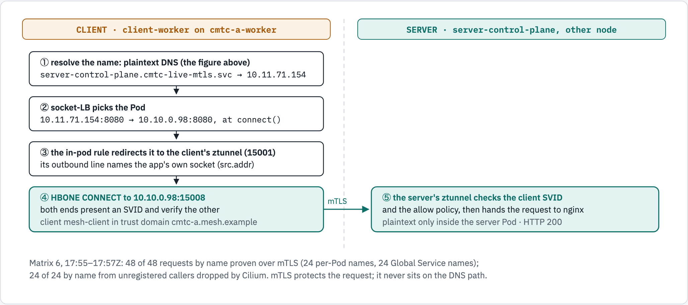

# DNS for enrolled Pods: plain text to CoreDNS, never through ztunnel

Status: current, 2026-10-26. Stories: CMTC-603 (critical platform traffic) and CMTC-404 (Service by name) in
[the backlog](docs/agile/BACKLOG.md).

An enrolled Pod is a Pod whose traffic the mesh requires to be mutual TLS (mTLS): its Cilium endpoint is HBONE-only,
and ztunnel carries its connections. DNS from such a Pod does not use mTLS. The query goes in plain text to CoreDNS,
which stays outside the mesh, and the Cilium agent lets it through only to an approved resolver. mTLS then protects
the connection that the answer leads to. So DNS never waits for a certificate, and a certificate problem never stops
name resolution.

| Path | Implemented | Tested | Deployed | Traffic-qualified |
|---|---|---|---|---|
| DNS over UDP | Cilium fork 8d7b7accfd (BPF gate, approved resolver identities) | Fork unit and BPF tests | Both labs ([pins](docs/agile/DELIVERY_STATUS.md)) | Yes: 6 of 6 names per cluster, before and after the TCP rule |
| DNS over TCP | Cilium fork a99264f008 (in-pod rule ahead of the ztunnel redirect) | 174 Go tests in a privileged container, gofmt and vet clean | Both labs, 2026-10-26 18:48Z (cmtc-a) and 18:57Z (cmtc-b) | Yes: [6 of 6 names per cluster](docs/evidence/image-qualification-20261026/dns/after-tcp-bypass/); 0 of 6 [before](docs/evidence/image-qualification-20261026/dns/before-tcp-bypass/) |
| Requests by name | No change needed | — | Both labs | Yes: 48 of 48 over mTLS in [matrix 6](docs/evidence/image-qualification-20261026/matrix-6-by-name/join.txt) and again in [matrix 7](docs/evidence/image-qualification-20261026/matrix-7-tcp-dns/join.txt), after the TCP rule |

The labs set the approved resolvers in `cilium-config`, not in a Helm values file. A Cilium Helm upgrade removes
that option and the other ztunnel options ([#33](https://github.com/ephico2real2/clustermesh-trust-controller/issues/33)).

## The path of a query

<!-- markdownlint-disable MD033 -->
<picture>
  
</picture>
<!-- markdownlint-enable MD033 -->

*Current on both labs, for UDP and TCP. Before the TCP rule, TCP DNS from enrolled Pods was refused by ztunnel
(4 of 4 clients, [2026-10-26 18:25:47Z](docs/evidence/image-qualification-20261026/dns/tcp-dns-before-fix-20261026T182547Z-ztunnel.txt)).*

```text
enrolled Pod      ① resolve a name: nameserver 10.11.0.10 (kube-dns), UDP; TCP when an answer is truncated
Cilium            ② socket-LB: 10.11.0.10:53 -> one CoreDNS Pod :53, at connect() or send, before iptables
enrolled Pod      ③ UDP 53: no in-pod rule matches, so ztunnel never sees it
                    TCP 53: ACCEPT ahead of the REDIRECT to ztunnel 15001   [without the rule: refused by ztunnel]
Cilium            ④ HBONE-only egress gate: TCP 15008 (HBONE), or UDP/TCP to port 53 of an approved resolver
                    identity (66322 on cmtc-a, 131449 on cmtc-b); anything else: Policy denied, bpf_lxc.c:1630
CoreDNS           ⑤ answers; not enrolled, no ztunnel, no SVID
Cilium            ⑥ reply gate: source port 53 and the approved identity
enrolled Pod      ⑦ has the address, then connects over HBONE mTLS
```

## Why CoreDNS stays outside the mesh

The resolver serves every Pod, enrolled or not. If CoreDNS were enrolled, its ztunnel would accept only HBONE, so an
unenrolled Pod could not resolve any name. The mesh therefore keeps CoreDNS out and approves it by identity instead:

- The Cilium agent option `ztunnel-dns-resolver-labels` names the resolver's labels. On both labs it is
  `k8s:io.kubernetes.pod.namespace=kube-system,k8s:k8s-app=kube-dns,k8s:io.cilium.k8s.policy.serviceaccount=coredns`.
- The agent writes the matching security identities into the BPF map `cilium_ztunnel_dns_resolvers`. A reserved or
  node-local identity is never approved, whatever the map holds.
- With the option empty, no resolver is approved and enrolled Pods have no DNS. That fails closed.

The SPIRE registrar does not take part. It creates SPIRE registration entries, which give a workload a certificate.
DNS needs no certificate; it needs the forwarding path above.

## DNS over TCP

A resolver uses TCP when an answer does not fit in UDP, and some clients use TCP from the start. Without the rule,
the Pod's in-pod `nat CILIUM_OUTPUT` chain redirects every TCP connection to ztunnel on port 15001. ztunnel's strict
outbound mode then refuses a connection to CoreDNS, because CoreDNS has no verified workload:

```text
connection failed src.addr=10.10.1.205:45255 dst.addr=10.10.0.64:53 direction="outbound"
error="connection closed due to policy rejection: protected mesh destination has no verified xDS workload: 10.10.0.64:53"
```

Fork commit a99264f008 adds one rule at the head of that chain, so TCP DNS takes the UDP path:

```text
-A CILIUM_OUTPUT -p tcp -m tcp --dport 53 -j ACCEPT        <- new, first, one copy
-A CILIUM_OUTPUT -p tcp -m mark --mark 0x111/0xfff -j ACCEPT
-A CILIUM_OUTPUT ! -d 127.0.0.1/32 -o lo -j ACCEPT
-A CILIUM_OUTPUT ! -d 127.0.0.1/32 -p tcp -m mark ! --mark 0x539/0xfff -j REDIRECT --to-ports 15001
```

The rule accepts any TCP port 53 in the Pod. The BPF gate then decides: port 53 to an approved resolver passes, and
TCP port 53 to anything else is dropped as plain text.

The agent turns the rule on only when the port the rule sees is the port the gate judges. The gate admits any TCP
15008 as HBONE. If the endpoint program translated Services per packet, a Service on port 53 with a 15008 backend
would pass both in plain text. So the rule is on only when all of these hold:

- at least one approved resolver label;
- socket-LB enabled, and not limited to the host namespace;
- no Envoy configuration (`enable-envoy-config`) and no SCTP.

These are the inputs of `ENABLE_PER_PACKET_LB` in `bpf/bpf_lxc.c`. The agent logs its decision once at start:

```text
"TCP DNS from enrolled Pods" enabled=true reason="approved resolvers and socket-LB in every Pod: the port the rule sees is the port on the wire"
```

Every ztunnel snapshot reinstalls the in-pod rules. The rule stays first and unique:
- a chain that already has the right shape is not touched, so its counters survive;
- any other chain has every copy deleted before one is inserted at the head;
- with the option off, every copy is removed.

## A request by name

<!-- markdownlint-disable MD033 -->
<picture>
  
</picture>
<!-- markdownlint-enable MD033 -->

*Matrix 6, 2026-10-26 17:55–17:57Z: 48 of 48 requests by name proven over mTLS; 24 of 24 by name from unregistered
callers dropped by Cilium.*

```text
client   ① resolve server-control-plane.cmtc-live-mtls.svc -> 10.11.71.154 (plain-text DNS, as above)
client   ② socket-LB: 10.11.71.154:8080 -> 10.10.0.98:8080 at connect()
client   ③ in-pod rule: REDIRECT to the client's ztunnel (15001); ztunnel logs the app's socket as src.addr
client   ④ HBONE CONNECT to 10.10.0.98:15008; both sides present an SVID and verify the other
server   ⑤ the server's ztunnel checks the client SVID and the allow policy, then hands the request to nginx
```

Each per-Pod name is a selector-less ClusterIP Service with one EndpointSlice that names the Pod, so no Pod label
(and no Cilium identity) changes. The join tool proves that the named Pod served each request
(`expectedServer` in [join.json](docs/evidence/image-qualification-20261026/matrix-6-by-name/join.json)).

## What each query meets

| Query from an enrolled Pod | Result | Evidence |
|---|---|---|
| UDP 53 to CoreDNS (through kube-dns) | Answered | 6 of 6 per cluster |
| TCP 53 to CoreDNS | Answered | 6 of 6 per cluster ([after](docs/evidence/image-qualification-20261026/dns/after-tcp-bypass/)) |
| TCP 53 to CoreDNS, without the rule | Refused by ztunnel, no answer | 0 of 6 per cluster, 4 ztunnel refusals ([before](docs/evidence/image-qualification-20261026/dns/before-tcp-bypass/)) |
| UDP 53 to a server Pod or to 1.1.1.1 | Dropped, Policy denied, `bpf_lxc.c:1630` | Before and after |
| TCP 53 to a server Pod or to 1.1.1.1 | Dropped, Policy denied, `bpf_lxc.c:1630` (`tcp SYN`); refused by ztunnel without the rule | After; before |
| TCP to CoreDNS on 8080 or 9153 | Refused by ztunnel (curl 56) | Before and after |
| Plain-text UDP to a server Pod | Dropped, Policy denied | Before and after |

The unenrolled Pods (`cmtc-live-mtls-unauth`) are the control: TCP DNS from them is answered (2 of 2 per cluster,
before and after), so an enrolled failure is the mesh path, not the resolver.

## Check it

From the repository root, against the labs (read-only: execs in the fixture Pods and a drop monitor):

```sh
python3 scripts/evidence/dns_probes.py --cluster cmtc-a --out <dir> positive   # exit 0 only if every name resolves over UDP and TCP
python3 scripts/evidence/dns_probes.py --cluster cmtc-a --out <dir> negative   # exit 0 only if every probe fails
```

The in-pod chain of one enrolled Pod, read from its kind node (the lab nodes run in the `colima-cmtc-cilium` Docker
context):

```sh
cid=$(kubectl --context kind-cmtc-a -n cmtc-live-mtls get pod client-worker \
  -o jsonpath='{.status.containerStatuses[0].containerID}'); cid=${cid#containerd://}
pid=$(docker --context colima-cmtc-cilium exec cmtc-a-worker \
  crictl inspect --output go-template --template '{{.info.pid}}' "$cid")
docker --context colima-cmtc-cilium exec cmtc-a-worker nsenter -t "$pid" -n iptables -t nat -S CILIUM_OUTPUT
```

With the rule on, the TCP 53 rule is first, in one copy; without it, the chain has the last three rules of the listing
above. The agents restarted onto a99264f008 and every existing enrolled Pod had the rule first within the rollout, with
no Pod restart ([cmtc-a](docs/evidence/image-qualification-20261026/dns/after-tcp-bypass/cmtc-a-inpod-chains.txt),
[cmtc-b](docs/evidence/image-qualification-20261026/dns/after-tcp-bypass/cmtc-b-inpod-chains.txt)).

BusyBox `nslookup` does not apply the search list. `nslookup kubernetes.default` returns NXDOMAIN on enrolled and
unenrolled Pods alike, and the full name resolves on both
([evidence](docs/evidence/image-qualification-20261026/dns/nslookup-short-name-20261026T182625Z.txt)). Use full names
in probes.

## Limits and open items

- **A Service on TCP port 53 inside the mesh.** With the rule on, an enrolled caller's TCP 53 skips ztunnel, and the
  gate drops it unless the destination is an approved resolver. Before the rule, such a request went through ztunnel
  over mTLS. UDP to such a service was already dropped. The change fails closed; a mesh service that must answer
  enrolled callers uses a port other than 53.
- **ExternalIP on a resolver address.** Socket-LB does not translate an ExternalIP for a Pod. The destination node
  can translate it after the source gate, so DNS to a resolver address could reach another backend. This applies
  to UDP and TCP DNS. The fix is an admission rule
  ([#32](https://github.com/ephico2real2/clustermesh-trust-controller/issues/32)).
- **Configuration persistence.** The resolver labels and the other ztunnel options are not in Helm values
  ([#33](https://github.com/ephico2real2/clustermesh-trust-controller/issues/33)).
- **Agent restart.** Rolling the agents onto a99264f008 under traffic failed 273 (cmtc-a) and 270 (cmtc-b) allowed
  requests, all inside the restart window, as the previous agent rollout did
  ([rollout records](docs/evidence/image-qualification-20261026/README.md#rollout-steps)). In that window the denied
  caller reached a ztunnel 6 and 4 times, and ztunnel refused it
  ([#31](https://github.com/ephico2real2/clustermesh-trust-controller/issues/31)).

## Diagram sources

The [diagram page](docs/diagrams/dns-enrolled-pods/source.html) uses diagram-kit. Render it:

```sh
~/.local/share/diagram-kit/.venv/bin/diagram-render docs/diagrams/dns-enrolled-pods/source.html docs/diagrams/dns-enrolled-pods dns-path,by-name
```

The pictures, their text versions and the page change together.
