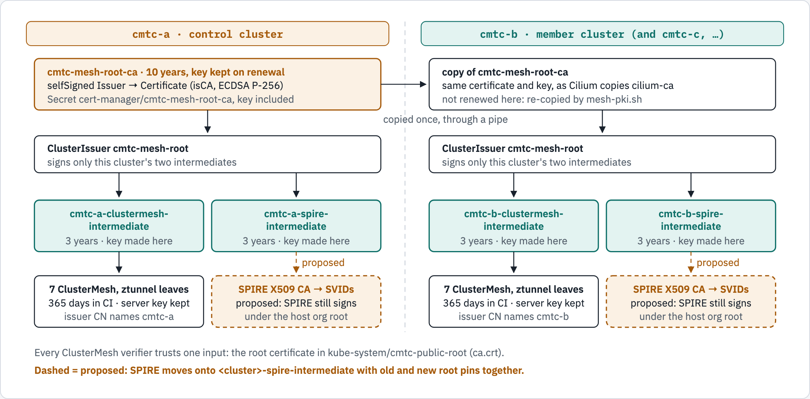
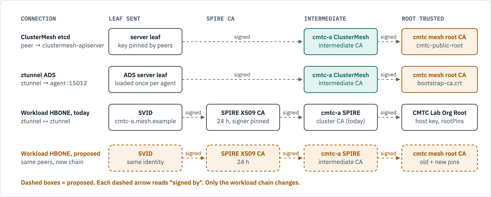

# Mesh PKI: one root, a named intermediate per cluster

Status: current, revised 2026-10-26. Design decision: [ADR-011](docs/architecture/adr/ADR-011.md).

Every cluster of the mesh trusts one root certificate. Each cluster signs its own certificates with its own
intermediates, and every intermediate carries the cluster's name. So any certificate shows which cluster signed it,
and one cluster's CA can be renewed or revoked without touching the others.

| State | ClusterMesh and ztunnel control-plane certificates | SPIRE workload certificates |
|---|---|---|
| Implemented | `config/lab-pki/*.yaml`, `scripts/lab/pki/mesh-pki.sh`, `scripts/lab/up.sh` | Intermediates only (`<cluster>-spire-intermediate`) |
| Tested | Functional test on both labs: refusals, create, rerun, cross-cluster verification, SVID-depth chain ([run 2](docs/evidence/clustermesh-pki-20261026/mesh-pki-test/run-2-cluster-names/result.txt)) | The SVID-depth chain (test B4) verifies against the root |
| Deployed | kind-cmtc-a and kind-cmtc-b, 2026-10-26 12:49-13:51Z ([cutover evidence](docs/evidence/clustermesh-pki-20261026/cutover/)) | Not deployed: SPIRE still signs under `CMTC Lab Organization Root` |
| Traffic-qualified | Matrix after the cutover: 48 requests proven over mTLS, 12 denials as expected | Not yet |

CI (`up.sh`) builds this PKI from the same files. The CI run of this change is still to be checked.

## The chain

The control cluster (cmtc-a in the lab) mints the root with cert-manager. Its Secret, key included, is copied to
every member, as Cilium's Cluster Mesh guide copies `cilium-ca`. Each cluster then signs its own intermediates. The
intermediate keys never leave their cluster.

<!-- markdownlint-disable MD033 -->
<picture>
  
</picture>
<!-- markdownlint-enable MD033 -->

*Deployed on both labs: the root, its copy, both intermediates per cluster, and the 7 leaves on each cluster's
ClusterMesh intermediate. The SPIRE intermediates exist but sign nothing yet.*

```text
cmtc-a (control):  Issuer cmtc-mesh-root-bootstrap (selfSigned)
                     -> Certificate cmtc-mesh-root-ca (10 y)  -> Secret, key included --copied--> every member
every cluster:     ClusterIssuer cmtc-mesh-root (on the root Secret)
                     -> <cluster>-clustermesh-intermediate (3 y) -> 7 ClusterMesh and ztunnel leaves
                     -> <cluster>-spire-intermediate (3 y)       -> SPIRE X509 CA -> SVIDs   [proposed]
trust:             kube-system/cmtc-public-root ca.crt holds the root certificate
```

A leaf's `tls.crt` holds the leaf and its intermediate. The verifier holds only the root. This is the issuer
chaining shown in [Linkerd's cert-manager guide](https://docs.buoyant.io/buoyant-enterprise-linkerd/latest/guides/cert-manager-concepts/).

## Names

Each per-cluster CA has one name. Its Certificate (in `cert-manager`), its Secret, and the ClusterIssuer that signs
with it all use that name.

| Object | Name | Scope |
|---|---|---|
| Root Certificate and Secret | `<prefix>-mesh-root-ca` | Control cluster; Secret copied to members |
| Root signer | Issuer `<prefix>-mesh-root-bootstrap` | Control cluster |
| Issuer on the root | ClusterIssuer `<prefix>-mesh-root` | Every cluster |
| ClusterMesh CA | `<cluster>-clustermesh-intermediate` | One cluster |
| SPIRE CA | `<cluster>-spire-intermediate` | One cluster |

The prefix is `cmtc` in the lab. The cluster names are `cmtc-a`, `cmtc-b`, and for a third cluster `cmtc-c`. The
common names follow the same rule: `cmtc mesh root CA`, `cmtc-a ClusterMesh intermediate CA`,
`cmtc-a SPIRE intermediate CA`.

The live labs also keep the old ClusterIssuer `cmtc-lab-intermediate`. No Certificate refers to it since 13:51Z. It
is deleted once the Helm release values name the new issuer (see [open items](#open-items)).

## Lifetimes

Rule: each CA renews at least one full lifetime of what it signs before it expires. So no certificate outlives the
CA that signed it.

| Certificate | Lifetime | Renewed | Key on renewal | Set in |
|---|---|---|---|---|
| Mesh root | 10 years | 3 years before expiry | kept (`Never`) | `config/lab-pki/root-control.yaml` |
| ClusterMesh and SPIRE intermediates | 3 years | 1 year before expiry | new | `config/lab-pki/clustermesh.yaml`, `spire.yaml` |
| clustermesh-apiserver server | 365 days | cert-manager default | kept (`Never`): peers pin its key | `up.sh` chart values |
| clustermesh-apiserver clients | 365 days | cert-manager default | new | `up.sh` chart values |
| ztunnel ADS, membership writer, origin reader | 24 hours | 1 hour before expiry | new | lab activation script (to move into the chart) |
| SPIRE X509 CA | 24 hours | SPIRE | new | SPIRE `ca_ttl` |
| Workload SVID | 120 s (registrar) | half-life | new | `internal/spireregistrar/plan.go` |

Reference values, read from each project's own source on 2026-10-26:

| Product | Root or trust anchor | Intermediate or issuer | Leaf or workload |
|---|---|---|---|
| Cilium, without ClusterMesh | CA 1095 days | — | ClusterMesh and Hubble 365 days ([values.yaml](https://github.com/cilium/cilium/blob/main/install/kubernetes/cilium/values.yaml)) |
| Istio | self-signed root `87600h` | plug-in CA per cluster | default `24h`, at most `2160h` ([pilot-discovery](https://istio.io/latest/docs/reference/commands/pilot-discovery/)) |
| Linkerd | trust anchor `8760h` | identity issuer `48h` | rotated automatically ([cert-manager guide](https://linkerd.io/2-edge/tasks/automatically-rotating-control-plane-tls-credentials/)) |
| SPIRE | — | `ca_ttl` 24h | X509-SVID 1h, JWT-SVID 5m ([server reference](https://spiffe.io/docs/latest/deploying/spire_server/)) |

The live labs still run the old leaf lifetimes (24 hours) until the Helm release and the activation resources carry
the new values. The CA lifetimes on the live labs are 1 year (the templates before this change); they reach the new
values at the next reissue.

## What each mTLS peer presents

<!-- markdownlint-disable MD033 -->
<picture>
  
</picture>
<!-- markdownlint-enable MD033 -->

*The ClusterMesh rows are deployed. The proposed SVID row is the planned SPIRE move.*

```text
ClusterMesh etcd   server leaf -> cmtc-a ClusterMesh intermediate CA -> cmtc mesh root CA (cmtc-public-root)
ztunnel ADS        ADS leaf    -> cmtc-a ClusterMesh intermediate CA -> cmtc mesh root CA (bootstrap-ca.crt)
workload, today    SVID -> SPIRE X509 CA -> cmtc-a SPIRE cluster CA -> CMTC Lab Organization Root (rootPins)
workload, proposed SVID -> SPIRE X509 CA -> cmtc-a SPIRE intermediate CA -> cmtc mesh root CA (old + new pins)
```

## Troubleshooting

All commands run on Linux and macOS. Use the explicit context of the cluster you inspect.

**Which cluster signed a certificate.**

```sh
kubectl --context kind-cmtc-a -n kube-system get secret clustermesh-apiserver-server-cert \
  -o jsonpath='{.data.tls\.crt}' | base64 -d | openssl x509 -noout -subject -issuer -enddate
# subject=CN=clustermesh-apiserver.kube-system.svc
# issuer=CN=cmtc-a ClusterMesh intermediate CA
```

**What a peer serves on the wire.** From a node of the other cluster, without a client certificate:

```sh
docker exec cmtc-a-control-plane sh -c \
  'echo | openssl s_client -connect cmtc-b-control-plane:32379 -showcerts 2>/dev/null | grep -E "^ *[0-9] s:|i:"'
#  0 s:CN=clustermesh-apiserver.kube-system.svc   i:CN=cmtc-b ClusterMesh intermediate CA
#  1 s:CN=cmtc-b ClusterMesh intermediate CA      i:CN=cmtc mesh root CA
```

**How many certificates each cluster CA issues.**

```sh
kubectl --context kind-cmtc-a get certificates -A -o json | python3 -c '
import json,sys,collections
n=collections.Counter(); c=collections.Counter()
for x in json.load(sys.stdin)["items"]:
    k=x["spec"]["issuerRef"]["name"]; c[k]+=1; n[k]+=x.get("status",{}).get("revision",0)
for k in sorted(c): print(f"{k}: {c[k]} certificates, {n[k]} issuances")'
# cmtc-a-clustermesh-intermediate: 7 certificates, 22 issuances
```

`status.revision` counts every issuance of a Certificate, including issuances before it moved to its current issuer
(22 = 15 under the old chain + 7 after the move). Do not count CertificateRequests: cert-manager keeps one per
Certificate (7 were left for 15 issuances on 2026-10-26), and SPIRE's CA requests leave none.

**Which root a verifier trusts.** Every ClusterMesh verifier and ztunnel reads `kube-system/cmtc-public-root`
`ca.crt`. The [projection check](docs/evidence/clustermesh-pki-20261026/cutover/projections.sh) prints the root
fingerprints in each Pod's projected file, read from the node.

## Build the PKI

CI and a new lab: `scripts/lab/up.sh` runs, after cert-manager is installed in both clusters,

```sh
bash scripts/lab/pki/mesh-pki.sh --root-out "$pki/root.crt" cmtc-a cmtc-b
```

The first cluster is the control cluster. A cluster is `NAME` or `NAME=CONTEXT`; by default its context is
`kind-NAME`. Other names need no file change:

```sh
bash scripts/lab/pki/mesh-pki.sh --prefix acme --root-out root.crt prod-east=eks-east prod-west=eks-west
bash scripts/lab/pki/mesh-pki.sh --render cmtc-c      # print the manifests for one cluster
```

The script is idempotent. Before its first write it refuses a root Secret without its Certificate, and an issuer of
these names that signs from another Secret. It refuses a member that holds a different root. No private key is printed
or written to disk: the root Secret moves between clusters through a pipe.

The Cilium chart then uses `clustermesh.apiserver.tls.auto.certManagerIssuerRef.name=<cluster>-clustermesh-intermediate`
per cluster and puts the root certificate in `tls.caBundle`.

The live labs were moved in place; the procedure as run is in the
[cutover runbook](docs/evidence/clustermesh-pki-20261026/RUNBOOK.md).

## Findings from the cutover

- [A clustermesh-apiserver restart closes same-cluster crossnode admission](docs/evidence/clustermesh-pki-20261026/cutover/07-finding-local-source-watch.md)
  until each Cilium agent restarts (cmtc-a: 10 minutes). The apiserver's etcd is an `emptyDir`, and the agent's
  local source-membership watch resumes at a revision the new etcd has not reached.
- [An origin-reader reissue interrupts cross-cluster traffic](docs/evidence/clustermesh-pki-20261026/cutover/08-finding-origin-reader-renewal.md)
  for 0.4 to 10 seconds (two measurements).

## Open items

1. Persist the Helm values on the live labs (per-cluster issuer name, server key `Never`, 365 days, both roots), with
   the fork chart commit `64a07d46a6`; then delete `cmtc-lab-intermediate`.
2. Remove the disposable root from `cmtc-public-root` before 2026-10-27T19:37Z, with the traffic matrix after.
3. Move the ztunnel ADS, membership-writer and origin-reader Certificates from the lab activation script into the
   chart, with the CA lifetimes above.
4. Move SPIRE onto `<cluster>-spire-intermediate`: `scripts/lab/spire/render_spire.py` issuer per cluster, old and new
   root pins together in `pins.json` and the issuer approval.
5. Decide the SVID TTL (registrar 120 s today; SPIRE default 1 h; Istio 24 h).
6. Fix the local source-membership watch (finding 1).

## Diagram sources

The [diagram page](docs/diagrams/mesh-pki/source.html) uses diagram-kit. Render both themes:

```sh
~/.local/share/diagram-kit/.venv/bin/diagram-render docs/diagrams/mesh-pki/source.html docs/diagrams/mesh-pki chain,peers
```

The pictures, their text versions and the page change together.
