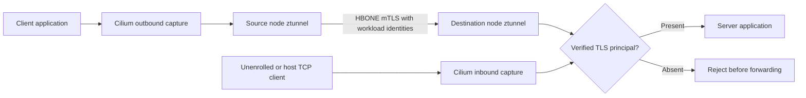
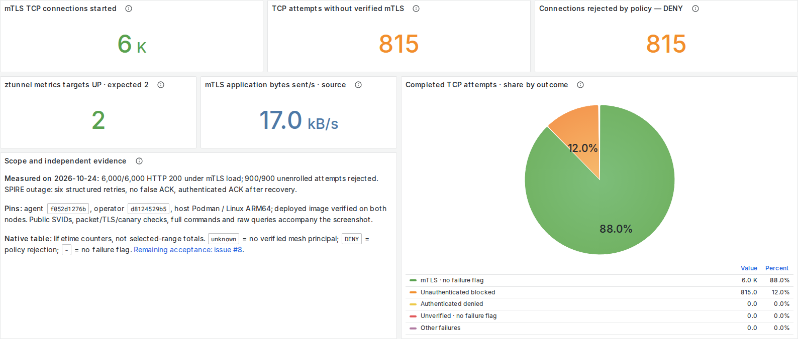

# Workload mTLS guide

Updated October 24, 2026. This guide explains the local authenticated-only
ztunnel trial, its measured results, the Grafana panels and the remaining work.
The [original evidence report][report] preserves every command, exit status,
test result, source/image pin and screenshot.

**Current status:** the two-node development fixture passes the tested
authenticated-only TCP paths. Complete fail-closed protection and cross-cluster
workload mTLS remain unqualified. The public CMTC API remains Observe-only.

The [latest local security validation](LOCAL_SECURITY_VALIDATION.md) records the
persistent proxy authentication floor, empty-policy-cache tests, ZDS ACK and
restart qualification, fresh load/screenshots and exact local image pins. CI and
publication are currently deferred.

## What runs in the fixture

The applications have one container each. Node-level ztunnel performs workload
TLS; there are no per-application sidecars. Cilium captures traffic and publishes
the experimental destination authentication policy. SPIRE issues workload SVIDs
through the cert-manager-backed issuer chain. CMTC's current DaemonSet reports
inventory; it does not itself terminate TLS or prove protection.

The enrolled client runs on `cmtc-mtls-worker`; the server runs on
`cmtc-mtls-control-plane`. Their verified identities are:

| Workload | SPIFFE identity |
| --- | --- |
| Client | `spiffe://cmtc-mtls.test/ns/mtls-spike/sa/client` |
| Server | `spiffe://cmtc-mtls.test/ns/mtls-spike/sa/server` |



The rule `cilium_require_mtls` is a native GLOBAL DENY matching an absent verified
TLS principal, delivered through xDS. It has **no application-port predicate**.
The trial has no CiliumNetworkPolicy, CiliumClusterwideNetworkPolicy or Kubernetes
NetworkPolicy supplying the rejection. The
[actual proxy policy][policy] and [deployed image checks][image] are retained.

Requiring a verified identity does not yet implement the full destination
authorization contract. In particular, this trial does not prove that every
authenticated but unauthorized caller is denied.

## Measured results

These are completed local Linux ARM64 tests using host-Podman-built images and
the existing Ubuntu Colima kind runtime. They are independent of GitHub Actions.

| Check | Observed result |
| --- | --- |
| Steady and post-restart path matrix | **57/57 passed** across three stages: steady, after ztunnel restart and after Cilium restart |
| Authenticated application paths | HTTP 200 through Pod IP and Service on **80, 8080 and 9443**, plus Service **18080 → 8080** |
| Unauthenticated application paths | Unenrolled pods on the same and other node, and both node hosts, received **no HTTP response** on the three application ports |
| Continuous probes during ztunnel restart | **384 attempts**, zero unexpected HTTP responses |
| Continuous probes during Cilium restart | **1,014 attempts**, zero unexpected HTTP responses |
| Five-minute authenticated load | Service **3,000/3,000** plus Pod IP **3,000/3,000 HTTP 200** |
| Unenrolled load | **900/900 attempts rejected**, zero HTTP responses |
| SPIRE outage and recovery | **Six structured retries**, no false authenticated ACK while unavailable, authenticated ACK after recovery |
| Logger validation | Retry stage, attempt, elapsed duration, backoff, deadline and error present; ACK fields checked separately |
| Public workload certificates | Expected client/server SPIFFE SANs and chains verified for client/server TLS use |
| Packet evidence | No HTTP canary in **9,142 captured packets**; **7,380 HBONE packets** and **4,984 TLS application-data record packets** |
| Grafana | **12 populated panels in each theme**, all five outcome labels and the complete caption visible |
| PromQL | Queries succeed without notices; outcome categories equal the denominator and total **100%**; missing telemetry stays unavailable |

Continuous restart probes used port 8080. The complete multiport matrix ran
before and after each restart. These bounded observations do not prove all
first-packet or startup races. TLS record packets can include duplicate capture
observations; they are not TLS handshake counts.

The retry trial uses operator source `d8124529b5`. Its six-retry result is a
separate run from the earlier seven-retry baseline. It validates the initial
operator startup/RPC acknowledgment slice; registration, proxy lifecycle,
issuer-fault and rotation acceptance remain open in [issue #7][retry-issue].

## Read the Grafana panels

Presentation follows the [diagram-kit dashboard skill][dashboard-skill]: inventory
the actual metrics, choose a chart for the question, use fixed outcome colours,
put legends below charts and inspect both light and dark screenshots after load.
The fixture's [metric inventory](examples/observability/ztunnel-spike/METRICS_INVENTORY.md)
records **21 metric names and 51 series**.

| Panel | Meaning |
| --- | --- |
| **TCP attempts without verified mTLS** | Destination-reported TCP opens without a verified mTLS peer, including attempts later rejected |
| **Connections rejected by policy — DENY** | Actual destination-reported failed connections with `response_flags="DENY"`, regardless of authentication state |
| **mTLS TCP connections started** | Destination-reported TCP opens after peer TLS authentication; authorization can still reject an authenticated connection |

The three totals use counter increases over the selected time range, handling
proxy restart resets. Prometheus extrapolates those increases, so they are
estimates. **DENY overlaps the attempt counters. Adding DENY to attempts would
double count rejected connections.** TCP connections are not HTTP requests or
TLS handshakes. The identity table shows lifetime counters at the selected range
end; its source and destination rows describe overlapping connections.

### Outcome percentages

The pie divides **completed, destination-reported TCP attempts in the selected
range** into five mutually exclusive categories. Using destination reports only
avoids counting both ends of a connection.

| Category | Recorded share | Interpretation |
| --- | --- | --- |
| mTLS · no failure flag | **87.97%** | Verified mTLS, with no recorded failure flag; this alone does not prove an HTTP 200 |
| Unauthenticated blocked | **12.03%** | No verified mTLS peer; rejected by policy |
| Authenticated denied | **0%** | Verified mTLS peer, rejected by authorization policy |
| Unverified · no failure flag | **0%** | No verified mTLS peer and no recorded failure flag; investigate any such traffic when strict authentication is intended |
| Other failures | **0%** | Other failure flags, with either authentication state |

These percentages describe the controlled TCP test mix. In-flight connections and
early failures without a completed record are outside this denominator. Missing
telemetry is unavailable, not a healthy-looking zero. With no completed attempts,
there is no meaningful percentage. Zero authenticated denials in this run do not
qualify the unimplemented general authorization tests.

The screenshot uses the recorded load window: **October 23, 2026,
11:45:42–11:50:52 p.m. America/Chicago**, displayed by Grafana as October 24,
04:45:42–04:50:52 UTC. It was captured after load completed; the plotted window
ends five seconds before load completion. This explains why selected-window
counter estimates differ from the complete 6,000/900 HTTP test totals.

<picture>
  <source media="(prefers-color-scheme: dark)" srcset="docs/images/mtls-tcp-outcomes.dark.png">
  <source media="(prefers-color-scheme: light)" srcset="docs/images/mtls-tcp-outcomes.light.png">
  
</picture>

*Measured TCP outcomes after real load. The caption distinguishes attempts,
rejections, HTTP requests and TLS handshakes; complete protection remains open.*

[Full dark dashboard](docs/images/mtls-dashboard.dark.png) ·
[full light dashboard](docs/images/mtls-dashboard.light.png) ·
[open the recorded window locally](http://127.0.0.1:13000/d/cmtc-authenticated-only?from=1792817142251&to=1792817452353).

## Repeat the local checks

Use the matching development checkout and the isolated `cmtc-mtls` fixture.
[SPIRE fixture setup](docs/development/SPIRE_SPIKE.md) covers issuer/bootstrap
requirements and the host-Podman build. The default Observe lab does not enable
this experimental policy. The Cilium flag is `ztunnel-require-mtls`; the chart
setting is `encryption.ztunnel.requireMtls=true`, requiring ztunnel encryption.

After verifying the deployed agent source and enabling the policy in that fixture:

```bash
CILIUM_AGENT_SOURCE=f052d1276b0fb1619809db0059fbbb7898c9cfae
MTLS_KUBECONFIG_PATH="$(cat .tmp/mtls-spike/kubeconfig-path)"
python3 scripts/lab/mtls/qualify.py \
  --kubeconfig "$MTLS_KUBECONFIG_PATH" \
  --source "$CILIUM_AGENT_SOURCE" \
  --out artifacts/mtls-spike/authenticated-only \
  --restart-tests
```

Run this inside the fixture's Linux kind runtime. The runner checks the owned
context, exact agent source, policy flag and absence of confounding network
policies. It retains commands/output and removes its own test resources. Choose
a fresh output directory; existing evidence is not overwritten. The runner
qualifies the path/restart matrix; the separate load, SPIRE outage and packet
drivers used in the recorded run are retained under [reproduction][reproduction].

Validate the dashboard source locally, then validate real queries using the
actual new load window:

```bash
python3 examples/observability/ztunnel-spike/validate.py
python3 examples/observability/ztunnel-spike/validate.py \
  --prometheus http://127.0.0.1:13000/api/datasources/proxy/uid/cmtc-prom \
  --from-ms "$LOAD_FROM_MS" --to-ms "$LOAD_TO_MS" --expect-load \
  --out artifacts/mtls-spike/dashboard-query-evidence.json
```

Generate both authenticated and unenrolled load before using `--expect-load`.
The [dashboard runbook](examples/observability/ztunnel-spike/README.md) covers
scraping, provisioning, both-theme browser walks and missing-telemetry checks.
Save the absolute capture window, source/image proof and raw load results with
every new screenshot. The existing CI unit job runs the offline validator;
the results in this guide were measured locally.

## Source and image record

| Component | Qualified source |
| --- | --- |
| Cilium agent | `f052d1276b0fb1619809db0059fbbb7898c9cfae` |
| Cilium operator | `d8124529b590bfb24adbd3d2916a4a984b666f9e` |
| Qualification runner | CMTC `4f94290a898c30ad964c3053e45f4676d154691e` |
| Cilium ztunnel | v1.0.0, `5bb9cf256b10a209ae9bc0624ddfbf27dbc439de` |
| SPIRE / cert-manager | 1.15.5 / 1.21.1 |
| Presentation | Grafana 12.2.0; diagram-kit `26b7c19791159929c76a264ea3d5274bef72e9f6` |

The agent image config is
`sha256:0f3a6f60cbb61700e0760536bf7fe0cbe5678a26c2f0e968505ec962a519d8dc`.
The fresh Go agent binary was overlaid on the qualified fork's unchanged
`42f89f83` runtime/BPF image. Exact node image content and binary version were
verified on both nodes. This trial does not qualify AMD64 or publish a new GHCR
development bundle. Public certificate chains are retained; private keys and
kubeconfig credentials are excluded, and the external bootstrap root key was
removed.

## Evidence index

The [immutable evidence bundle][report] retains the historical timestamped run.
This root-level guide and the readable screenshot filenames provide its stable
entry point.

| Evidence | Where to inspect it |
| --- | --- |
| Human-readable path results | [check.txt][checks] |
| Full command/exit/output trace | [commands.ndjson][commands] |
| Matrix and continuous restart observations | [results.json][results] |
| Successful HTTP load | [load summary][load] |
| Rejected unenrolled load | [negative results][negative] and [probe output][negative-log] |
| Actual retry and acknowledgment | [runtime summary][retry] and [structured field validation][logging] |
| Effective policy / deployed image | [native policy][policy] and [image verification][image] |
| Identity and encrypted packet proof | [runtime public certificates][runtime], [TLS record summary][tls] and [PCAP][pcap] |
| Screenshot/query checks | [browser verdicts][browser], [layout bounds][layout], [query vectors][queries] and [capture window][window] |
| Reproducibility | [executed helpers and source patch][reproduction], [local tests/build logs][local-tests] and [SHA-256 checksums][checksums] |

## Remaining work

`fullFailClosedProtection` remains **false**. The next acceptance gates are:

- Persistent admission while policy is missing, including the proxy's known
  default-allow behavior, fresh first-packet capture, reconnect/NACK and revocation.
- General authenticated destination permissions and preservation of finer
  Cilium pod-label restrictions.
- Required Kubernetes/OpenShift platform traffic and health-probe handling.
- Workload/issuer identity isolation, certificate rotation and issuer-fault tests.
- Authenticated remote discovery and ClusterMesh workload mTLS.
- Independent WireGuard and IPsec composition, packet and MTU qualification.

[Issue #8][enforcement-issue] tracks enforcement acceptance;
[issue #7][retry-issue] tracks retry/ACK/logging lifecycle acceptance.
[EP10, issue #9][envoy-issue] evaluates the user's per-node Envoy alternative.
Envoy has not been selected or deployed by this trial. Strict/Protected and the
ClusterMesh compatibility guard remain unchanged until their gates pass.

[report]: https://github.com/ephico2real2/clustermesh-trust-controller/blob/1c192a5ee84fb5218cb1385fdd9c5bf45ca69e1a/2026-10-24T0509Z-local-authenticated-only-f052d127/README.md
[checks]: https://github.com/ephico2real2/clustermesh-trust-controller/blob/1c192a5ee84fb5218cb1385fdd9c5bf45ca69e1a/2026-10-24T0509Z-local-authenticated-only-f052d127/check.txt
[commands]: https://github.com/ephico2real2/clustermesh-trust-controller/blob/1c192a5ee84fb5218cb1385fdd9c5bf45ca69e1a/2026-10-24T0509Z-local-authenticated-only-f052d127/runtime/commands.ndjson
[results]: https://github.com/ephico2real2/clustermesh-trust-controller/blob/1c192a5ee84fb5218cb1385fdd9c5bf45ca69e1a/2026-10-24T0509Z-local-authenticated-only-f052d127/runtime/results.json
[load]: https://github.com/ephico2real2/clustermesh-trust-controller/blob/1c192a5ee84fb5218cb1385fdd9c5bf45ca69e1a/2026-10-24T0509Z-local-authenticated-only-f052d127/runtime/authenticated-load-summary.json
[negative]: https://github.com/ephico2real2/clustermesh-trust-controller/blob/1c192a5ee84fb5218cb1385fdd9c5bf45ca69e1a/2026-10-24T0509Z-local-authenticated-only-f052d127/runtime/negative-load-results.json
[negative-log]: https://github.com/ephico2real2/clustermesh-trust-controller/blob/1c192a5ee84fb5218cb1385fdd9c5bf45ca69e1a/2026-10-24T0509Z-local-authenticated-only-f052d127/runtime/negative-load.log
[retry]: https://github.com/ephico2real2/clustermesh-trust-controller/blob/1c192a5ee84fb5218cb1385fdd9c5bf45ca69e1a/2026-10-24T0509Z-local-authenticated-only-f052d127/runtime/spire-retry-runtime-summary.json
[logging]: https://github.com/ephico2real2/clustermesh-trust-controller/blob/1c192a5ee84fb5218cb1385fdd9c5bf45ca69e1a/2026-10-24T0509Z-local-authenticated-only-f052d127/runtime/structured-log-validation.json
[policy]: https://github.com/ephico2real2/clustermesh-trust-controller/blob/1c192a5ee84fb5218cb1385fdd9c5bf45ca69e1a/2026-10-24T0509Z-local-authenticated-only-f052d127/runtime/cmtc-mtls-control-plane-native-policies.json
[image]: https://github.com/ephico2real2/clustermesh-trust-controller/blob/1c192a5ee84fb5218cb1385fdd9c5bf45ca69e1a/2026-10-24T0509Z-local-authenticated-only-f052d127/runtime/deployed-image-verification.json
[runtime]: https://github.com/ephico2real2/clustermesh-trust-controller/tree/1c192a5ee84fb5218cb1385fdd9c5bf45ca69e1a/2026-10-24T0509Z-local-authenticated-only-f052d127/runtime
[tls]: https://github.com/ephico2real2/clustermesh-trust-controller/blob/1c192a5ee84fb5218cb1385fdd9c5bf45ca69e1a/2026-10-24T0509Z-local-authenticated-only-f052d127/runtime/tls-record-summary.json
[pcap]: https://github.com/ephico2real2/clustermesh-trust-controller/blob/1c192a5ee84fb5218cb1385fdd9c5bf45ca69e1a/2026-10-24T0509Z-local-authenticated-only-f052d127/runtime/authenticated-capture.pcap
[browser]: https://github.com/ephico2real2/clustermesh-trust-controller/blob/1c192a5ee84fb5218cb1385fdd9c5bf45ca69e1a/2026-10-24T0509Z-local-authenticated-only-f052d127/runtime/screenshots/walk-results.json
[layout]: https://github.com/ephico2real2/clustermesh-trust-controller/blob/1c192a5ee84fb5218cb1385fdd9c5bf45ca69e1a/2026-10-24T0509Z-local-authenticated-only-f052d127/runtime/screenshots/layout-checks.json
[queries]: https://github.com/ephico2real2/clustermesh-trust-controller/blob/1c192a5ee84fb5218cb1385fdd9c5bf45ca69e1a/2026-10-24T0509Z-local-authenticated-only-f052d127/runtime/dashboard-query-evidence.json
[window]: https://github.com/ephico2real2/clustermesh-trust-controller/blob/1c192a5ee84fb5218cb1385fdd9c5bf45ca69e1a/2026-10-24T0509Z-local-authenticated-only-f052d127/runtime/capture-time-window.json
[reproduction]: https://github.com/ephico2real2/clustermesh-trust-controller/tree/1c192a5ee84fb5218cb1385fdd9c5bf45ca69e1a/2026-10-24T0509Z-local-authenticated-only-f052d127/reproduction
[local-tests]: https://github.com/ephico2real2/clustermesh-trust-controller/tree/1c192a5ee84fb5218cb1385fdd9c5bf45ca69e1a/2026-10-24T0509Z-local-authenticated-only-f052d127/local-validation
[checksums]: https://github.com/ephico2real2/clustermesh-trust-controller/blob/1c192a5ee84fb5218cb1385fdd9c5bf45ca69e1a/2026-10-24T0509Z-local-authenticated-only-f052d127/SHA256SUMS
[dashboard-skill]: https://github.com/ephico2real2/diagram-kit/blob/26b7c19791159929c76a264ea3d5274bef72e9f6/skill/dashboard/SKILL.md
[retry-issue]: https://github.com/ephico2real2/clustermesh-trust-controller/issues/7
[enforcement-issue]: https://github.com/ephico2real2/clustermesh-trust-controller/issues/8
[envoy-issue]: https://github.com/ephico2real2/clustermesh-trust-controller/issues/9
