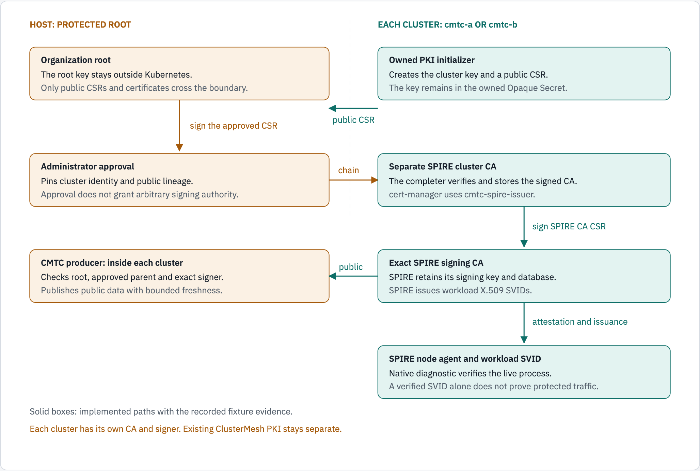
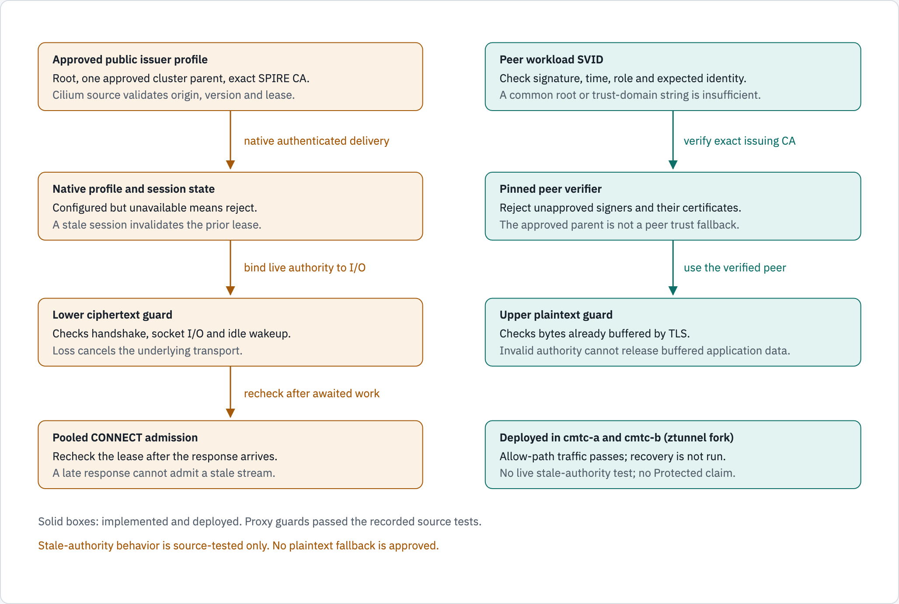

# PKI trust and workload verification flow

Status: current, revised 2026-10-25.

The intended certificate chain has four levels:

**Organization root → cluster intermediate → exact SPIRE signing CA → workload SVID.**

The first verifier supported a direct-root SPIRE signer. That model did not match the cert-manager fixture. The corrected producer accepts one explicitly approved cluster intermediate. It still pins the exact SPIRE signing CA.

Direct-root tests remain valid for that topology. They do not qualify the parented topology. [The parented qualification](LOCAL_ISSUER_PROFILE.md#approved-cluster-intermediate-support-historical-source-f5fe9992da) records its separate rejection and recovery results.

## Current implementation

| Part | Qualified scope |
| --- | --- |
| PKI helper | Completed separate SPIRE cluster CAs in both existing clusters. The exact helper image was verified on all four nodes. |
| cert-manager | Both `cmtc-spire-issuer` ClusterIssuers became Ready. Existing ClusterMesh PKI was preserved. |
| SPIRE | Retained the approved signing keys and PVCs through real restart tests. |
| CMTC producer | Publishes the real approved SPIRE signer mappings in both clusters. |
| Native credential diagnostic | Obtained and verified workload SVIDs through the native process-attestation path. |
| Cilium and ztunnel forks | Passed source-level profile, TLS and stale-flow regression tests. Deployed in both clusters; ztunnel verifies each peer against the exact approved signer of its trust domain. |

Since 2026-10-25 ztunnel runs in `cmtc-a` and `cmtc-b` with per-cluster trust domains (`cmtc-a.mesh.example`, `cmtc-b.mesh.example`). Allow-path traffic passes in both directions; see the [test matrix](docs/architecture/SECURITY_AND_FAILURE_TEST_MATRIX.md). A public profile, valid SVID or successful image version Job does not establish `Protected`.

## Issuance and approval

<!-- markdownlint-disable MD033 -->
<picture>
  
</picture>
<!-- markdownlint-enable MD033 -->

*Issuance and public-profile publication have recorded local evidence. Each cluster retains its own keys. Traffic results are a separate record.*

```text
Host organization root key
  signs public CSR from each cluster
    -> separate SPIRE cluster CA in that cluster
      -> cert-manager signs SPIRE CA CSR
        -> exact SPIRE signer issues workload SVIDs
CMTC producer in each cluster
  validates public root + approved cluster parent + exact SPIRE signer
    -> publishes bounded public issuer profile
```

The initializer creates the cluster key inside an owned Opaque Secret. It returns only the public CSR. The root key remains outside Kubernetes.

The host signs the approved CSR. An immutable approval records the public chain and exact cluster binding. The completer verifies that approval and adds the certificate to the existing Secret. It preserves the Secret UID and private key.

The existing ClusterMesh issuer cannot support the extra CA level. Its issuer and Secret remain intact. SPIRE uses the separate `cmtc-spire-cluster-ca` Secret and `cmtc-spire-issuer` ClusterIssuer.

SPIRE generates and retains its own signing key. Cert-manager signs its CA certificate through the approved cluster intermediate. SPIRE then issues workload SVIDs after registration and attestation.

The experimental registrar controls registration entries. It does not sign certificates or carry application traffic. [Its ownership review](SPIRE_REGISTRATION_DESIGN.md) distinguishes this experiment from the original Cilium enrollment plan.

## What the verifier accepts

The corrected model validates the approved chain. It does not trust every signer beneath the shared root.

| Check | Required result |
| --- | --- |
| Root | Matches the independently approved root fingerprint. |
| Cluster intermediate | Exactly one approved parent, with valid root signature, CA usage, validity and sufficient path depth. |
| Cluster binding | Matches the approved cluster and trust-domain mapping. A parent cannot be reused across an unauthorized cluster mapping. |
| SPIRE signer | Matches the exact approved signing authority. An alternate signer beneath the same root is rejected. |
| Workload certificate | Has the expected SPIFFE identity, valid signature, validity window and TLS role. |
| Publication | Has accepted origin, version floors and current lease. A content hash alone is not an authority signature. |

The producer rejects missing, extra, cyclic or substituted parents. Parent expiry bounds publication freshness. A trust-domain string alone cannot prove the source cluster.

The peer verifier pins the approved SPIRE signer. The organization root and cluster intermediate are not fallback peer-signing authorities.

## Stale-connection checks

<!-- markdownlint-disable MD033 -->
<picture>
  
</picture>
<!-- markdownlint-enable MD033 -->

*The proxy checks have local source-test evidence and run in the deployed ztunnel. Stale-authority behavior has no live test yet.*

```text
Approved profile + current native session -> live authority lease
Peer SVID -> exact signer and identity verification
Lower guard -> handshake, ciphertext I/O and idle cancellation
Upper guard -> TLS plaintext already buffered in memory
Pooled CONNECT -> recheck after awaited response, before stream admission
Stale authority -> reject or cancel; never treat unavailable as approval
```

Local tests reproduced two bypasses before the fix:

- TLS could release plaintext already buffered before authority became stale.
- A pooled CONNECT response could arrive after authority became stale and still admit a stream.

The corrected source guards both ciphertext and application plaintext. It also rechecks authority after awaited CONNECT work. Loss of the configured provider cannot select the legacy path as a fallback.

The [live-provider evidence](docs/evidence/native-issuer-profile/live-provider/summary.json) records the failing regressions and corrected tests. Later [source-binding tests](docs/evidence/native-issuer-profile/source-binding/summary.json) add kernel-peer, verified-identity and native-workload checks. These are source results; they do not qualify the stale-authority behavior of the deployed image.

Registration withdrawal, credential availability and active-flow revocation remain distinct. Removing an entry does not revoke an issued SVID. A timeout does not prove a policy denial.

## Build and deployment records

Use [the local image build guide](LOCAL_IMAGE_BUILD.md) for the command sequence and component recipes.

The corrected PKI helper is a CMTC image with initializer and completer commands. It is not the SPIRE server image or the registrar image.

The [real-cluster PKI ledger](docs/evidence/spire-ca-initializer/real-clusters/summary.json) records the helper image and completed Jobs. The [approved-lineage build command](docs/evidence/approved-issuer-lineage/build-command.json) records the later producer image build. The [SPIRE build script](docs/evidence/spire-recovery/build-server.sh) records the separate server build.

## Evidence and open gates

Read [local PKI preparation](LOCAL_SPIRE_PKI.md), [issuer-profile qualification](LOCAL_ISSUER_PROFILE.md), and [native credentials](LOCAL_NATIVE_CREDENTIALS.md) for measured results.

Exact-image deployment, authenticated remote membership and effective policy are in place, and the allow paths pass. Still open: live negative identity tests (wrong issuer, wrong domain, cross-cluster issuance), stale-authority and recovery traffic, rotation, and per-connection peer-certificate evidence. WireGuard and IPsec composition require separate tests.

Use [delivery status](docs/agile/DELIVERY_STATUS.md) for current source and image pins. Our Cilium fork replaces the upstream ClusterMesh/ztunnel rejection with a capability check that requires issuer-profile pins among other owners; the security gates above stay open.

## Diagram sources

The [diagram page](docs/diagrams/pki-trust-flow/source.html) uses diagram-kit. Render both themes:

```sh
~/.local/share/diagram-kit/.venv/bin/diagram-render \
  docs/diagrams/pki-trust-flow/source.html \
  docs/diagrams/pki-trust-flow issuance,verification
```

Documentation displays the light-theme figures. The dark-theme figures remain validation assets. Update the page, images and text twins together. Inspect all four images after rendering.
