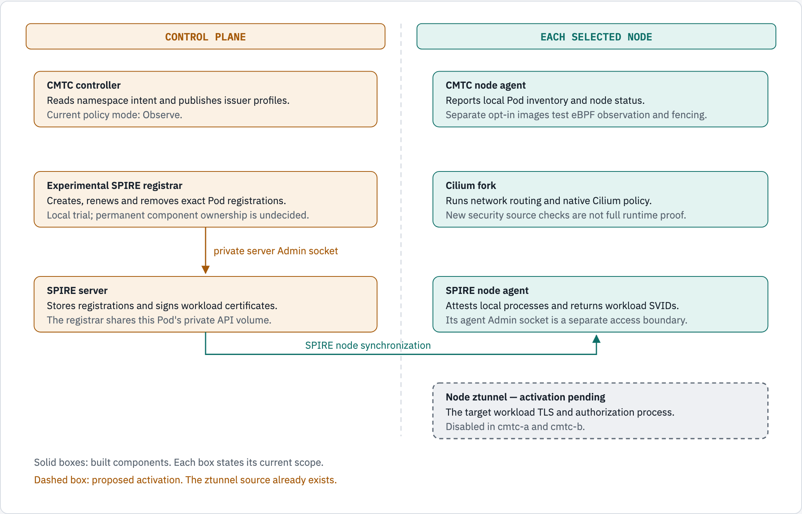

# ClusterMesh Trust Controller

CMTC is an experimental trust controller for Cilium ClusterMesh. **End-to-end cross-cluster workload mTLS is not ready.**

The local labs are `cmtc-a` and `cmtc-b`. ClusterMesh and KVStoreMesh run in both labs. Applications communicate in both directions. Ztunnel remains disabled. WireGuard/IPsec composition is still unqualified.

## Current state

| Part | What works | What remains open |
| --- | --- | --- |
| CMTC controller and node agents | Observe policy, Pod inventory and public issuer-profile publication | Complete enforcement and recovery |
| CMTC eBPF prototypes | Local observer and deny-fence qualification | Mandatory capture and production integration |
| SPIRE server and node agents | Retained signers, secure node attestation and native workload SVID delivery | Complete trust rotation and production proxy access |
| Cilium fork | Routing; source-qualified membership, source-IP receipts and native policy-drain guards | Exact-image activation, policy-map reachability and restore quarantine |
| Ztunnel fork | Local TLS, identity and flow-drain tests | Combined ClusterMesh runtime qualification |
| Experimental SPIRE registrar | Local exact registration and SVID trials | Correct withdrawal evidence and a component-ownership decision |

The [delivery status](docs/agile/DELIVERY_STATUS.md) owns current source pins, deployed images, test results and blockers. A source test does not prove that its image runs in the lab.

## Component roles

CMTC manages trust intent and observation. Cilium owns routing and native policy. SPIRE attests workloads and issues SVIDs. Ztunnel performs workload TLS.

The registrar is a separate Go helper in this repository. It runs inside the SPIRE server Pod. It is **not** the CMTC node DaemonSet. The original plan reused Cilium's enrollment logic. The separate registrar is an experimental design change. See the [registration decision](SPIRE_REGISTRATION_DESIGN.md).

<!-- markdownlint-disable MD033 -->
<picture>
  
</picture>
<!-- markdownlint-enable MD033 -->

*The registrar handles identity registration. It does not carry application traffic. Dashed means activation is still proposed.*

```text
Control plane: CMTC controller; experimental registrar; SPIRE server.
Each node: CMTC node agent; Cilium agent; SPIRE agent.
The registrar uses the private server Admin socket.
Ztunnel activation is pending in both ClusterMesh labs.
```

## Read the guides

| Task | Guide |
| --- | --- |
| Continue implementation | [Handover](docs/handover/CODEX_START_HERE.md) |
| Understand the design | [Target architecture](docs/architecture/END_TO_END_DESIGN.md) |
| Check the work plan | [Backlog](docs/agile/BACKLOG.md) and [security test matrix](docs/architecture/SECURITY_AND_FAILURE_TEST_MATRIX.md) |
| Understand PKI and stale-flow checks | [PKI trust flow](PKI_TRUST_FLOW.md) |
| Build each image | [Local image build](LOCAL_IMAGE_BUILD.md) |
| Build and test locally | [Podman workflow](docs/development/PODMAN_LOCAL_VALIDATION.md) |
| Understand node images | [DaemonSet implementation](CMTC_DAEMONSET_IMPLEMENTATION.md) |
| Check native credentials | [Credential evidence](LOCAL_NATIVE_CREDENTIALS.md) |
| Compare registration workflows | [Existing and enhanced flow](SPIRE_REGISTRATION_WORKFLOW.md) |
| Check registration | [Registrar guide](LOCAL_SPIRE_REGISTRAR.md) |
| Check the actual source-IP program | [Kernel validation](LOCAL_SOURCE_IP_VALIDATION.md) |
| Check native policy transitions | [Policy transition guide](LOCAL_NATIVE_POLICY_TRANSITIONS.md) |
| Read Grafana correctly | [Dashboard guide](DASHBOARD_GUIDE.md) |
| Find all documentation | [Documentation guide](DOCUMENTATION_GUIDE.md) |

## Delivery rules

1. Run affected tests locally.
2. Run the required lint and vet checks.
3. Build the exact Linux ARM64 image with host Podman.
4. Load its archive into the existing kind labs.
5. Verify the running image and binary source.
6. Run positive, negative and recovery checks.
7. Collect load, packet, identity and dashboard evidence where applicable.
8. Commit the qualified increment.

CI, branch pushes and registry publication are deferred. Keep platform traffic safe. Keep private keys out of logs and evidence. Preserve the existing labs and applications.

`NamespaceMTLSPolicy` currently supports `Observe`. Target manifests and proposed CRDs do not enable Strict enforcement. A label, SVID or ACK cannot establish `Protected`.

## Diagram sources

The [diagram source](docs/diagrams/component-roles/source.html) uses diagram-kit. Render both themes with `diagram-render`. Update the source, images and text twin together. The [documentation guide](DOCUMENTATION_GUIDE.md) gives the command.
