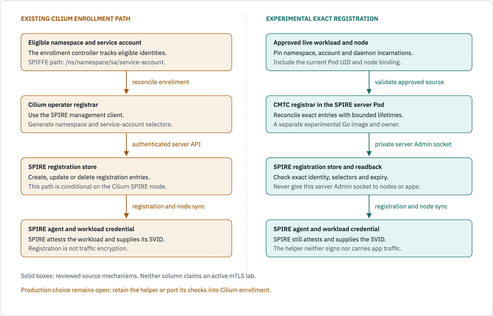
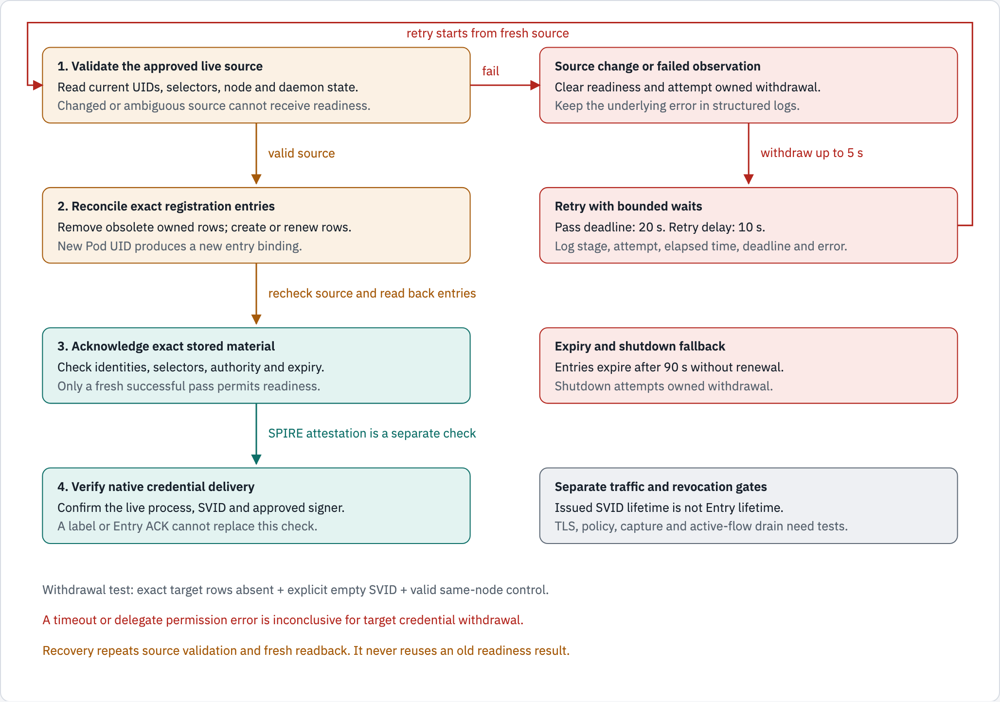

# SPIRE registration workflow

Status: source explanation and an active local experiment, 2026-10-25.
The production registration owner remains undecided.
The original baseline reuses Cilium's SPIRE enrollment.
The separate CMTC registrar is a later experiment, not an approved permanent replacement.
See [the design decision record](SPIRE_REGISTRATION_DESIGN.md) for ownership alternatives and acceptance gates.

A registration entry defines which attested workload can receive an identity.
An SVID is the credential issued for that identity.
SPIRE still attests workloads and signs SVIDs in both workflows.

## Existing Cilium workflow

This description uses the enhanced Cilium fork at `8bb97137fcc92b935171d60e59d7fb8a93714bd8`.
It describes source behavior when ztunnel uses SPIRE and legacy enrollment is enabled.
The retained two-cluster lab has ztunnel disabled.

1. The namespace reflector observes `io.cilium/mtls-enabled: "true"`.
2. The namespace table records its name and UID as an enrolled namespace.
3. The operator waits for the namespace and service-account tables to initialize.
4. Its SPIRE client obtains an operator SVID from the agent Workload API.
5. The client connects to the SPIRE server with mTLS.
6. It requires an authenticated `CountEntries` response before releasing the initialization gate.
7. The reconciler registers each service account in the enrolled namespace.
8. Service-account changes update or remove the corresponding registration.
9. Namespace removal from enrollment requests deletion for its service accounts.

The generated identity is `/ns/<namespace>/sa/<service-account>` in the configured trust domain.
Its parent is `/ztunnel`.
The registration selectors are `k8s:ns:<namespace>` and `k8s:sa:<service-account>`.
Pods that match those selectors can use that namespace/service-account identity under the configured parent.
The namespace UID exists in Cilium's table; it is not a selector in these generated entries.
The generated entries do not add Pod UID, node name, or bounded entry expiry.

This fork already has retry and acknowledgment controls.
Startup uses a three-minute overall limit and jittered backoff from 100 milliseconds to 10 seconds.
Definitive authentication, permission, and configuration errors stop startup.
Service-account failures requeue namespace reconciliation.
These controls do not establish exact workload registration or traffic protection.

Source: [namespace derivation](docs/evidence/spire-registration-workflow/source/pkg/ztunnel/table/enrolled_namespaces.go.txt), [reconciler](docs/evidence/spire-registration-workflow/source/operator/pkg/ztunnel/reconciler/reconciler.go.txt), [entry generation](docs/evidence/spire-registration-workflow/source/operator/pkg/ztunnel/config/config.go.txt), [SPIRE client](docs/evidence/spire-registration-workflow/source/operator/pkg/ztunnel/spire/client.go.txt), and [startup controls](docs/evidence/spire-registration-workflow/source/operator/pkg/ztunnel/spire/startup.go.txt).

## Why test an exact workflow

The existing workflow expresses entitlement at namespace and service-account scope.
The experiment asks a narrower question: does this approved, current Pod incarnation remain entitled on this node?
It also checks the namespace, service account, node, SPIRE agent, and delegate incarnations.
An incarnation is one object instance, identified by its UID.
A replacement object can reuse a name while receiving a different UID.

The workload SPIFFE identity still names the namespace and service account.
The experiment changes registration eligibility and lifecycle; it does not give each Pod a new identity path.



*Existing Cilium source and the experimental exact workflow have different registration scope. The experiment is not production-qualified.*

```text
Existing Cilium source:
  Enrolled namespace -> service accounts -> SPIRE registration
  Identity: trust-domain + namespace + service account
  Selectors: namespace + service account
  SPIRE attests the requesting workload and issues its SVID.

Experimental exact workflow:
  Explicit approval + current API objects -> exact registration plan
  Identity: trust-domain + namespace + service account (unchanged shape)
  Leaf selectors: namespace + service account + Pod UID + node name
  Parent alias: cluster + node UID + current SPIRE agent Pod UID
  Namespace/SA/DaemonSet UIDs and pinned images are checked by the helper.
  SPIRE still attests the workload and issues its SVID.
```

## Controls compared

| Control | Existing Cilium source | Experimental exact helper |
| --- | --- | --- |
| Registration scope | Namespace and service-account names. | Approved incarnations plus exact Pod and node binding. |
| Startup acknowledgment | Authenticated `CountEntries` response before client initialization. | Verified API reads, private server socket checks, and exact entry readback before readiness. |
| Retry | Bounded jittered startup retry; service-account failures requeue namespace reconciliation. | A 20-second pass followed by a 10-second delay; failure clears readiness and attempts withdrawal. |
| Entry lifetime | Generated entries do not set a bounded expiry. | Entries expire after 90 seconds unless renewed. The requested SVID lifetime is 120 seconds. |
| Success meaning | Enrollment operations and authenticated server availability. | Exact registration material was read back. Credential and traffic gates remain separate. |

## Experimental registration checks

The [registrar command](cmd/cmtc-spire-registrar/main.go) loads independently pinned approval bytes.
It uses verified Kubernetes HTTPS and the SPIRE server's private Admin socket.
The [source collector](internal/spireregistrar/source.go) joins current API objects.
The [planner](internal/spireregistrar/plan.go) builds deterministic entry IDs and selectors.

| Check | Purpose |
| --- | --- |
| Cluster UID | Bind the installation to the approved cluster incarnation. |
| Namespace and service-account UIDs | Reject a same-name replacement that lacks approval. |
| Agent and delegate DaemonSet UIDs | Bind the expected controller owners. |
| Container name and image digest | Reject an unapproved agent or delegate image. |
| Current agent Pod and node UID | Bind the node alias to the current agent incarnation. |
| Target Pod UID and node name | Select the intended workload on the intended node. |
| Source resource versions | Reject a snapshot that changes during registration. |

The alias uses SPIRE PSAT selectors for the cluster, agent namespace, agent service account, agent Pod, and node.
Its identity contains the node UID and agent Pod UID.
The leaf registration selects namespace, service account, Pod UID, and node name.
Namespace and service-account UIDs are helper approval checks, not extra SPIRE workload selectors.
The alias supplies the node UID binding that the leaf's node-name selector cannot supply alone.

The [entry reconciler](internal/spireregistrar/entries.go) creates or renews only its owned registrations.
It compares returned material and performs exact readback.
Conflicting identity, selectors, or authority fields cause failure.
The helper renews expiry without converting a conflicting row into an entitled workload.

## Registration lifecycle



*The implemented lifecycle is under local qualification. Readiness acknowledges registration readback; it does not acknowledge protected traffic.*

```text
Load pinned approval -> collect current API objects -> plan exact entries
  -> remove obsolete owned entries, children first
  -> recheck API snapshot -> write/renew -> exact readback -> recheck snapshot
  -> publish registration readiness only after a successful pass

Every pass: 20-second deadline; next pass after a 10-second delay
Failure: clear readiness -> attempt owned withdrawal for up to 5 seconds
Shutdown: clear readiness -> attempt owned withdrawal for up to 5 seconds
If removal fails: entries retain their bounded 90-second expiry
Requested X.509 SVID lifetime: 120 seconds (separate from entry expiry)
Recovery: use a fresh complete pass and a fresh attested credential request
```

The [runner](internal/spireregistrar/runner.go) requires a readback acknowledgment no older than 20 seconds.
Logs identify the stage, attempt, elapsed time, retry delay, deadline, and public error.
A failed or canceled reconcile uses a new bounded context for best-effort withdrawal.
A successful retry must produce new readback evidence.
An old acknowledgment cannot keep readiness true indefinitely.

Entry removal first changes server registration state.
An agent may still hold cached state during propagation.
The [owned fixture](scripts/lab/spire/qualify_registrar.py) therefore keeps a separate enrolled control namespace.
It requires one target and one control workload on each node.
It expects eight exact rows initially and six after target withdrawal.
A valid control credential must bracket the target's explicit empty or unusable SVID response.
The same live probe and node must serve both checks.
A deadline, `Unavailable`, or delegate `PermissionDenied` does not pass target withdrawal.
The withdrawal observation includes commands and sleeps inside one bounded phase.
Reenrollment and same-name Pod replacement require fresh credential evidence.

## Authority stays separate

| Component | Responsibility |
| --- | --- |
| CMTC intent controller | Select eligible namespaces and retain exclusions and platform safety. |
| Registration owner | Translate approved eligibility into SPIRE entries. Production ownership still needs a decision. |
| SPIRE server | Authorize registration RPCs and issue SVIDs through its signing hierarchy. |
| SPIRE agent | Attest the node and target process, authorize the delegate, and serve credentials. |
| Cilium node agent | Own capture, endpoint lifecycle, native policy, and workload delivery. |
| Ztunnel | Use validated credentials for workload TLS and effective policy when that runtime is enabled and qualified. |

The experimental registrar runs as UID1000 inside the SPIRE server Pod.
Its private server Admin socket remains inside that Pod.
The helper adds no server Admin mount to a node proxy or application.
The node agent Admin socket is a different endpoint for delegated credential requests.
The production proxy's group-access migration remains a separate approval and qualification gate.
The current diagnostic uses the qualified UID1000/GID0 profile.

The fork's [external registrar switch](docs/evidence/spire-registration-workflow/source/operator/pkg/ztunnel/config/config.go.txt) disables legacy SPIRE enrollment when selected.
That switch does not prove replacement readiness.
Keep one authoritative writer and prevent obsolete broad entries from remaining as alternate entitlement.
The production choice must compare enhancing Cilium's native registrar with retaining this helper.
Implementation alone does not approve the second option.

## Current evidence and open work

| Item | Snapshot |
| --- | --- |
| Registrar source | `e39928bc4f79ad6da134e77583945c8e5e9d52bf`; source retry/log tests pass 15 top-level tests and 27 subtests. |
| Host helpers | 124 tests pass. These tests do not establish runtime acceptance. |
| Corrected diagnostic source | `75843515d549f7928d080801ac3f7e4344f572eb`; the first SPIRE stream error now ends its request. |
| Diagnostic image | `localhost/cmtc-spire-workload-check@sha256:80096e7eab07cae5df6a093b7fcb4b39ceee47f30467dc3491abc2782380c524` |
| Diagnostic configuration | `4bf82edb89ad5b03a2ff1bebe9c29c4c5881024f447e3d62fcbebf2111948430`; imported and version-checked on all four nodes. |
| Eighth runtime trial | Passed both clusters. Four target-withdrawal checks used valid same-node controls. Reenrollment, Pod replacement, server restart and exact cleanup passed. No cleanup errors. |
| Traffic | Ztunnel remains disabled in the retained two-cluster profile. No workload TLS activation follows from this guide. |

The snapshot guard rejects a changed UID or resource version. Three startup passes rejected changing API observations before a fresh pass became ready. Those failed attempts remain in the logs. The successful retry required fresh readback; it did not accept an old acknowledgment.
[The actual runtime output](docs/evidence/exact-spire-registration/summary.json) and [delivery status](docs/agile/DELIVERY_STATUS.md) retain the source, image and cleanup results.

Registration readback, valid credentials, TLS, effective policy, and encrypted packets remain separate gates.
Removing an entry does not revoke an issued certificate automatically.
It does not close existing TLS, HBONE, or application streams automatically.
The recorded trial qualifies registration withdrawal, reenrollment, replacement, restart and cleanup for its exact images. Certificate revocation, existing-flow drain, mandatory capture and effective traffic policy retain separate acceptance gates.
CI, branch pushes, and image publication remain deferred.

## Diagram sources

The primary owns [the source page](docs/diagrams/spire-registration-workflow/source.html) and the two light PNGs.
This guide references light images only.
The source, PNGs, captions, and text twins must change together.
The no-output diagram-kit checks pass. The primary inspected both light PNGs after export. No dark PNG was generated for this guide.

Run these commands from the repository root:

```sh
~/.local/share/diagram-kit/.venv/bin/diagram-render --check \
  docs/diagrams/spire-registration-workflow/source.html
~/.local/share/diagram-kit/.venv/bin/python scripts/capture/render_light_diagrams.py \
  docs/diagrams/spire-registration-workflow/source.html \
  docs/diagrams/spire-registration-workflow existing-vs-enhanced,lifecycle
```

The validation command writes no PNGs.
The primary's capture utility exports light PNGs only.
Inspect both light PNGs at readable size before accepting the diagram update.
