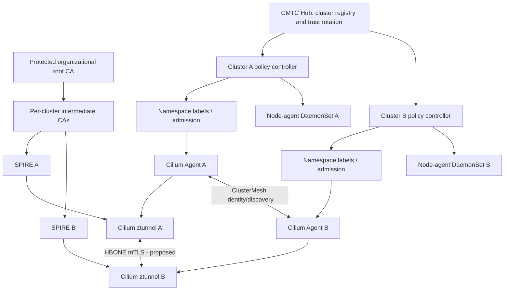

# CMTC Architecture Design v1.1 — Draft

Status: Design proposal; no implementation or upstream Cilium compatibility is implied.

**Historical design input.** Use [END_TO_END_DESIGN.md](END_TO_END_DESIGN.md), the [nine ADR files](adr/ADR-001.md), [canonical backlog](../agile/BACKLOG.md) and [pinned source audit](../research/SOURCE_AUDIT.md) for current work. Story/ADR identifiers in this older draft conflict with the canonical files; its mention of ADR-010 does not create an approved tenth ADR. Native Cilium ztunnel is a Rust dependency; Go applies to CMTC and the Cilium control-plane extensions.

## System boundary
CMTC Hub coordinates trust and policy across registered clusters. Per-cluster controller reconciles namespace policy and native Cilium enrollment labels. Node agent (Go DaemonSet) observes local workload coverage and reports signed/versioned configuration acknowledgments. Cilium agent and ztunnel enforce transport authentication. SPIRE issues X.509-SVIDs using per-cluster intermediate CAs under a common protected root. cert-manager manages intermediate CA lifecycle where SPIRE upstream authority integration is validated; trust-manager publishes public trust bundles.

## Diagram


## CRD schema (illustrative)
```yaml
apiVersion: security.cmtc.io/v1alpha1
kind: NamespaceMTLSPolicy
metadata:
  name: cluster-default
spec:
  enrollment:
    enabled: true
    scope: ApplicationNamespaces
    selectionMode: MatchSelectors # or AllEligible
    autoLabel: true
  inclusions:
    namespaceSelectors:
      - matchLabels:
          company.net/lob: alpha
      - matchLabels:
          company.net/mnemonic: delta
  exclusions:
    namespaces: [legacy-payments]
    namespaceSelectors:
      - matchLabels:
          company.net/mtls-exempt: 'true'
  platformProtection:
    enabled: true
    profile: AutoDetect
  enforcement:
    mode: Strict
    failClosed: true
  reconciliation:
    repairLabelDrift: true
```
The Cilium label `io.cilium/mtls-enabled: "true"` is fixed in code, not user-configurable. Exclusions override inclusions; platform-protected namespaces cannot be opted in through ordinary policy. Excluded-to-protected traffic must not silently downgrade to plaintext. Selector lists use OR across selectors and AND within each Kubernetes LabelSelector.

## Reconciliation algorithm
1. Watch namespace UID, labels, resourceVersion; watch NamespaceMTLSPolicy generation.
2. Classify platform-critical namespace and host-network workload dependencies; platform protection wins.
3. Apply approved exclusions; otherwise enroll if AllEligible or any inclusion selector matches.
4. Apply/remove only CMTC-owned enrollment label via server-side apply/patch with conflict handling and audit event.
5. Watch Cilium effective enrollment and ztunnel identity readiness; label applied != protected.
6. Publish conditions `PolicyEvaluated`, `LabelReconciled`, `IdentityReady`, `EnforcementVerified`, `PlatformCompatible` and reasons. Never mark protected until enforced.
7. Admission and datapath gates must close namespace/pod creation race; controller-only reconciliation cannot guarantee fail-closed.

## Node agent contract
- Deploy one Go agent per eligible node, with bounded cache and least-privilege access.
- Consume versioned desired state from cluster controller; observe local pods and Cilium/ztunnel readiness using supported interfaces.
- Report observed generation, applied bundle digest, pod coverage, config lag, probe results, and node health.
- Do not mint identities, distribute private CA keys, modify eBPF independently, or act as a second TLS proxy.
- Prefer Cilium Hive integration if upstream APIs allow it; separate DaemonSet remains a design decision pending source review.

## Trust rotation state machine
`Pending -> Distributing -> Verifying -> Switching -> Draining -> Completed`; any unsafe condition enters `Blocked`.
- Publish old+new trust anchors first; require acknowledgment of actual consumption by SPIRE/ztunnel, not ConfigMap existence.
- Switch intermediate issuance only after all required clusters pass trust probes.
- Retire old trust after expiry/drain, unless emergency revocation requires immediate removal.
- Central hub failure retains previously validated configuration but must not authorize new unverified identities.

## Encryption and traffic compatibility
| ClusterMesh transport | ztunnel off | ztunnel on (target, requires Cilium changes) |
|---|---|---|
| none | existing networking | HBONE TLS only |
| WireGuard | existing supported configuration | HBONE TLS over WireGuard |
| IPsec | existing supported configuration | HBONE TLS over IPsec |

Cilium's current encryption mode settings and ztunnel/ClusterMesh incompatibility require upstream investigation. Test routing, MTU/MSS, HBONE TCP, UDP/DNS exceptions, policy hook ordering, endpoint discovery races, and hostNetwork traffic. Never equate WireGuard/IPsec node encryption with workload authentication. Default application namespace policy must preserve API/DNS/webhook/bootstrap traffic using narrowly scoped, verified platform compatibility rules.

## Metrics contract (proposed, not shipped)
- Namespace: `cmtc_namespaces_eligible`, `cmtc_namespaces_enrolled`, `cmtc_namespaces_excluded`, `cmtc_namespace_label_drift_total`, `cmtc_namespace_enrollment_duration_seconds`.
- Pod/node: `cmtc_pods_protected`, `cmtc_pods_pending`, `cmtc_node_agent_ready`, `cmtc_node_config_sync_duration_seconds`.
- Trust: `cmtc_trust_bundle_ready`, `cmtc_trust_bundle_sync_duration_seconds`, `cmtc_ca_rotation_phase`, `cmtc_certificate_expiry_timestamp_seconds`.
- ztunnel (requires integration): `cmtc_mtls_handshakes_total{result,reason}`, `cmtc_mtls_handshake_duration_seconds`, `cmtc_mtls_identity_validation_failures_total`, `cmtc_remote_identity_resolution_duration_seconds`.
- Transport: `cmtc_transport_compatibility_ready`, `cmtc_dual_encryption_probe_success`, `cmtc_mtu_validation_failures_total`.
- Platform: `cmtc_apiserver_probe_success`, `cmtc_dns_probe_duration_seconds`, `cmtc_platform_compatibility_failures_total`, `cmtc_rollout_aborted_total`.
Use bounded labels (cluster, component, result, reason), no pod UID or arbitrary mnemonic label on aggregate Prometheus series. Logs/Hubble carry high-cardinality diagnostics. Source ownership and actual instrumentability require review.

## Nine dashboards
01 Security overview; 02 Namespace selection/enrollment; 03 Pod/node enforcement; 04 Cross-cluster mTLS latency; 05 CA trust/rotation; 06 Network encryption; 07 Security violations; 08 Kubernetes/OpenShift platform safety; 09 CMTC controller/DaemonSet health.

## Agile backlog: features -> epics -> stories and subtasks
| Feature / Epic | Story | Subtasks | Acceptance criteria |
|---|---|---|---|
| F01 Policy / E01 Namespace | CMTC-501 Automatic enrollment | Informer; selector; SSA label; drift repair | Existing/new eligible namespaces labeled; idempotent |
| F01 Policy / E02 Exceptions | CMTC-502 Exclusion precedence | Exclusion validation; remove label; audit | Excluded namespace never enrolled by selector |
| F01 Policy / E03 Metadata | CMTC-505 LOB/mnemonic inclusion | LabelSelector OR/AND; dynamic updates | Match and unmatch reconciled without manual edits |
| F02 Node / E01 Coverage | CMTC-503 Enforcement readiness | Node watch; Cilium state; ztunnel health | Protected only when verified; otherwise pending/failed |
| F02 Node / E02 Distribution | CMTC-201 Node agent | DaemonSet; version ACK; health | All scheduled nodes report applied digest |
| F03 Trust / E01 Issuance | CMTC-301 SPIRE upstream CA | cert-manager issuer; intermediate; SVID test | Unique cluster identity chains to approved root |
| F03 Trust / E02 Rotation | CMTC-302 Trust rollover | Dual bundle; ACK; drain; rollback | No unexpected outage in staged rotation test |
| F04 Cilium / E01 Discovery | CMTC-401 Remote identity xDS | Code trace; workload metadata; spoof checks | Remote identity cryptographically bound to cluster |
| F04 Cilium / E02 Datapath | CMTC-402 Fail-closed HBONE | Hook tracing; policy enforcement; bypass tests | Protected flows never downgrade |
| F04 Cilium / E03 Encryption | CMTC-403 Dual encryption | WireGuard/IPsec/no encryption E2E; MTU | All supported combinations pass test matrix |
| F05 Platform / E01 Classification | CMTC-601 Platform guard | K8s/OCP detection; critical namespace inventory | Critical components never auto-enrolled |
| F05 Platform / E02 Dependencies | CMTC-603 Control plane compatibility | API/DNS/webhook probes; rollout gates | No platform degradation across toggles |
| F06 Observability / E01 Schema | CMTC-701 Metrics contract | Names/types/labels; cardinality; ownership | Schema approved with source for every metric |
| F06 Observability / E02 Instrumentation | CMTC-702 Go exporters | Prometheus collectors; ServiceMonitor; tests | Metrics scrape and reset semantics validated |
| F06 Observability / E03 Dashboards | CMTC-703 Grafana suite | 9 dashboards; PromQL; rules; alerts | Import tested; panels show correct data |
| F07 Operations / E01 Rollout | CMTC-801 Progressive rollout | Preflight; canary; abort; recovery | Unsafe change blocked or rolled back safely |

## Definition of Ready
Design ADR, ownership, dependencies, threat model, test environment, acceptance criteria, metric source, and upgrade compatibility documented.

## Definition of Done
Go unit/race tests, Kubernetes envtest, multi-cluster integration tests, negative security tests, control-plane compatibility tests, encryption matrix, metrics and alert validation, docs and runbooks, and peer security review completed. Cilium-dependent stories are not complete until tested against a compatible upstream branch.

## ADRs and open questions
ADR-001 shared root + isolated intermediates; ADR-002 hub/agent topology; ADR-003 encryption composition; ADR-004 namespace policy precedence; ADR-005 node agent vs Hive; ADR-006 pod lifecycle fail-closed; ADR-007 platform safety; ADR-008 metrics cardinality and ownership; ADR-009 SPIFFE identity trust-domain and cluster boundary; ADR-010 service routing and HBONE interception.

Highest-risk open questions: actual Cilium version/ztunnel APIs; SPIRE trust-domain structure and cluster-specific issuance constraints; whether Cilium policy can enforce decrypted HBONE identity; how to prevent first-packet bypass; OpenShift CNI support profile; UDP and non-enrolled platform traffic; trust reload acknowledgments; performance and HA targets.
