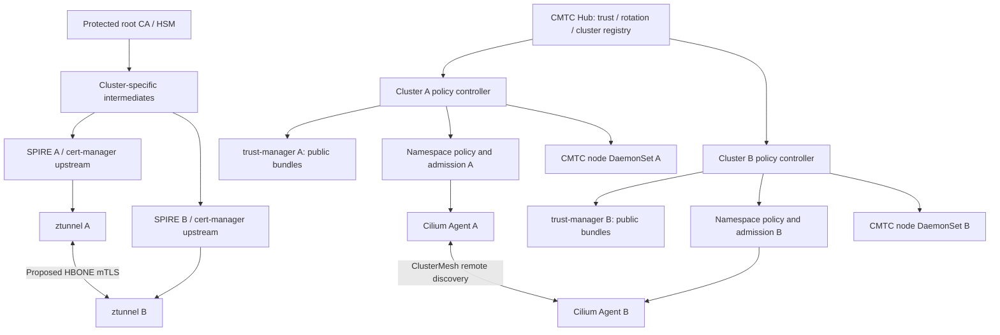
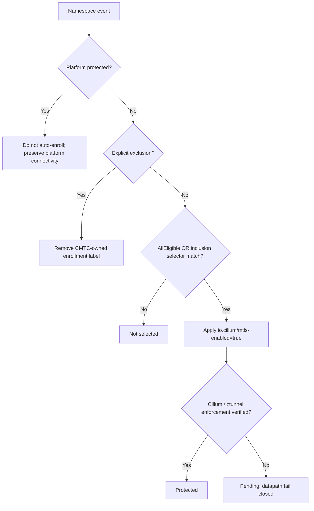
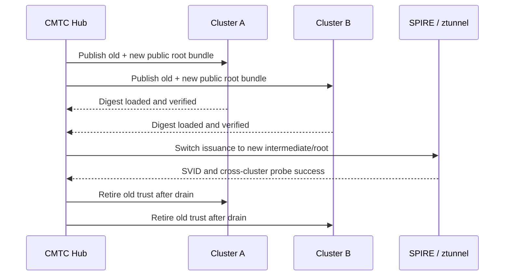
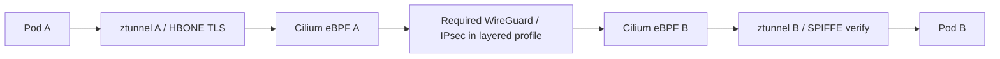

# Consolidated end-to-end CMTC target design

<!-- CMTC_DOC_CONTEXT -->
Design scope: proposed behavior requires the stated acceptance tests. Read [current delivery status](../agile/DELIVERY_STATUS.md) and [documentation terms](../../DOCUMENTATION_GUIDE.md).
<!-- /CMTC_DOC_CONTEXT -->

This page defines the target architecture.
Some prerequisites now have source tests and local runtime evidence.
The complete cross-cluster workload mTLS profile remains unqualified.
The [2026-10-23 source audit](../research/SOURCE_AUDIT.md) is the historical baseline.
Use [delivery status](../agile/DELIVERY_STATUS.md) for current acceptance results.
The ADRs remain proposed unless their own records state otherwise.
Diagram arrows describe required interactions, not verified interfaces.
In A2, the fail-closed datapath is a target requirement.

## Current source and runtime — 2026-10-25

| Component | Current source | Runtime boundary |
| --- | --- | --- |
| Cilium | `8bb97137fcc92b935171d60e59d7fb8a93714bd8` | The retained lab runs `4459d58ed3d98805f15c74298076025fc97dd540`. Later source changes need exact-image qualification. |
| Ztunnel | `75843515d549f7928d080801ac3f7e4344f572eb` | Local qualification passes 568 full-suite tests, 2 diagnostic tests, formatting, and strict Clippy. There is no runtime activation of this candidate. |
| Two-cluster profile | KVStoreMesh stays enabled; the compatibility guard stays closed. | Ztunnel remains disabled. ClusterMesh reachability does not prove workload mTLS. |

CI, branch pushes, and image publication remain deferred.
Continue local acceptance work within the existing owned lab.

## A1: system components

The SPIRE boxes include the server and node agents.
The credential path uses the local agent; it does not give applications server Admin access.

## A2: namespace decision order

- Namespace selector array: OR; within each Kubernetes LabelSelector: AND.
- `AllEligible` enrolls every eligible application namespace; `MatchSelectors` narrows to selected namespaces. Platform protection and exclusions win in either mode.
- Namespace UID is tracked to avoid stale state on delete/recreate; field ownership and drift repair must not fight GitOps.
- Label applied != protection verified. Admission and Cilium datapath gates are required to prevent creation-time plaintext races.
- Excluded -> protected traffic is **not** automatically permitted.

## A3: trust rotation

Rotation phases: `Pending -> Distributing -> Verifying -> Switching -> Draining -> Completed`; unsafe transitions -> `Blocked`. Emergency compromise has separate immediate revocation playbook. Root private key never distributed.

## A4: dual encryption target

Primary target confirmed 2026-10-23: ztunnel supplies workload mTLS and WireGuard or IPsec supplies the node transport layer. A successful end-to-end result must verify both. See the [existing lab review](../research/EXISTING_LAB_REVIEW.md) for the reusable PoC baseline; none/mTLS-off remain explicit control profiles.

**Conceptual only:** actual kernel interception order, identity and network policy preservation, MTU/MSS, service translation, TCP/UDP, strict encryption, overlay/direct-routing must be proven by source investigation and captures.

| Network encryption | mTLS off | mTLS on (target; requires upstream work) |
|---|---|---|
| none | Baseline ClusterMesh control | HBONE-only control; does not satisfy layered profile |
| WireGuard | Existing WG ClusterMesh if supported by pinned version | HBONE over WireGuard |
| IPsec | Existing IPsec ClusterMesh if supported by pinned version | HBONE over IPsec |
| Mixed incompatible modes | Reject/unsupported | Reject/fail closed |

## A5: control-plane safety

- Detect upstream Kubernetes, managed variants, OpenShift and hosted-control-plane variants.
- System, control-plane, infrastructure, static/hostNetwork components are platform-protected and not auto-enrolled.
- Test app-to-API HTTPS, DNS UDP/TCP, admission webhooks, kubelet, ingress, auth, operators, etcd and cluster bootstrap/recovery.
- No blanket security-policy bypass; narrow explicit interoperability contracts for non-enrolled platform endpoints.
- Canary rollout with API/DNS/webhook/ClusterOperator health gates; rollback is not considered complete merely when labels are removed.

## A6: node-agent contract

- One Go DaemonSet per eligible node provides local pod inventory, authenticated policy/bundle generation acknowledgment, Cilium/ztunnel readiness, configuration lag, bounded probes and telemetry.
- Transitional implementation stage: evaluate a separate opt-in CMTC DaemonSet eBPF observer/deny prototype, then port the qualified production gate into the enhanced Cilium agent. Cilium remains the target owner of packet enforcement, service translation and effective policy; the prototype cannot become a permanent parallel datapath.
- The current Observe DaemonSet remains non-root with no host mounts or BPF access. The prototype's exact hook mode, map lifecycle, CNI first-packet handshake, privilege set and rollback must be proven before enabling that profile.
- The node agent does not mint identities, copy root keys or proxy application traffic. Evaluate the Cilium-native migration seam in ADR-005.

## A7: SPIRE registration ownership

The original design reuses Cilium's SPIRE enrollment and ZDS inventory.
The separate CMTC registrar is a later experiment inside the SPIRE server Pod.
It is a separate image and registration writer, not the CMTC node DaemonSet or a traffic proxy.
It has not been approved as the permanent production registration owner.

[SPIRE registration design](../../SPIRE_REGISTRATION_DESIGN.md) compares the helper with enhancing Cilium's native registrar.
It also identifies SPIRE controller-manager as an unverified option for investigation.
A recorded decision and acceptance tests must precede production owner adoption.
Prevent concurrent legacy and replacement writers or alternate broad entitlement.

The experimental server Admin socket remains inside the SPIRE server Pod.
The production proxy's node agent Admin permission migration is separate and still awaits approval.
Entry readback, SVID validation, TLS, effective policy, and encrypted packets are separate evidence.
The source-qualified stream correction makes explicit SPIRE errors terminate a credential request.
Timeout remains inconclusive.
Delegate `PermissionDenied` does not establish target workload withdrawal by itself.
Removing registration does not revoke an existing certificate or drain an established flow automatically.

## A8: observability

Two consolidated Grafana pages present Operations and Workload Security.
They preserve the nine original domains and JSON definitions in `observability/`.
Planned signals remain visible until their owning implementation and tests exist.
A missing exporter or unavailable metric must not appear as a successful zero.

- Distinguish desired enrollment, applied labels, and verified datapath protection.
- Measure selector decisions, exclusions, credential and trust lifecycle, handshakes, remote identity, transport, and platform health.
- Keep attempts, policy rejections, application requests, and TLS handshakes distinct.
- Bound aggregate labels by cluster, component, status, and reason.
- Put Pod and identity details in structured logs, events, and Hubble.
- Validate real queries after load and inspect both dashboard themes.

## Security and release gates

1. No root signing-key distribution.
2. Remote identity bound to expected cluster/namespace/service account; unauthorized identities denied.
3. No plaintext fallback for protected traffic.
4. Existing Cilium network policy not bypassed.
5. No control-plane bootstrapping or recovery regression.
6. Cilium version matrix and failure-mode tests completed before production claim.
