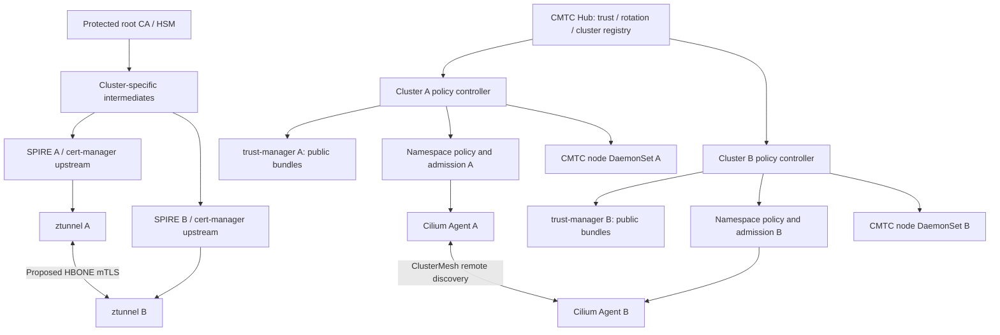
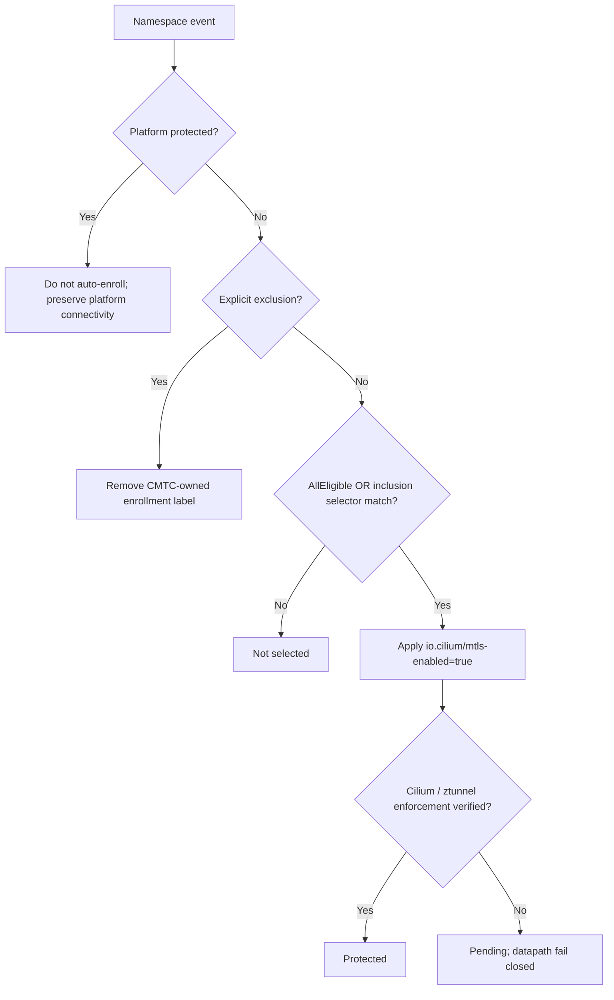
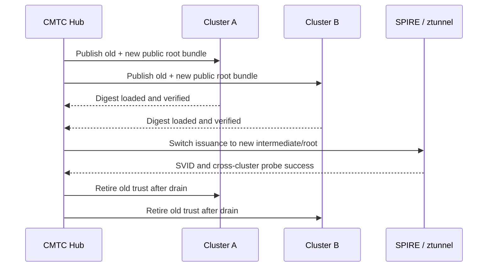

# Consolidated end-to-end CMTC target design

**Target architecture, not an implemented capability.** The [2026-10-23 source audit](../research/SOURCE_AUDIT.md) pins Cilium v1.20.4 and records incompatible ClusterMesh/ztunnel, missing remote discovery/authorization and unproven dual encryption. [Implementation gates](IMPLEMENTATION_PLAN.md) govern progression; all nine ADRs remain Proposed. Solid arrows below describe the desired system, not verified interfaces. In A2, “datapath fail closed” is a required future gate, not a current guarantee.

## A1: system components

## A2: namespace decision order

- Namespace selector array: OR; within each Kubernetes LabelSelector: AND.
- `AllEligible` enrolls every eligible application namespace; `MatchSelectors` narrows to selected namespaces. Platform protection and exclusions win in either mode.
- Namespace UID is tracked to avoid stale state on delete/recreate; field ownership and drift repair must not fight GitOps.
- Label applied != protection verified. Admission and Cilium datapath gates are required to prevent creation-time plaintext races.
- Excluded -> protected traffic is **not** automatically permitted.

## A3: trust rotation

Rotation phases: `Pending -> Distributing -> Verifying -> Switching -> Draining -> Completed`; unsafe transitions -> `Blocked`. Emergency compromise has separate immediate revocation playbook. Root private key never distributed.

## A4: dual encryption target

**Conceptual only:** actual kernel interception order, identity and network policy preservation, MTU/MSS, service translation, TCP/UDP, strict encryption, overlay/direct-routing must be proven by source investigation and captures.

| Network encryption | mTLS off | mTLS on (target; requires upstream work) |
|---|---|---|
| none | Baseline ClusterMesh | HBONE TLS |
| WireGuard | Existing WG ClusterMesh if supported by pinned version | HBONE over WireGuard |
| IPsec | Existing IPsec ClusterMesh if supported by pinned version | HBONE over IPsec |
| Mixed incompatible modes | Reject/unsupported | Reject/fail closed |

## A5: control-plane safety
- Detect upstream Kubernetes, managed variants, OpenShift and hosted-control-plane variants.
- System, control-plane, infrastructure, static/hostNetwork components are platform-protected and not auto-enrolled.
- Test app-to-API HTTPS, DNS UDP/TCP, admission webhooks, kubelet, ingress, auth, operators, etcd and cluster bootstrap/recovery.
- No blanket security-policy bypass; narrow explicit interoperability contracts for non-enrolled platform endpoints.
- Canary rollout with API/DNS/webhook/ClusterOperator health gates; rollback is not considered complete merely when labels are removed.

## A6: node-agent contract
- One lightweight Go DaemonSet per eligible node for local pod inventory, policy/bundle generation acknowledgment, Cilium/ztunnel readiness, configuration lag, bounded probes and telemetry.
- Does not mint identities, copy root keys, rewrite eBPF, or proxy application traffic.
- Evaluate separate DaemonSet vs Hive module vs hybrid in ADR-005.

## A7: observability
- Nine Grafana JSON dashboards and starter Prometheus rules in `observability/`.
- Differentiate desired enrollment, applied label and **verified datapath protection**.
- Metrics for selector matches, exclusions, pod protection, CA propagation/expiry, handshake p95/p99, remote identity lookup, dual-encryption probes, platform dependencies, operator/agent health.
- Aggregate metrics bounded by cluster/component/status/reason; per-pod/identity/LOB drilldowns in structured logs, Kubernetes events and Hubble, not high-cardinality metrics.

## Security and release gates
1. No root signing-key distribution.
2. Remote identity bound to expected cluster/namespace/service account; unauthorized identities denied.
3. No plaintext fallback for protected traffic.
4. Existing Cilium network policy not bypassed.
5. No control-plane bootstrapping or recovery regression.
6. Cilium version matrix and failure-mode tests completed before production claim.
