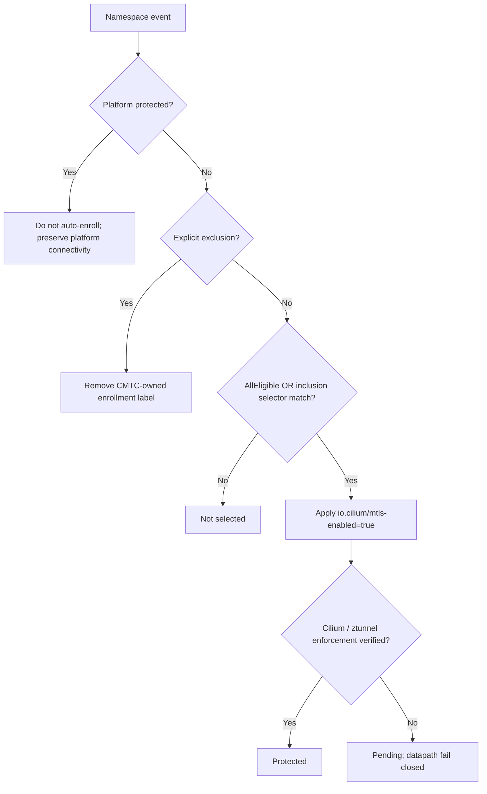
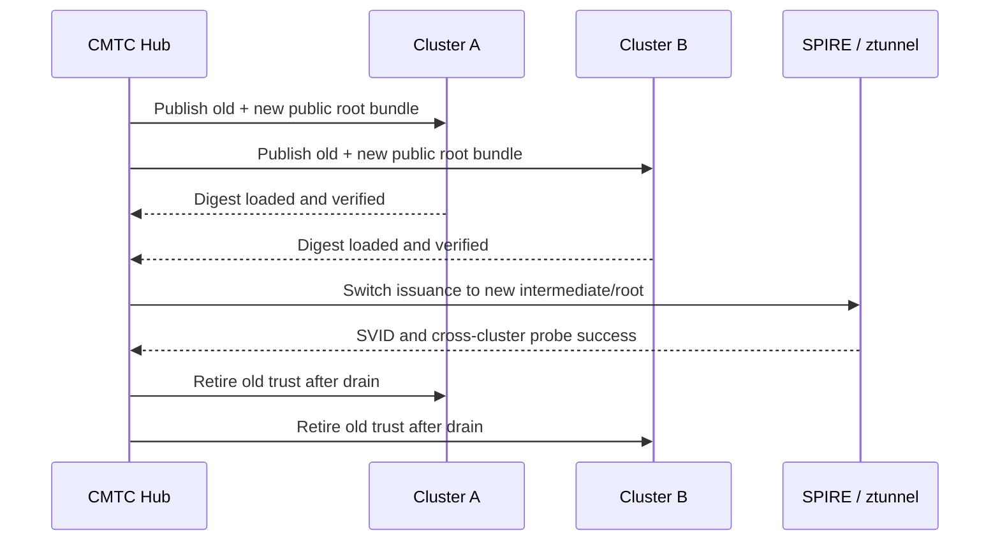
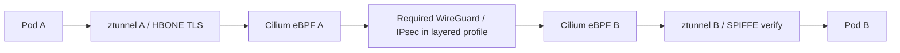

# Consolidated end-to-end CMTC target design

<!-- CMTC_DOC_CONTEXT -->
Design scope: proposed behavior requires the stated acceptance tests. Read [current delivery status](../agile/DELIVERY_STATUS.md) and [documentation terms](../../DOCUMENTATION_GUIDE.md).
<!-- /CMTC_DOC_CONTEXT -->

This page defines the target architecture. Each section marks what is **current** (deployed in `cmtc-a` and
`cmtc-b`), **proposed** or **historical**. The ADRs remain proposed unless their own records state otherwise.
Diagram arrows show required interactions; the current state of each is in the table below.

## Current state — 2026-10-25

| Area | State |
| --- | --- |
| Workload mTLS across ClusterMesh | Deployed: ztunnel runs on all four nodes with strict inbound mTLS, and the Cilium encryption mode is `Ztunnel`. Allow paths pass: same node, cross node, cross cluster by Pod IP and Global Service by ClusterIP, both directions, ports 80, 8080 and 31337. These are traffic outcomes; per-connection peer-certificate evidence is not recorded. |
| ClusterMesh | `1/1 remote clusters ready` on every agent. Agents use CRD identity allocation (KVStore disabled); KVStoreMesh runs in the ClusterMesh API server. |
| ClusterMesh with ztunnel | The upstream blanket rejection is replaced in our Cilium fork by a capability check: strict mTLS, SPIRE CA, effective-policy quarantine, authenticated remote workload membership and issuer-profile pins are all required at startup. |
| Open | DNS from enrolled Pods fails (blocks Global Service by name). Recovery not run on the deployed build. ADR-010 review findings not fixed. WireGuard/IPsec not configured. Denial by policy not traffic-tested. |

No workload is `Protected`. Pins: [delivery status](../agile/DELIVERY_STATUS.md). Traffic record:
[G1 destination sources](../evidence/g1-destination-sources/README.md). Gates:
[security and failure test matrix](SECURITY_AND_FAILURE_TEST_MATRIX.md). The
[2026-10-23 source audit](../research/SOURCE_AUDIT.md) is the historical baseline.

## A1: system components

The SPIRE boxes include the server and node agents.
The credential path uses the local agent; it does not give applications server Admin access.

## A2: namespace decision order

- Namespace selector array: OR; within each Kubernetes LabelSelector: AND.
- `AllEligible` enrolls every eligible application namespace; `MatchSelectors` narrows to selected namespaces. Platform protection and exclusions win in either mode.
- Namespace UID is tracked to avoid stale state on delete/recreate; field ownership and drift repair must not fight GitOps.
- Label applied != protection verified. Admission and Cilium datapath gates are required to prevent creation-time plaintext races.
- Excluded -> protected traffic is **not** automatically permitted.

## A3: trust rotation

Rotation phases: `Pending -> Distributing -> Verifying -> Switching -> Draining -> Completed`; unsafe transitions -> `Blocked`. Emergency compromise has separate immediate revocation playbook. Root private key never distributed.

## A4: dual encryption target

Primary target confirmed 2026-10-23: ztunnel supplies workload mTLS and WireGuard or IPsec supplies the node transport layer. A successful end-to-end result must verify both. **Current:** only the HBONE-only row (network encryption none, mTLS on) runs in the lab. WireGuard and IPsec are not configured, so the layered profile is unqualified. See the [existing lab review](../research/EXISTING_LAB_REVIEW.md) for the reusable PoC baseline; none/mTLS-off remain explicit control profiles.

**Conceptual only:** actual kernel interception order, identity and network policy preservation, MTU/MSS, service translation, TCP/UDP, strict encryption, overlay/direct-routing must be proven by source investigation and captures.

| Network encryption | mTLS off | mTLS on (implemented in our forks) |
|---|---|---|
| none | Baseline ClusterMesh control | HBONE-only control (current lab profile); does not satisfy layered profile |
| WireGuard | Existing WG ClusterMesh if supported by pinned version | HBONE over WireGuard |
| IPsec | Existing IPsec ClusterMesh if supported by pinned version | HBONE over IPsec |
| Mixed incompatible modes | Reject/unsupported | Reject/fail closed |

## A5: control-plane safety

- Detect upstream Kubernetes, managed variants, OpenShift and hosted-control-plane variants.
- System, control-plane, infrastructure, static/hostNetwork components are platform-protected and not auto-enrolled.
- Test app-to-API HTTPS, DNS UDP/TCP, admission webhooks, kubelet, ingress, auth, operators, etcd and cluster bootstrap/recovery.
- No blanket security-policy bypass; narrow explicit interoperability contracts for non-enrolled platform endpoints.
- Canary rollout with API/DNS/webhook/ClusterOperator health gates; rollback is not considered complete merely when labels are removed.

## A6: node-agent contract

- One Go DaemonSet per eligible node provides local pod inventory, authenticated policy/bundle generation acknowledgment, Cilium/ztunnel readiness, configuration lag, bounded probes and telemetry.
- Per-node eBPF measurement plane (operator mandate 2026-10-25, [ADR-005](adr/ADR-005.md)): the CMTC DaemonSet carries permanent, observe-only eBPF programs that measure datapath, enrollment, capture, authorization, TLS shape, withdrawal and recovery on every node. Every program returns the pass verdict; none modifies, redirects or writes state Cilium or ztunnel reads. Cilium owns packet enforcement, service translation, effective policy and the native quarantine gate; ztunnel owns workload TLS and authorization.
- The node agent container stays non-root with no host mounts or BPF access. A separate measurement loader container in the same DaemonSet holds only the BPF capabilities and mounts its hooks need. Discovery of enrolled workloads is node-wide and automatic; a frozen-identity mismatch makes that workload's data unavailable, never misattributed.
- The CMTC fence is a lab qualification tool for deny-path tests; it is not the production gate.
- The node agent does not mint identities, copy root keys or proxy application traffic. ADR-005 keeps porting individual signals into the Cilium agent open as an alternative.
- **Current:** the deployed DaemonSet runs only the unprivileged node agent container. The measurement loader is not built. The single-workload eBPF observer and the fence exist in source (`internal/datapath/`) and are not deployed.

## A7: SPIRE registration ownership

The original design reuses Cilium's SPIRE enrollment and ZDS inventory.
The separate CMTC registrar is a later experiment inside the SPIRE server Pod.
It is a separate image and registration writer, not the CMTC node DaemonSet or a traffic proxy.
It has not been approved as the permanent production registration owner.

[SPIRE registration design](../../SPIRE_REGISTRATION_DESIGN.md) compares the helper with enhancing Cilium's native registrar.
It also identifies SPIRE controller-manager as an unverified option for investigation.
A recorded decision and acceptance tests must precede production owner adoption.
Prevent concurrent legacy and replacement writers or alternate broad entitlement.

**Current (2026-10-25).**

- Cilium's legacy namespace/service-account registration is switched off (`ztunnel-spire-external-exact-registrar=true` in `cilium-config`).
- The experimental registrar helper is not deployed. The SPIRE server Pod runs the server and a container that confirms the SPIRE agent node entry (`register-agent-node`).
- The live fixture's exact workload entries were written by the operational fixture runner with `spire-server entry create`, outside the product.
- Ztunnel requests delegated credentials through a DelegatedIdentity-only agent socket (our SPIRE fork, `0f8fe4d681`), mounted from `/run/cmtc-spire/<cluster>/delegated`. The earlier plan to share the agent Admin socket with the proxy is superseded and was never applied.

A production registration owner is still undecided.
The experimental server Admin socket remains inside the SPIRE server Pod.
Entry readback, SVID validation, TLS, effective policy, and encrypted packets are separate evidence.
The source-qualified stream correction makes explicit SPIRE errors terminate a credential request.
Timeout remains inconclusive.
Delegate `PermissionDenied` does not establish target workload withdrawal by itself.
Removing registration does not revoke an existing certificate or drain an established flow automatically.

## A8: observability

**Current:** two consolidated Grafana pages in `observability/` (v1) present Operations and Workload Security.
They preserve the nine original domains and JSON definitions.
**In progress:** a metrics overhaul in `observability/v2/` (contract, collectors, rules, dashboards). Until it lands, v1 stays current.
Planned signals remain visible until their owning implementation and tests exist.
A missing exporter or unavailable metric must not appear as a successful zero.

- Distinguish desired enrollment, applied labels, and verified datapath protection.
- Measure selector decisions, exclusions, credential and trust lifecycle, handshakes, remote identity, transport, and platform health.
- Keep attempts, policy rejections, application requests, and TLS handshakes distinct.
- Bound aggregate labels by cluster, component, status, and reason.
- Put Pod and identity details in structured logs, events, and Hubble.
- Validate real queries after load and inspect both dashboard themes.

## Security and release gates

1. No root signing-key distribution.
2. Remote identity bound to expected cluster/namespace/service account; unauthorized identities denied.
3. No plaintext fallback for protected traffic.
4. Existing Cilium network policy not bypassed.
5. No control-plane bootstrapping or recovery regression.
6. Cilium version matrix and failure-mode tests completed before production claim.
