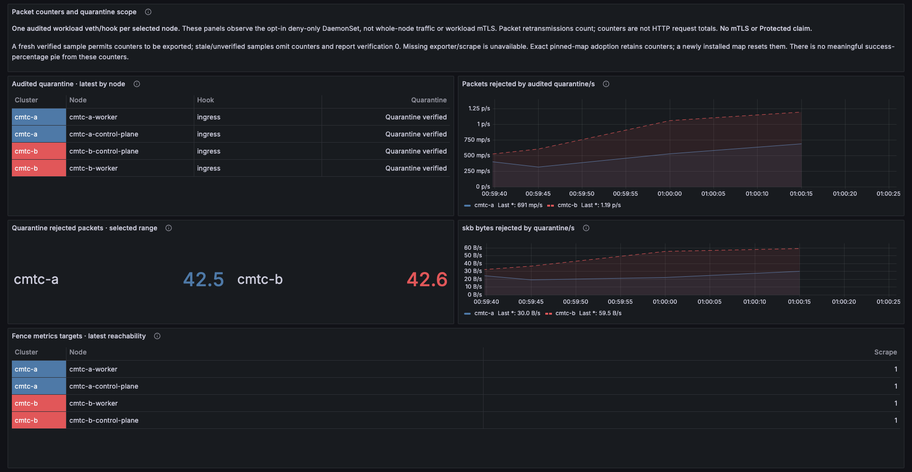
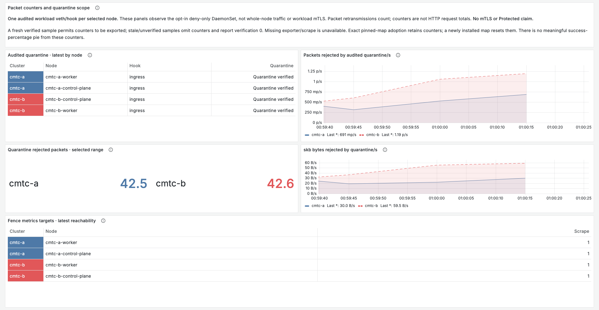

# Exact-image DaemonSet evidence

Runtime source: `5b1bc205fee9c6bc999c7d545e23ac0ff6f29bf2`, Linux ARM64.
The [local guide](../../../LOCAL_DAEMONSET_TELEMETRY.md) explains the build,
archive import, health/scrape surfaces and remaining security gates.

- [Image and packaged-file identities](images.json) and [four-node imports](loaded-images.json).
- [Affected kernel/race/vet tests](kernel-metrics-final.log) and [actual packaged ELF/CLI tests](packaged-kernel.log).
- [Ubuntu capture build](capture-build.log) and [image/source-file ledger](capture-image.json).
- [Passed four-node fence trial](fence/summary.json), [integration ledger](fence/integration.json), [raw commands/logs/source archive](fence/raw-integration.tar.gz).
- [Additional84-attempt worker lifecycle trial](fence-lifecycle/summary.json): corrupted adoption, stale Pod replacement and defunct retirement.
- [Real dashboard queries](fence/telemetry/candidate-dashboard-queries.json) and [browser expectations](fence/screenshots/walk-results.json).

The four-node run has168 audited client attempts:24 baseline successes and144
expected denials. Its48 telemetry-load attempts are included in that count.
Another84 existing-mesh continuity checks are separate. Installed and absent
telemetry, both themes and ownership-checked cleanup pass. This proves the
explicit audited-hook deny fence; it does not prove mTLS, automatic enrollment,
first-packet admission, destination-tail-call coverage or reboot persistence.

Readable captures use the same recorded absolute load window as the full pages.
The current fixture deliberately removes these opt-in exporters after testing;
their absence in a later live range is unavailable telemetry, not a successful
zero. Planned security panels remain visible and unavailable.

