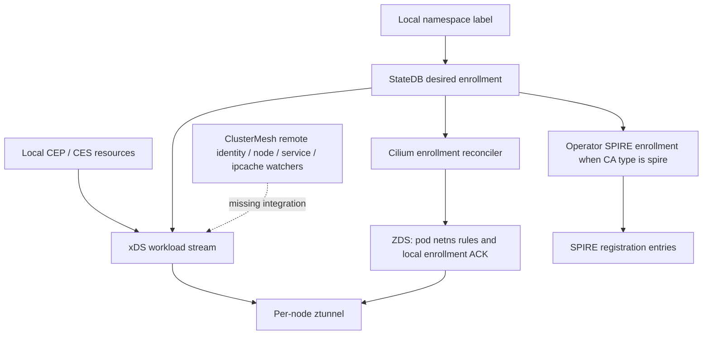

# Pinned source audit — 2026-10-23

<!-- CMTC_DOC_CONTEXT -->
Research scope: findings apply to the source version named in this document. Read [current delivery status](../agile/DELIVERY_STATUS.md) and [documentation terms](../../DOCUMENTATION_GUIDE.md).
<!-- /CMTC_DOC_CONTEXT -->

This records the initial static design review, before the Observe implementation. See [OBSERVE_LAB.md](../development/OBSERVE_LAB.md) for current code, deployment and test scope; the Cilium enforcement gaps below remain open.

## Scope and evidence levels

This is a static source review for CMTC-001, with initial inputs to CMTC-002/003. **No Cilium build, cluster deployment, traffic test, certificate issuance, Grafana import or Prometheus evaluation was performed.** “Verified source” below means a branch of code or a declared configuration was inspected, not that runtime behavior passed a test. Inferences and unverified interfaces are called out separately.

The input directory contained 39 files including its manifest, nine dashboards, two proposed API samples and nine proposed ADRs. Every one of the 38 manifest entries matched its archived SHA-256. There was no `.git`, `.codegraph`, Cilium checkout/pin, Go module, executable code, generated CRD, deployment package or CI. The GitHub target was empty (GET refs returned 409; SSH `git ls-remote` returned no refs). An initial README commit supplies the PR base; the design branch imports the remaining archive and this review. Archived handover statements about failed writes are historical.

## Research baseline

| Input | Pin | Meaning |
|---|---|---|
| Cilium | [v1.20.4](https://github.com/cilium/cilium/releases/tag/v1.20.4), commit [`beb276d2f38d4aadfda14710acf8d14a0f1ba723`](https://github.com/cilium/cilium/commit/beb276d2f38d4aadfda14710acf8d14a0f1ba723), tree `470fefbb8620813c4c7570004a9e61122f16f488` | Release observed on the review date; research baseline, not a CMTC support declaration. All Cilium links below use this immutable commit. |
| Cilium chart's ztunnel default | `quay.io/cilium/ztunnel:v1.0.0@sha256:884de5adde400e39f58e36c7a729f7690466ca4a8eb4c2a8daa9c1c025115b24` | Declared chart image; image provenance and execution unverified. |
| ztunnel source tag | [`5bb9cf256b10a209ae9bc0624ddfbf27dbc439de`](https://github.com/cilium/ztunnel/commit/5bb9cf256b10a209ae9bc0624ddfbf27dbc439de) (`v1.0.0`) | Cargo metadata reviewed for language only. Matching tag names do not prove the chart image was built from this commit. |
| SPIRE reference documentation | [`0d589ad07d7b7e7a244f5b5548bf9d2d21e9fbba`](https://github.com/spiffe/spire/blob/0d589ad07d7b7e7a244f5b5548bf9d2d21e9fbba/doc/plugin_server_upstreamauthority_cert_manager.md) | cert-manager UpstreamAuthority documentation exists. This development commit is a documentation reference, not a selected deployment version. |

Machine-readable pins and reviewed paths: [sources.lock.json](sources.lock.json). cert-manager, trust-manager, Kubernetes and OpenShift deployment versions are not selected. No current `main` branch compatibility is implied.

## Verified interfaces and their limits

| ID | Verified source | Implication for CMTC |
|---|---|---|
| V01 | [`pkg/ztunnel/cell.go:39–53`](https://github.com/cilium/cilium/blob/beb276d2f38d4aadfda14710acf8d14a0f1ba723/pkg/ztunnel/cell.go#L39-L53): validation errors when ztunnel is enabled with non-nil ClusterMesh. | The existing combination cannot be enabled by an operator. Removing the guard alone would not implement security or discovery. |
| V02 | [`table/enrolled_namespaces.go:60–83`](https://github.com/cilium/cilium/blob/beb276d2f38d4aadfda14710acf8d14a0f1ba723/pkg/ztunnel/table/enrolled_namespaces.go#L60-L83): `mtls-enrolled-namespaces` is derived from exact namespace label `io.cilium/mtls-enabled=true`. [`reconciler/cell.go`](https://github.com/cilium/cilium/blob/beb276d2f38d4aadfda14710acf8d14a0f1ba723/pkg/ztunnel/reconciler/cell.go#L23-L59) registers its Hive/StateDB reconciler. | The enrollment label is real. StateDB is an in-process integration surface/debug view, not an established external CMTC protection API. Namespace name is the table key; CMTC still needs UID-aware state. |
| V03 | [`reconciler.go:130–179,199–275`](https://github.com/cilium/cilium/blob/beb276d2f38d4aadfda14710acf8d14a0f1ba723/pkg/ztunnel/reconciler/reconciler.go#L130-L179): enrollment handles existing and newly created local endpoints; skips missing netns paths and ztunnel pods. [`zds/server.go:341–404`](https://github.com/cilium/cilium/blob/beb276d2f38d4aadfda14710acf8d14a0f1ba723/pkg/ztunnel/zds/server.go#L341-L404) installs pod iptables rules, sends an update and caches the endpoint after success. | ZDS is the local socket/netns enrollment path. Its acknowledgment is useful local evidence, but does not prove SVID availability, remote trust, application-port authorization, transport encryption or first-packet safety. |
| V04 | [`xds/cell.go:46–58`](https://github.com/cilium/cilium/blob/beb276d2f38d4aadfda14710acf8d14a0f1ba723/pkg/ztunnel/xds/cell.go#L46-L58), [`stream_processor.go:185–285`](https://github.com/cilium/cilium/blob/beb276d2f38d4aadfda14710acf8d14a0f1ba723/pkg/ztunnel/xds/stream_processor.go#L185-L285): xDS subscribes to local CiliumEndpoint/CiliumEndpointSlice resources and filters using local namespace enrollment. | Remote ClusterMesh metadata is not connected to this source path. Local namespace names must not accidentally authorize remote workloads with the same name. |
| V05 | [`endpoint_event.go:132–172`](https://github.com/cilium/cilium/blob/beb276d2f38d4aadfda14710acf8d14a0f1ba723/pkg/ztunnel/xds/endpoint_event.go#L132-L172) populates workload UID, node IP, namespace, service account, addresses and HBONE. It does not populate `network`, `trust_domain` or `cluster_id`, though the [proto declares them](https://github.com/cilium/cilium/blob/beb276d2f38d4aadfda14710acf8d14a0f1ba723/pkg/ztunnel/pb/workload_ztunnel.proto#L168-L269). | A cluster-qualified mapping, deletion/recreation semantics and expected-peer binding need design. Presence of proto fields is not an implementation. |
| V06 | [`remote_cluster.go:118–170`](https://github.com/cilium/cilium/blob/beb276d2f38d4aadfda14710acf8d14a0f1ba723/pkg/clustermesh/remote_cluster.go#L118-L170): remote identity, node, service and ipcache watchers exist, with observer registration. | Candidate discovery inputs exist. This trace does not establish a complete remote namespace/service-account/Pod-UID export contract or that observer registration alone supplies one. |
| V07 | [`stream_processor.go:303–359`](https://github.com/cilium/cilium/blob/beb276d2f38d4aadfda14710acf8d14a0f1ba723/pkg/ztunnel/xds/stream_processor.go#L303-L359) sends workloads, assumes socket-LB handles services, and returns empty authorization resources with a TODO. [Pinned documentation](https://github.com/cilium/cilium/blob/beb276d2f38d4aadfda14710acf8d14a0f1ba723/Documentation/security/network/encryption-ztunnel.rst#L190-L192) describes application L4-policy interference. | No verified application-port authorization preservation. HBONE port 15008 reachability is insufficient evidence. Global Services, socket-LB, reverse NAT and decrypted identity/policy hooks require tracing and denial tests. |
| V08 | [`values.yaml:1192–1217`](https://github.com/cilium/cilium/blob/beb276d2f38d4aadfda14710acf8d14a0f1ba723/install/kubernetes/cilium/values.yaml#L1192-L1217), [`operator/pkg/ztunnel/cell.go:42–68`](https://github.com/cilium/cilium/blob/beb276d2f38d4aadfda14710acf8d14a0f1ba723/operator/pkg/ztunnel/cell.go#L42-L68), [`config.go`](https://github.com/cilium/cilium/blob/beb276d2f38d4aadfda14710acf8d14a0f1ba723/operator/pkg/ztunnel/config/config.go#L14-L78): chart supports `internal` (default) and `spire`; operator manages namespace/service-account registrations for SPIRE mode. Paths are `/ns/<namespace>/sa/<serviceaccount>`; selectors contain namespace and service account. | Reuse existing SPIRE enrollment before building another reconciler. The shown path/selectors do not bind a cluster. A shared root and identical names alone cannot provide cluster isolation. External CA endpoint attestation, issuance, trust-domain propagation and rotation remain unverified end to end. |
| V09 | [`xds_server.go:87–124`](https://github.com/cilium/cilium/blob/beb276d2f38d4aadfda14710acf8d14a0f1ba723/pkg/ztunnel/xds/xds_server.go#L87-L124) initializes the internal CA server. [`ca_server.go`](https://github.com/cilium/cilium/blob/beb276d2f38d4aadfda14710acf8d14a0f1ba723/pkg/ztunnel/ca/ca_server.go#L30-L81) reads signing material from disk; its [CSR handler](https://github.com/cilium/cilium/blob/beb276d2f38d4aadfda14710acf8d14a0f1ba723/pkg/ztunnel/ca/ca_server.go#L203-L269) checks one SPIFFE URI and local namespace/service-account endpoints. | This built-in CA is not Option A. Do not follow the example's root-key distribution for CMTC. Do not infer cluster-bound issuance or hot reload from these checks. External SPIRE mode still needs a full call-path and key-mount audit. |
| V10 | [`cilium-configmap.yaml:750–769`](https://github.com/cilium/cilium/blob/beb276d2f38d4aadfda14710acf8d14a0f1ba723/install/kubernetes/cilium/templates/cilium-configmap.yaml#L750-L769) uses mutually exclusive IPsec/WireGuard/ztunnel branches. [`iptables/inpod.go:239–365`](https://github.com/cilium/cilium/blob/beb276d2f38d4aadfda14710acf8d14a0f1ba723/pkg/ztunnel/iptables/inpod.go#L239-L365) redirects TCP in the pod netns. | No chart configuration for dual encryption was verified. This does not prove that every internal flag combination is rejected or works. The node eBPF/WG/XFRM path, marks, MTU/MSS, overlay/direct routing and strict-encryption failure behavior remain open. UDP has no workload mTLS guarantee. |
| V11 | [`ztunnel/daemonset.yaml:55–76`](https://github.com/cilium/cilium/blob/beb276d2f38d4aadfda14710acf8d14a0f1ba723/install/kubernetes/cilium/templates/ztunnel/daemonset.yaml#L55-L76) deploys a per-node proxy with local xDS and configurable CA endpoint. [Cilium ztunnel Cargo metadata](https://github.com/cilium/ztunnel/blob/5bb9cf256b10a209ae9bc0624ddfbf27dbc439de/Cargo.toml#L1-L24) identifies Rust. | CMTC and Cilium control-plane extensions can stay Go/Hive. An all-Go ztunnel assumption is false. Review the Istio-origin dependency against the no-Istio requirement without introducing an Istio control plane. |
| V12 | [`xds/metrics.go`](https://github.com/cilium/cilium/blob/beb276d2f38d4aadfda14710acf8d14a0f1ba723/pkg/ztunnel/xds/metrics.go#L11-L46), [`zds/metrics.go`](https://github.com/cilium/cilium/blob/beb276d2f38d4aadfda14710acf8d14a0f1ba723/pkg/ztunnel/zds/metrics.go#L11-L64): enrollment attempts/failures and ZDS connection state have native collectors. | Candidate metrics can be reused after scrape validation. None proves `Protected`; no `cmtc_*` instrumentation exists here. See the [observability audit](../../observability/docs/SOURCE_AUDIT.md). |

SPIRE's pinned [cert-manager UpstreamAuthority reference](https://github.com/spiffe/spire/blob/0d589ad07d7b7e7a244f5b5548bf9d2d21e9fbba/doc/plugin_server_upstreamauthority_cert_manager.md) requests intermediate signing certificates through CertificateRequest and a suitable issuer. This supports investigating Option A; it does not validate a deployed hierarchy. [trust-manager documentation](https://cert-manager.io/docs/trust/trust-manager/) describes public Bundle distribution within a cluster. CMTC must separately establish multi-cluster propagation and actual consumer reload acknowledgments.

## Traced control paths

Dashed edge is proposed work. A ZDS ACK is not a trust-bundle digest ACK, and xDS acceptance is not an application-flow authorization verdict.

## Gaps and blocking evidence

| Gap | Required next result | Stories |
|---|---|---|
| G01 — Remote identity/discovery | Trace exported remote metadata, lifecycle, provenance and cluster-qualified xDS mapping; reject unknown/stale/foreign workloads. Keep V01 guard until security gates pass. | CMTC-001,401,404 |
| G02 — Authentication versus authorization | Specify expected peer `(cluster, namespace, service account)` and verifier binding; preserve original application L4 decisions after interception. TLS success and shared CA ancestry cannot substitute for policy. | CMTC-002,105,402,403 |
| G03 — Creation/relabel/restart races | Define a Cilium packet gate covering the first packet, failed ZDS/SVID setup, ztunnel outage and teardown. Admission/readiness alone cannot block packets from running workloads. | CMTC-503,507,303 |
| G04 — Option A lifecycle | Select supported dependency versions, validate external SPIRE CA endpoint and attestation, keep organizational root key off clusters/nodes, prove bounded intermediates and dual-root reload/retirement. | CMTC-101..105 |
| G05 — Dual encryption | Trace eBPF interception, socket-LB, identity marks, WireGuard/XFRM and routing; define explicit configuration and unsupported-mode rejection; prove both layers independently. | CMTC-301..305 |
| G06 — Platform interoperability | Non-enrolled system namespaces are not sufficient: pinned documentation does not support enrolled↔non-enrolled workload traffic. Design narrow API, DNS TCP/UDP, webhook, ingress, kubelet, OAuth, etcd and hosted-control-plane paths. No blanket bypass. | CMTC-601..606 |
| G07 — Observation boundary | Design a versioned, authenticated Cilium observation interface. StateDB internals/debug commands are not a stable least-privilege DaemonSet API. Define evidence freshness and generation/UID binding. | CMTC-202,203,503 |
| G08 — Metrics and delivery | Define collectors/types/bounded labels, missing-data behavior, rule fixtures and nine dashboard imports. Generated schemas, Go module and CI follow architecture review. | CMTC-701..706,801 |

## ADR review result

All nine ADRs were read and remain **Proposed**; source review does not grant approval. ADR-001 now distinguishes the operator, Cilium enforcement and the Rust proxy dependency. ADR-002 has a real SPIRE enrollment reuse path but unverified issuance/reload. ADR-003 has a verified chart composition gap. ADR-004 has a verified label with unimplemented CMTC precedence/ownership. ADR-005 must avoid duplicating existing Cilium inventory/ZDS logic. ADR-006 lacks a verified first-packet gate and protection API. ADR-007 is blocked by non-enrolled endpoint interoperability and untested OpenShift profiles. ADR-008 lacks exporters, latency panels and missing-series tests. ADR-009 lacks runtime rollback and trust-retirement evidence. Their individual evidence gates are recorded in the ADR files.

The older `CMTC-architecture-v1.md` contains conflicting story/ADR numbering and is retained as historical design input. The nine ADR files and `docs/agile/stories.csv` are the canonical identifiers. The observability package's old backlog is also superseded by those IDs.

## Review limits and next gate

Static artifact checks passed: all 11 JSON files parsed, including nine dashboards with 45 panels; all 46 canonical story IDs are unique across nine features/epics; internal Markdown file links resolve; all 23 Cilium source links use the pinned commit and valid source line ranges. The five repository YAML files were parsed separately. These checks do not validate PromQL, Kubernetes schemas or security behavior.

Source was retrieved through GitHub at exact commits, not compiled from a local Cilium checkout. Cilium tests were not run, and no compatibility matrix entry is certified. Remaining work is explicitly tracked in [VERIFICATION_QUEUE.md](VERIFICATION_QUEUE.md) and [IMPLEMENTATION_PLAN.md](../architecture/IMPLEMENTATION_PLAN.md). Do not start enforcement or claim architecture approval based on this audit alone.
